# Documentación Técnica de Harness Flow

Bienvenido al directorio de documentación técnica y memorias de arquitectura de **Harness Flow**. Este repositorio contiene los informes de auditoría, las memorias técnicas de hitos implementados y los marcos metodológicos que gobiernan la ejecución de los agentes.

---

## 1. Índice de Documentos en `docs/`

| Documento | Propósito y Alcance | Audiencia Principal |
| :--- | :--- | :--- |
| [`memoria-tecnica-implementaciones.md`](memoria-tecnica-implementaciones.md) | **Memoria técnica maestra** que documenta exhaustivamente todos los hitos implementados: stacks (.NET, Rust, iOS, Android), metodologías (Karpathy/STE100, DDIA, Ousterhout, GoF/Fowler, McConnell, OWASP/ZAP) y auditoría de los 10 stacks CALPIL. | Arquitectos, Líderes Técnicos e Ingenieros de Plataforma |
| [`patrones-de-diseno-y-raiz-de-composicion.md`](patrones-de-diseno-y-raiz-de-composicion.md) | **Guía de Patrones de Diseño y Raíz de Composición**: Mapeo dialéctico de patrones GoF (creacionales, estructurales y de comportamiento) en capas hexagonales y clarificación de la inyección en `main`. | Diseñadores de Arquitectura, Implementers y Revisores |
| [`principios-karpathy-ste100-harness-flow.md`](principios-karpathy-ste100-harness-flow.md) | Informe especializado sobre los **7 principios de Andrej Karpathy** y la norma aeroespacial **ASD-STE100** para comunicación de alta densidad y micro-reportes. | Implementers, Revisores y Diseñadores de Prompts |
| [`explicacion-y-diagnostico.md`](explicacion-y-diagnostico.md) | **Diagnóstico de salud y auditoría estructural** del arnés: verificación de gates, postmerge medido, scripts neutralizados y telemetría de procesos CBM. | Mantenedores del arnés y Administradores de Infraestructura |

---

## 2. Los Hitos Técnicos Implementados

El detalle exhaustivo y los componentes de cada hito se encuentran en [`memoria-tecnica-implementaciones.md`](memoria-tecnica-implementaciones.md):

```mermaid
flowchart TD
    H1["<b>Hito 1: Stack .NET Hexagonal</b><br/>C# 13 / .NET 10 LTS, Clean Architecture, 4 rules, 9 skills y check-architecture.py"]
    H2["<b>Hito 2: Principios Karpathy & ASD-STE100</b><br/>Prompts compactos, frases &le; 20 palabras, Mermaid prioritario y micro-reportes"]
    H3["<b>Hito 3: Patrones de Datos DDIA (Kleppmann)</b><br/>Transactional Outbox, OCC con version, Idempotency-Key y Expand-Contract"]
    H4["<b>Hito 4: Stack Rust Hexagonal</b><br/>Rust 2021/2024, Axum, Tokio, SQLx, 4 rules, 9 skills y check-architecture.py"]
    H5["<b>Hito 5: Filosofía Ousterhout (Stanford)</b><br/>Deep Modules, anti-classitis, inversión 10-20% y Design It Twice"]
    H6["<b>Hito 6: Auditoría Integral 8 Stacks</b><br/>Verificadores AST/regex para todos los stacks; 8/8 plantillas CALPIL COMPLIANT"]
    H7["<b>Hito 7: Patrones GoF & Fowler Refactoring</b><br/>GoF por capa hexagonal, regla de Dos Sombreros (Beck/Fowler) y 24 Code Smells"]
    H8["<b>Hito 8: Auto-Normalización y Feature #0</b><br/>Auto-instala Nivel 1 (reglas/skills) y crea F-0 prioritaria bloqueando features de negocio si hay violaciones"]
    H9["<b>Hito 9: Algoritmos y Estructuras CLRS</b><br/>Complejidad asintótica, DAG de features (DFS 3-color/Kahn) y prevención de N+1 y O(N^2)"]
    H10["<b>Hito 10: AI Engineering (Chip Huyen)</b><br/>Pipeline 5 capas, Structured Outputs, Golden Datasets, Bounded Reflection y AI-as-a-Judge"]
    H11["<b>Hito 11: Microservicios y Sistemas Distribuidos (Sam Newman)</b><br/>Database per Service, Monolith-First, comunicación síncrona/EDA bajo YAGNI, resiliencia y Expand-Contract"]
    H12["<b>Hito 12: Ingeniería Pragmática y Design Docs (Gergely Orosz)</b><br/>Estándar RFC/Design Docs, entrega predecible de 1-3 días, code reviews sin nitpicking y blameless post-mortems"]
    H13["<b>Hito 13: Construcción Code Complete (Steve McConnell)</b><br/>Partes I a VII, layout gobernado por formateador del stack y estrategia de errores en SDD"]
    H14["<b>Hito 14: Seguridad Web OWASP, CLASP y ZAP</b><br/>OWASP Top 10, Shift-Left CLASP, casos de abuso, barricadas y escaneo dinámico DAST"]
    H15["<b>Hito 15: Design Patterns por Fase (GoF)</b><br/>Lectura cerrada capítulos 1 a 6, blanco de refactorización y composición en main"]
    H16["<b>Hito 16: Paridad Total de Rules Multi-LLM</b><br/>Espejado en .agents/rules/, .gemini/rules/, .claude/rules/ y síntesis en AGENTS.md"]
    H17["<b>Hito 17: Stacks Mobile iOS & Android</b><br/>SwiftUI y Compose Clean Architecture, 4 rules, 9 skills, check-architecture.py y paridad multi-LLM"]
    H18["<b>Hito 18: Neutralidad y Paridad Multi-LLM</b><br/>Neutralización de 56 archivos, detección dinámica de skills y telemetría dual"]
    H19["<b>Hito 19: Argumentos en Base Cero</b><br/>Los comandos de Claude Code leen $ARGUMENTS[0] y $ARGUMENTS[1]"]
    H20["<b>Hito 20: Plantillas fuera del Índice de Hermes</b><br/>stacks/ pasa a assets/stacks/; Hermes deja de indexar 153 plantillas"]
    H21["<b>Hito 21: Verificadores sin Falsos Positivos</b><br/>Workspaces Angular, Go progresivo y raíces de grafos.json"]
    H22["<b>Hito 22: Normalizar Respeta al Usuario</b><br/>AGENTS.md existente intacto y skills excluidas por proyecto"]
    H23["<b>Hito 23: Trinquete de Arquitectura</b><br/>Base sellada de código heredado, gate en close y cuota de normalización"]
    H24["<b>Hito 24: Trinquete y Brief Genéricos</b><br/>Layout en los 10 stacks y stack de cada repo en el brief"]
    H25["<b>Hito 25: Context7 por Host</b><br/>Herramientas del revisor y conexión en cada agente"]
    H26["<b>Hito 26: Memory Hub Genérico</b><br/>Servicios por repos reales, purga de dependencias muertas y lectura sin DDL"]
    H27["<b>Hito 27: Fable 5.2 u Opus 5.5</b><br/>Producto y Leader eligen por formulario; el modelo se aplica por turno"]
    H28["<b>Hito 28: Pair y Reglas Garantizados</b><br/>Pair por defecto registrado en el backlog, lista de tests sellada y reglas completas en el brief"]
    H29["<b>Hito 29: Feature #0 Completa y Medible</b><br/>Cubre todos los repos con violaciones y sus AC corren desde el proyecto"]
    H30["<b>Hito 30: Norma del Stack y Pair en Cada Rol</b><br/>Índice de skills en el brief, stacks del proyecto para el rol producto y pair fijado al aprobar el spec"]
    H31["<b>Hito 31: Una Sola Lista de Normas</b><br/>Registro norma × rol para producto, leader, implementer y revisor; AC negativos; Context7 y auditar con exit real"]
    H32["<b>Hito 32: Brief como Paquete para Delegar</b><br/>Protocolo en el brief y comandos que imprimen cada skill del stack y cada referencia"]

    H1 --> H2 --> H3 --> H4 --> H5 --> H6 --> H7 --> H8 --> H9 --> H10 --> H11 --> H12 --> H13 --> H14 --> H15 --> H16 --> H17 --> H18 --> H19 --> H20 --> H21 --> H22 --> H23 --> H24 --> H25 --> H26 --> H27 --> H28 --> H29 --> H30 --> H31 --> H32
```

---

## 3. Conexión con Referencias Normativas en `references/`

Los documentos de `docs/` complementan y fundamentan las guías operativas que los agentes cargan en tiempo de ejecución:

* [`references/ingenieria-software-gergely-orosz.md`](../references/ingenieria-software-gergely-orosz.md): Ingeniería de software pragmática (Gergely Orosz), estándar Design Docs / RFCs, entrega predecible y revisiones sin nitpicking.
* [`references/code-complete-mcconnell.md`](../references/code-complete-mcconnell.md): *Code Complete* (Steve McConnell). Lectura cerrada, partes I a VII: construcción, calidad, integración y oficio. El layout lo pone el formateador. El comentario dice el porqué.
* [`references/seguridad-owasp-y-zap.md`](../references/seguridad-owasp-y-zap.md): Seguridad web en el SDLC (OWASP Top 10, CLASP y ZAP): casos de abuso en PRD, barricadas en SDD, TDD defensivo y escaneo DAST.
* [`references/microservicios-sam-newman.md`](../references/microservicios-sam-newman.md): Principios de microservicios y sistemas distribuidos (Sam Newman), Database per Service, resiliencia y contratos.
* [`references/ai-engineering-chip-huyen.md`](../references/ai-engineering-chip-huyen.md): Arquitectura de AI Engineering (Chip Huyen), pipeline de 5 capas, Structured Outputs y mitigación de sesgos en AI-as-a-Judge.
* [`references/algoritmos-y-estructuras-clrs.md`](../references/algoritmos-y-estructuras-clrs.md): Fundamentos de algoritmos y estructuras de datos (CLRS), análisis asintótico, ordenación topológica y prevención de anti-patrones.
* [`references/patrones-gof-y-refactoring.md`](../references/patrones-gof-y-refactoring.md): Matriz de patrones GoF por capa hexagonal, regla de los dos sombreros y catálogo de 24 *Code Smells*.
* [`references/design-patterns-gof.md`](../references/design-patterns-gof.md): *Design Patterns* (Gamma, Helm, Johnson, Vlissides). Lectura cerrada, capítulos 1 a 6: cuándo entra un patrón. El catálogo no se repite y no genera la feature.
* [`references/filosofia-diseno-ousterhout.md`](../references/filosofia-diseno-ousterhout.md): Guía de diseño de software de John Ousterhout (*Deep Modules*, combate a la *classitis*, *Design It Twice*).
* [`references/patrones-datos-ddia.md`](../references/patrones-datos-ddia.md): Patrones de datos distribuidos basados en Martin Kleppmann (Transactional Outbox, OCC, Idempotencia).
* [`references/comunicacion-ste100-y-prompts.md`](../references/comunicacion-ste100-y-prompts.md): Norma de redacción técnica ASD-STE100 y optimización de prompts de Karpathy.
* [`references/context7-documentacion-oficial.md`](../references/context7-documentacion-oficial.md): Integración con Context7 MCP, enlaces oficiales por stack y escáneres de seguridad CVE.
* [`references/vertical-slice.md`](../references/vertical-slice.md): Metodología de desarrollo vertical, costuras públicas y modo Pair interactivo.
* [`references/normas-de-ingenieria.md`](../references/normas-de-ingenieria.md): Registro de las 12 normas de ingeniería (`scripts/normas.py`), cuadro norma × rol, cómo llega cada una a producto, leader, implementer y revisor en cualquier host, AC negativos, bloque `documentation`/`security_audit` del manifest y exit de `stack.py auditar`.
* [`references/arquitectura-heredada.md`](../references/arquitectura-heredada.md): Trinquete de arquitectura para proyectos con código anterior al arnés: inventario, base, cuota de normalización y casos límite.
* [`references/modelos.md`](../references/modelos.md): Modelo y esfuerzo por rol y proveedor; elección de Fable 5.2 u Opus 5.5 en Producto y Leader.
* [`references/hub.md`](../references/hub.md): Memory Hub Postgres: qué es un servicio, purga de dependencias y cómo apagarlo en tests.

---

## 4. Estado de los 10 Stacks Tecnológicos

Todos los stacks se encuentran auditados, normalizados y gobernados mediante sus correspondientes manifiestos, reglas modulares, habilidades y verificadores ejecutables:

1. [`assets/stacks/golang-hexagonal/`](../assets/stacks/golang-hexagonal/): Go estándar puro en dominio, puertos Driving/Driven, `check-architecture.py`.
2. [`assets/stacks/angular-product/`](../assets/stacks/angular-product/): Angular 17+ Zoneless, Signals, componentes standalone, `check-architecture.py`.
3. [`assets/stacks/dotnet-hexagonal/`](../assets/stacks/dotnet-hexagonal/): C# 13 / .NET 10 LTS, Clean Architecture, xUnit, `check-architecture.py`.
4. [`assets/stacks/rust-hexagonal/`](../assets/stacks/rust-hexagonal/): Rust 2021/2024, Axum 0.8, Tokio, SQLx, `check-architecture.py`.
5. [`assets/stacks/nextjs-product/`](../assets/stacks/nextjs-product/): Next.js App Router, React Server Components, `check-architecture.py`.
6. [`assets/stacks/springboot-hexagonal/`](../assets/stacks/springboot-hexagonal/): Spring Boot 3 Java, arquitectura hexagonal, `check-architecture.py`.
7. [`assets/stacks/nestjs-hexagonal/`](../assets/stacks/nestjs-hexagonal/): NestJS TypeScript, módulos desacoplados, `check-architecture.py`.
8. [`assets/stacks/python-dataproduct/`](../assets/stacks/python-dataproduct/): Python Data Product, FastAPI, Polars, `check-architecture.py`.
9. [`assets/stacks/ios-swiftui-clean/`](../assets/stacks/ios-swiftui-clean/): Swift 6, SwiftUI, Swift Package Manager (SPM) modular (`CalpilDomain`, `CalpilData`, `CalpilUI`, `CalpilApp`), `check-architecture.py`.
10. [`assets/stacks/android-compose-clean/`](../assets/stacks/android-compose-clean/): Kotlin 2.0+, Jetpack Compose, Material 3, Clean Architecture (`domain`, `data`, `presentation`, `core`), `check-architecture.py`.
