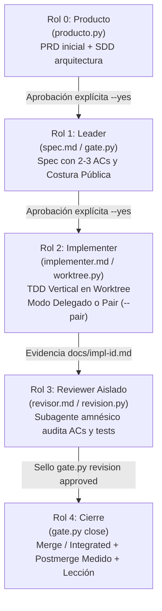

# Harness Flow: Explicación Integral y Diagnóstico de Funcionamiento

> **Fecha de auditoría:** 2026-11-07  
> **Repositorio:** `/Users/alan/.hermes/skills/software-development/harness-flow`  
> **Versión evaluada:** 1.0.0 (commit `c8440d1` + soporte multi-host)

---

## 1. ¿Qué es y qué hace esta Skill?

**Harness Flow** es un framework de ingeniería de software autónomo y guiado por especificación (*spec-driven development*), diseñado para equipos multi-repo y monorepo que trabajan con agentes de inteligencia artificial (Claude Code, Hermes Agent, OpenAI GPT/Codex, Google Antigravity / Gemini CLI, Grok y Kimi Code).

Es el puerto directo del arnés original en Rust (`harness_process`) a un entorno nativo de agentes: **sin binarios que compilar por sistema operativo, sin instaladores por proyecto y con dependencias mínimas en Python estándar** (más `psycopg` para el grafo compartido).

### Principios Fundamentales

1. **Gates ejecutables con `exit ≠ 0`**:
   Las promesas o respuestas en el chat no constituyen evidencia. Si un criterio de aceptación no está probado, si un archivo protegido fue modificado sin autorización, o si un test nuevo se rompe tras la integración, los scripts Python retornan código de salida distinto de cero y bloquean el avance.
2. **Desarrollo vertical (*Vertical Slice*)**:
   Prohibido el desarrollo horizontal por capas (ej. "hacer base de datos", luego "hacer endpoints"). Cada historia `F-n` es un incremento observable de punta a punta (`UI/API -> lógica -> persistencia -> tests`), comenzando con un *walking skeleton* (`F-1`).
3. **Aislamiento de contexto y amnesia deliberada**:
   El agente que implementa el código **nunca** es el que lo revisa. Un subagente revisor se lanza con contexto limpio; sólo recibe el spec, los criterios de aceptación y el diff.
4. **Neutralidad de Host**:
   Los mismos gates determinísticos y scripts Python corren en cualquier CLI de agente. Lo único que se adapta son las herramientas de subagentes y la terminal.

---

## 2. Estructura y Arquitectura del Sistema

El arnés se instala **una sola vez en la raíz del proyecto** (espacio de trabajo donde conviven los repositorios o microservicios), manteniendo fuera de los repositorios las credenciales y el estado volátil.

```text
~/proyectos/tu-proyecto/         <- Ejemplo de raíz multi-repo donde aplicas el arnés
  harness/                       <- Estado del proceso de desarrollo (en la raíz)
    feature_list.json            <- Backlog vivo, estado y reglas activas
    grafos.json                  <- Declaración de raíces para graphify / CBM
    progress/current-<id>.md     <- Bitácora activa por feature
    progress/history.md          <- Historial append-only
  docs/                          <- Specs, borradores de PRD/SDD, evidencia
    prd/PRD-master.md            <- PRD consolidado (cuerpo del usuario + bloque sync)
    sdd.md                       <- SDD de arquitectura
    vault/                       <- Notas Obsidian generadas por vault.py
  backend-api/                   <- (Ejemplo) Repositorio Git de un servicio o backend
  frontend-app/                  <- (Ejemplo) Repositorio Git del frontend o web
```

### Scripts Principales (`scripts/`)

| Script | Responsabilidad |
| :--- | :--- |
| `entorno.py` | Detecta el host (`claude`, `hermes`, `gemini`, `gpt`, `grok`, `kimi`), resuelve `$PY` (intérprete en venv neutro con `psycopg`) y `$H` (directorio de scripts). |
| `gate.py` | Orquestador de gates: `check`, `check-spec`, `approve-spec`, `enmienda`, `revision`, `verify`, `close`. |
| `producto.py` | Rol 0: redacción y sellado de borradores de PRD y SDD; validación de candidatas `F-n` y dependencias cíclicas (`requiere:`). |
| `worktree.py` | Creación y limpieza de `git worktree` aislados por feature (`<repo>-wt/<id>-<slug>`). En multi-repo, valida el registro manual. |
| `contexto.py` | Cálculo de frescura del grafo, extracción de brief compacto por feature y enlace con Memory Hub Postgres. |
| `revision.py` | Generación del briefing completo para el subagente revisor y diff contra `merge-base`. |
| `cbm_procesos.py`| Monitor del daemon de `codebase-memory-mcp`, eliminación de procesos huérfanos y mitigación de daemon sin socket. |
| `leccion.py` | Memoria procedural cruzada: localiza y valida skills de lecciones aprendidas entre todos los agentes de la máquina. |
| `postmerge_medido.py` | Validador post-merge para Go: captura foto de rojos antes del merge y falla si hay rojos nuevos, build roto o tests desaparecidos. |
| `postmerge_frontend.py`| Validador post-merge para Angular / Node / TypeScript. |
| `postmerge_terraform.py`| Validador post-merge para infraestructura Terraform (`fmt`, `validate`, `test`). |
| `stack.py` | Gobernanza de los 10 stacks tecnológicos CALPIL: detección dinámica, auditoría de cumplimiento, normalización multi-LLM (Claude, Codex, Gemini, Hermes), scaffolding y verificadores AST/regex. |
| `copias.py` | Copias de la normativa instaladas en un repo: alcance real de cada regla (medido en el código del repo), huellas, registro de lo instalado e historial de la plantilla para distinguir una copia vieja de una editada por el proyecto. |
| `arquitectura.py` | Trinquete de arquitectura: mide el código que vive fuera del layout del stack, sella la base y exige que solo baje. `inventario` dice también el código que el layout no mira. |
| `normas.py` | Registro único de las normas de ingeniería (12 normas × 5 roles) que imprimen el brief, el briefing y el borrador de producto. |
| `documentacion.py` | Sincronización automática de bloques generados en `PRD-master.md` y `sdd.md`. |
| `vault.py` | Generación del panel visual en Obsidian (`docs/vault/`). |
| `atlassian.py` | Sincronización bidireccional opcional con Jira y Confluence. |

---

## 3. Flujo Operativo en 4+1 Roles



### Rol 0: Producto (`producto.py`)
- Redacta borradores en `docs/borrador-prd.md` y `docs/borrador-sdd.md` sin tocar los archivos protegidos.
- Aplica el cuestionario de las **4 decisiones costosas de cambiar**:
  1. Multi-tenant / Multi-organización.
  2. Modelo de permisos / Roles.
  3. Operación offline / Sincronización.
  4. Multi-idioma / Multi-moneda.
- Corta el backlog en 10–15 candidatas verticales `F-n` de una línea, con un walking skeleton inicial (`F-1`) y árbol de dependencias (`requiere: F-m`).
- **Ritual de aprobación**: el usuario debe dar el "SÍ" explícito antes de correr `producto.py aprobar --doc prd|sdd --yes`.

### Rol 1: Leader (`gate.py approve-spec`)
- Toma una candidata y redacta `docs/spec-feature-<id>-<slug>.md`.
- Define **2 a 3 Criterios de Aceptación (AC)** en formato Given/When/Then (máximo 5).
- Declara la **costura pública de prueba** (`[costura: endpoint|servicio|ui|integracion|manual]`), prohibiendo aserciones acopladas a mocks internos.
- Si el spec debe cambiar tras haber iniciado trabajo, se prohíbe re-aprobar directamente: exige una **enmienda formal** (`gate.py enmienda`).

### Rol 2: Implementer (`implementer.md`, `worktree.py`)
- Crea un `git worktree` dedicado para no ensuciar la rama base (`develop` o `main`).
- Ejecuta TDD vertical estricto (`1 test en costura pública -> Red -> código mínimo -> Green -> Refactor`).
- **Modo Pair interactivo (por defecto en toda feature)**: la IA actúa como Driver y el humano como Navigator, pausando en cada micro-ciclo. `gate.py approve-spec` lo registra al sellar el spec por primera vez y `gate.py close` exige la lista de tests aprobada. Se delega solo con `--delegado`.
- **El brief es el paquete completo** de quien implementa: protocolo, reglas de cada stack, índice de skills y normas de ingeniería, con los comandos que imprimen cada skill (`stack.py skill`) y cada referencia (`normas.py --ref`).
- **5 paradas inmediatas de Extreme Programming**:
  1. Decisión de diseño imprevista.
  2. Alcance no pedido (YAGNI).
  3. Integridad de tests comprometida (prohibido modificar o borrar tests viejos para forzar el verde).
  4. Dos intentos sin verde (revertir al último verde).
  5. Incremento excesivo (> 50 líneas o > 3 archivos).
- Produce `docs/impl-<id>.md` con citas `archivo:linea` para cada AC.

### Rol 3: Reviewer Aislado (`revisor.md`, `revision.py`)
- Genera un briefing autocontenido con `revision.py --feature <id> --briefing`.
- Lanza un **subagente aislado** sin memoria de la implementación (`harness-flow:revisor`).
- Audita cada AC, confirma que las líneas citadas existen y realizan la función, y verifica que no haya tests tautológicos.
- El veredicto no es auto-estampado: la sesión principal inspecciona el informe y sella formalmente con `gate.py revision --veredicto approved|changes_requested|blocked`. Máximo 2 rondas por feature.

### Rol 4: Cierre (`gate.py close`)
- Exige spec aprobado, review sellado `approved`, verify verde y lección procedural registrada en `leccion.py`.
- En monorepos ejecuta `git merge --no-ff`. En multi-repos valida el manifiesto contra las ramas base pre y post-merge (`--integrated`).
- Ejecuta los verificadores post-merge medidos (`postmerge_medido.py`, `postmerge_frontend.py` o `postmerge_terraform.py`).

---

## 4. Diagnóstico de Puntos Críticos y Estado de Correcciones

Tras una auditoría exhaustiva de los scripts, manifiestos de plugins y configuraciones de agentes en este entorno, se identificaron y corrigieron los siguientes puntos:

### ✅ Hallazgo 1 (Corregido): En Claude Code, el Subagente Revisor tenía bloqueadas las herramientas MCP

* **Ubicación:** [`agents/revisor.md`](file:///Users/alan/.hermes/skills/software-development/harness-flow/agents/revisor.md#L4) vs [`commands/review.md`](file:///Users/alan/.hermes/skills/software-development/harness-flow/commands/review.md)
* **El Problema:**
  En el frontmatter de `agents/revisor.md` se declaraba únicamente `tools: Read, Grep, Glob, Bash, Write`. En Claude Code, una directiva `tools:` explícita actúa como lista blanca estricta (allowlist), filtrando `mcp__codebase-memory-mcp__*` aunque el cuerpo del prompt instruyera usar `search_graph` y `trace_path`.
* **Corrección Aplicada:**
  Se actualizó el frontmatter de [`agents/revisor.md`](file:///Users/alan/.hermes/skills/software-development/harness-flow/agents/revisor.md#L4) a:
  ```yaml
  tools: Read, Grep, Glob, Bash, Write, mcp__codebase-memory-mcp__*
  ```
  y se blindó con test de regresión en [`tests/test_plugin_claude.py`](file:///Users/alan/.hermes/skills/software-development/harness-flow/tests/test_plugin_claude.py#L94-L100).

---

### ✅ Hallazgo 2 (Corregido): Neutralización completa del script retirado `scripts/postmerge.py`

* **Ubicación:** [`scripts/postmerge.py`](file:///Users/alan/.hermes/skills/software-development/harness-flow/scripts/postmerge.py) vs [`scripts/postmerge_medido.py`](file:///Users/alan/.hermes/skills/software-development/harness-flow/scripts/postmerge_medido.py)
* **El Problema:**
  Aunque el bloque `if __name__ == "__main__":` de `scripts/postmerge.py` ya salía con código 2, el archivo conservaba 130 líneas de código muerto (`correr()` y `main()` basados en regex) y un docstring que aparentaba seguir activo.
* **Corrección Aplicada:**
  Se eliminó todo el código muerto de regex en [`scripts/postmerge.py`](file:///Users/alan/.hermes/skills/software-development/harness-flow/scripts/postmerge.py) dejando un stub limpio que rechaza la ejecución (`sys.exit(2)`) tanto por CLI como al importar `main()` o `correr()`, redirigiendo a `postmerge_medido.py`. Cubierto en [`tests/test_postmerge.py`](file:///Users/alan/.hermes/skills/software-development/harness-flow/tests/test_postmerge.py).

---

### ✅ Hallazgo 3 (Corregido): Configuración de Permisos en `.claude/settings.json`

* **Ubicación:** [`.claude/settings.json`](file:///Users/alan/.hermes/skills/software-development/harness-flow/.claude/settings.json)
* **El Problema:**
  El archivo `.claude/settings.json` sólo incluía `Bash(python3 ~/.claude/skills/harness-flow/scripts/:*)`, omitiendo el intérprete del entorno virtual `~/.harness-flow/venv/bin/python` y el `eval "$(python3 ...)"` que usan los comandos de `commands/*.md`.
* **Corrección Aplicada:**
  Se añadieron `Bash(~/.harness-flow/venv/bin/python:*)` y `Bash(eval "$(python3:*)` en [`.claude/settings.json`](file:///Users/alan/.hermes/skills/software-development/harness-flow/.claude/settings.json), verificado por [`tests/test_plugin_claude.py`](file:///Users/alan/.hermes/skills/software-development/harness-flow/tests/test_plugin_claude.py#L102-L107).

---

### ✅ Hallazgo 4 (Comportamiento por diseño en Windows): Gestión de Procesos CBM en `cbm_procesos.py`

* **Ubicación:** [`scripts/cbm_procesos.py`](file:///Users/alan/.hermes/skills/software-development/harness-flow/scripts/cbm_procesos.py#L271-L273) y [`tests/test_cbm_procesos.py`](file:///Users/alan/.hermes/skills/software-development/harness-flow/tests/test_cbm_procesos.py#L320-L325)
* **Estado:** **Resuelto por diseño (no requiere cambio).**
  En sistemas POSIX (macOS/Linux), un proceso huérfano es reasignado a `PID 1` (`launchd`/`init`) y el daemon de `codebase-memory-mcp` coordina mediante sockets Unix (`.sock`/`.anc`) inspeccionables con `ps` y `lsof`. En Windows no existe reasignación a `PID 1`, por lo que `cbm_procesos.py` hace *no-op* seguro (`return 0` en `limpiar()`) para no matar procesos por falsos positivos, comportamiento exigido explícitamente por el test `test_windows_no_hace_nada`.

---

### ✅ Hallazgo 5 (Mitigado por el arnés): Hooks `hook-augment` en `~/.claude/settings.json`

* **Ubicación:** Configuración global del usuario `~/.claude/settings.json` + [`scripts/contexto.py`](file:///Users/alan/.hermes/skills/software-development/harness-flow/scripts/contexto.py#L422-L485)
* **Estado:** **Mitigado automáticamente (no es un defecto de la skill).**
  Los hooks `PreToolUse`, `PostToolUse`, `SessionStart` y `SubagentStart` en `~/.claude/settings.json` los registra el instalador externo de `codebase-memory-mcp` con `timeout: 5`. Cuando el daemon de CBM pierde su socket o deja huérfanos, [`scripts/contexto.py`](file:///Users/alan/.hermes/skills/software-development/harness-flow/scripts/contexto.py#L435-L485) y [`scripts/cbm_procesos.py`](file:///Users/alan/.hermes/skills/software-development/harness-flow/scripts/cbm_procesos.py) lo detectan y sanean automáticamente al correr `estado.py` o `contexto.py`.

### ✅ Hallazgo 6 (Corregido): La normalización dejaba código sin la norma del stack

* **Ubicación:** [`scripts/stack.py`](../scripts/stack.py), [`scripts/copias.py`](../scripts/copias.py), [`scripts/arquitectura.py`](../scripts/arquitectura.py) y [`tests/test_copias.py`](../tests/test_copias.py).
* **Estado:** **Corregido (Hito 33).** Medido en ADR e Innova Real Estate el 2026-11-12:
  * `normalizar` solo agregaba lo que faltaba: una copia instalada no se actualizaba nunca. Una regla apuntaba a `src/app/features/**` y el código vivía en `projects/*/src/app/`.
  * `stack.py verificar` decía "Arquitectura: OK" en 12 de 13 repos de un proyecto con 1.361 archivos fuera del layout del stack.
  * La raíz del proyecto, un back dentro de un front y un monorepo `apps/*` podían quedar sin normalizar.
* **Corrección:** el alcance de cada regla se calcula con el código del repo en cada normalización; las copias viejas se actualizan y las editadas por el proyecto se conservan; `verificar` cuenta el código fuera de la norma y muestra lo que el verificador no midió. Detalle: [`diagnostico-normalizacion-de-stacks.md`](diagnostico-normalizacion-de-stacks.md).
* **Pendiente en los proyectos (decisión del usuario):** actualizar y commitear las copias viejas que cada repo versiona, y adoptar el trinquete donde no está adoptado.

---

### ✅ Hallazgo 7 (Corregido en el procedimiento): 73 tests de frontend reportados como "fallos de entorno"

* **Ubicación:** [`tests/test_frontend_runner.py`](../tests/test_frontend_runner.py), `test_retirados_frontend.py`, `test_frontend_close.py` y `test_cierre_historico.py`.
* **Estado:** **No era un defecto del código ni del entorno.** Esos tests exigen `HARNESS_TEST_FRONTEND_MODULES` y fallan a propósito si falta. El toolchain estaba instalado en `~/.harness-flow/frontend-toolchain`; la suite se corría sin pasar su ruta y los 73 fallos se daban por conocidos.
* **Corrección:** la suite se corre siempre con el toolchain. El comando está en [`diagnostico-normalizacion-de-stacks.md`](diagnostico-normalizacion-de-stacks.md) y en `references/multirepo.md`.

### ✅ Hallazgo 8 (Corregido): El medidor de frontend obligaba a mover el proyecto Angular a `projects/<nombre>`

* **Ubicación:** [`scripts/postmerge_frontend.py`](../scripts/postmerge_frontend.py) (`project_tree`) y [`tests/test_frontend_runner.py`](../tests/test_frontend_runner.py).
* **Estado:** **Corregido (Hito 34).** El contrato exigía `root == projects/<nombre>` en `angular.json`. Un repo con un solo proyecto en la raíz no podía cerrar una feature, y en un proyecto real los agentes movieron el proyecto entero a `projects/<nombre>` para pasar el gate.
* **Corrección:** el medidor toma la carpeta que el repo declara: `root`, o `sourceRoot` cuando `root` es `""`. No impone un layout. Los workspaces que ya usan `projects/` no cambian.

---

## 5. Resumen de Salud del Sistema

| Componente | Estado | Diagnóstico |
| :--- | :---: | :--- |
| **Gates Python (`gate.py`, `comun.py`)** | ✅ Óptimo | Tests unitarios en verde. Firmas, sellos, hashes y validación de AC funcionan de manera determinística. |
| **Detección de Entorno (`entorno.py`)** | ✅ Óptimo | Soporta los 6 hosts (`hermes`, `claude`, `gemini`, `gpt`, `grok`, `kimi`) con aislamiento de venv en `~/.harness-flow/venv`. |
| **Rol Producto y SDD (`producto.py`)** | ✅ Óptimo | Control de candidatos verticales, prohibición de código final en PRD y bloqueo de dependencias circulares. |
| **Subagente Implementer (`implementer.md`)**| ✅ Óptimo | Hereda herramientas completas (incluido MCP) y dispone del modo interactivo `--pair`. |
| **Subagente Revisor (`revisor.md`)** | ✅ Óptimo | Habilitado `mcp__codebase-memory-mcp__*` en su allowlist de `tools:`, sin permitir `Edit` sobre el código. |
| **Permisos de Plugin (`.claude/settings.json`)** | ✅ Óptimo | Incluye permisos para `~/.harness-flow/venv/bin/python` y `eval "$(python3 ...)"`. |
| **Neutralización de `postmerge.py`** | ✅ Óptimo | Código muerto eliminado; falla rápido con `exit 2` tanto en CLI como por importación, redirigiendo a `postmerge_medido.py`. |
| **Gestión de CBM (`cbm_procesos.py`)** | ✅ Óptimo | Telemetría y saneamiento automático en macOS/Linux (aviso controlado en Windows). |
| **Normalización de stacks (`stack.py`, `copias.py`)** | ✅ Óptimo | El alcance de las reglas sale del código del repo, las copias viejas se actualizan o se avisan, y `verificar` no da un OK sobre código sin medir. Quedan pendientes en los proyectos las copias que cada repo versiona. |
| **Matriz de Modelos y Reasoning Effort** | ✅ Óptimo | Calibrada por coste/latencia: roles pesados en máxima capacidad, implementer en alta velocidad y tareas de lectura/rutina en esfuerzo medio/bajo sin extended thinking innecesario. |

---

## 6. Pasos Sugeridos para Dejarlo al 100% (Completados)

1. ✅ **Habilitar MCP en el Revisor de Claude Code**:
   Actualizado el frontmatter de [`agents/revisor.md`](file:///Users/alan/.hermes/skills/software-development/harness-flow/agents/revisor.md#L4) con `mcp__codebase-memory-mcp__*` y validado en [`tests/test_plugin_claude.py`](file:///Users/alan/.hermes/skills/software-development/harness-flow/tests/test_plugin_claude.py#L94-L100).
2. ✅ **Neutralizar `scripts/postmerge.py`**:
   Eliminado el código muerto de regex en [`scripts/postmerge.py`](file:///Users/alan/.hermes/skills/software-development/harness-flow/scripts/postmerge.py) y validado en [`tests/test_postmerge.py`](file:///Users/alan/.hermes/skills/software-development/harness-flow/tests/test_postmerge.py).
3. ✅ **Actualizar el allowlist de permisos de Claude Code**:
   Incorporados `Bash(~/.harness-flow/venv/bin/python:*)` y `Bash(eval "$(python3:*)` en [`.claude/settings.json`](file:///Users/alan/.hermes/skills/software-development/harness-flow/.claude/settings.json).
