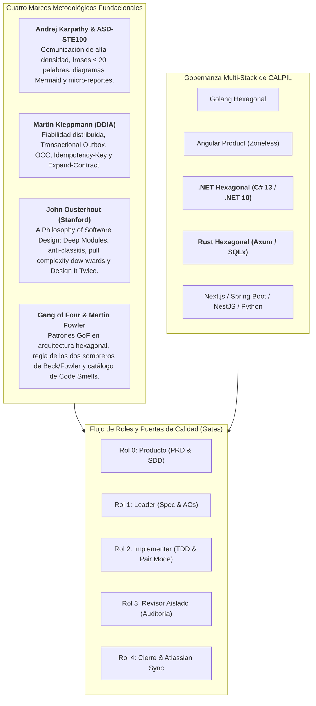

# Memoria Técnica de Implementaciones en Harness Flow

Este documento recopila y estructura de manera exhaustiva todas las capacidades, stacks tecnológicos, marcos teóricos y mejoras arquitectónicas implementadas en el repositorio de **Harness Flow**.

---

## 1. Resumen Ejecutivo de la Evolución del Arnés

**Harness Flow** ha evolucionado de un arnés de desarrollo guiado por gates a una **plataforma integral de ingeniería de software para sistemas multi-agente y desarrollo en pair programming**. Su arquitectura integra gobernanza multi-stack, verificación continua en caliente y la convergencia de cuatro marcos metodológicos de vanguardia:



---

## 2. Hito 1: Incorporación del Stack Tecnológico .NET Hexagonal (`dotnet-hexagonal`)

Se diseñó e integró formalmente el stack backend C# 13 / .NET 10 (LTS) bajo Clean Architecture / Arquitectura Hexagonal.

### Componentes Principales:
* **Manifiesto Declarativo**: [`assets/stacks/dotnet-hexagonal/manifest.json`](file:///Users/alan/.hermes/skills/software-development/harness-flow/assets/stacks/dotnet-hexagonal/manifest.json)
  * Detección por solución (`*.sln`, `*.slnx`, `*.csproj`), estructura de proyectos (`src/**/*.Domain`, `Application`, `Infrastructure`, `WebApi`) y dependencias clave (`Microsoft.AspNetCore`, `Dapper`, `Npgsql`).
  * Restricciones de arquitectura: pureza de Dominio en BCL sin dependencias externas, aislamiento de Application, Composition Root único en `Program.cs`, headers de seguridad y respuestas RFC 7807 (`application/problem+json`).
* **Reglas Normativas Modulares (`rules/`)**:
  * [`architecture.md`](file:///Users/alan/.hermes/skills/software-development/harness-flow/assets/stacks/dotnet-hexagonal/rules/architecture.md): Límites de Clean Architecture en .NET.
  * [`dependencies.md`](file:///Users/alan/.hermes/skills/software-development/harness-flow/assets/stacks/dotnet-hexagonal/rules/dependencies.md): Gobierno de paquetes NuGet, versiones estables LTS y prohibición de dependencias en Dominio.
  * [`security.md`](file:///Users/alan/.hermes/skills/software-development/harness-flow/assets/stacks/dotnet-hexagonal/rules/security.md): Consultas SQL parametrizadas en Dapper, middlewares RFC 7807, headers HTTP y cero secretos en código.
  * [`testing.md`](file:///Users/alan/.hermes/skills/software-development/harness-flow/assets/stacks/dotnet-hexagonal/rules/testing.md): Pruebas deterministas con xUnit, `WebApplicationFactory<Program>`, in-memory fakes y prohibición de `Thread.Sleep`.
* **9 Habilidades Operativas (`skills/`)**:
  * Implementadas con frontmatter YAML, descripción válida (35–1024 caracteres), 7 secciones obligatorias y procedimiento ejecutable de ≥ 5 pasos: `add-api-endpoint`, `add-feature`, `add-persistence`, `architecture-review`, `debug-targeted`, `dependency-review`, `prepare-release`, `security-review`, `write-tests`.
* **Herramientas de Auditoría**:
  * [`assets/stacks/dotnet-hexagonal/scripts/check-architecture.py`](file:///Users/alan/.hermes/skills/software-development/harness-flow/assets/stacks/dotnet-hexagonal/scripts/check-architecture.py): Validador AST/regex de límites entre proyectos `.csproj` y archivos `.cs`.
  * [`assets/stacks/dotnet-hexagonal/scripts/validate-agent-skills.mjs`](file:///Users/alan/.hermes/skills/software-development/harness-flow/assets/stacks/dotnet-hexagonal/scripts/validate-agent-skills.mjs): Validador de esquemas de skills.
* **Integración en `scripts/stack.py`**:
  * Scaffolding de estructura canónica (.Domain, .Application, .Infrastructure, .WebApi, Program.cs con middlewares).
  * Auditoría de versión de .NET en archivos `.csproj` frente a versión mínima `8.0.0` / `10.0.0`.
  * Plan de refactorización vertical para alinear soluciones .NET existentes.

---

## 3. Hito 2: Principios de Andrej Karpathy y Norma Aeroespacial ASD-STE100

A partir del análisis de las lecciones de Andrej Karpathy y el estándar Simplified Technical English (ASD-STE100), se rediseñó la interacción de los agentes para maximizar la densidad informativa y erradicar el *token bloat*.

### Documentación y Referencias:
* [`docs/principios-karpathy-ste100-harness-flow.md`](file:///Users/alan/.hermes/skills/software-development/harness-flow/docs/principios-karpathy-ste100-harness-flow.md): Informe exhaustivo de los 7 principios de Karpathy y su aplicación en software agentic.
* [`references/comunicacion-ste100-y-prompts.md`](file:///Users/alan/.hermes/skills/software-development/harness-flow/references/comunicacion-ste100-y-prompts.md): Manual normativo de comunicación técnica y prompts compactos.

### Principios Integrados:
1. **Comunicación de Alta Densidad sin Sobre-restricción (*Over-Constraining*)**:
   * Instrucciones breves y precisas; delegar la ejecución a la capacidad de razonamiento del LLM sin ahogarlo en micro-reglas redundantes.
2. **Regla de Oro ASD-STE100**:
   * Frases de **máximo 20 palabras**, en **voz activa**, con **una sola instrucción por frase** y sin sinónimos ambiguos.
   * Aplicada en redacción de criterios AC-n en specs, observaciones del revisor y micro-reportes.
3. **Diagramas Mermaid Prioritarios**:
   * En [`templates/sdd.md`](file:///Users/alan/.hermes/skills/software-development/harness-flow/templates/sdd.md), se prohíben descripciones en prosa de más de 3 líneas para flujos complejos; se exige modelar arquitecturas y secuencias con diagramas Mermaid (`flowchart` / `sequenceDiagram`).
4. **Micro-reportes de Pantalla de Instrumentos en Pair Mode**:
   * Formato telegráfico durante TDD:
     ```text
     [TEST: AC-1] Rojo: Esperaba HTTP 200, obtuvo 404.
     [CODE] Creado handler en crates/api/src/handlers/items.rs:18.
     [TEST: AC-1] Verde: 1 passed in 0.04s.
     [REFACTOR] Extraída validación a Domain::Item::validate. Verde confirmado.
     ```
5. **Optimización de Comandos Slash**:
   * Refactorizados [`commands/producto.md`](file:///Users/alan/.hermes/skills/software-development/harness-flow/commands/producto.md), [`commands/spec.md`](file:///Users/alan/.hermes/skills/software-development/harness-flow/commands/spec.md) e [`commands/implementar.md`](file:///Users/alan/.hermes/skills/software-development/harness-flow/commands/implementar.md) reduciendo hasta un 60% los tokens de prompt manteniendo el 100% de la fuerza prescriptiva.

---

## 4. Hito 3: Patrones de Datos Confiables y Escalables (DDIA - Martin Kleppmann)

Basado en la obra *Designing Data-Intensive Applications* de Martin Kleppmann, se incorporaron patrones fundamentales de fiabilidad distribuida y gestión de datos.

### Documentación y Referencias:
* [`references/patrones-datos-ddia.md`](file:///Users/alan/.hermes/skills/software-development/harness-flow/references/patrones-datos-ddia.md): Guía canónica de implementación en Go, C# .NET y Rust.

### Patrones Normativos Incorporados:
1. **Prevención de Doble Escritura (*Dual-Write*) mediante Transactional Outbox**:
   * Prohibición absoluta de guardar una entidad en base de datos y acto seguido publicar un evento en un broker (RabbitMQ/Kafka) en operaciones separadas.
   * Obligatoriedad de escribir el evento en una tabla local `outbox` dentro de la **misma transacción ACID** del negocio. Un worker en segundo plano (relay) lee y publica hacia el exterior con reintentos garantizando entrega *at-least-once*.
2. **Matriz Arquitectónica: ¿Kafka vs. Sin Kafka?**:
   * Se clarificó la frontera de diseño: **no incorporar Kafka prematuramente**.
   * Para la mayoría de servicios OLTP, PostgreSQL + Outbox Relay + índices b-tree resuelve la resiliencia con órdenes de magnitud menos complejidad operativa. Kafka solo se justifica formalmente cuando se superan 50.000 eventos/segundo, se requiere retención prolongada con *event sourcing* masivo o particionamiento horizontal por claves de ordenación causal.
3. **Control de Concurrencia Optimista (OCC - Optimistic Concurrency Control)**:
   * Prevención de pérdidas de actualización (*Lost Updates*) en entornos concurrentes mediante una columna `version INT DEFAULT 1`.
   * Actualizaciones atómicas condicionales: `UPDATE tabla SET campo = @val, version = version + 1 WHERE id = @id AND version = @expectedVersion`.
4. **Idempotencia de Red con `Idempotency-Key`**:
   * Endpoints mutadores (POST/PUT) soportan cabecera `Idempotency-Key` respaldada por una tabla de operaciones procesadas con índice único, devolviendo la respuesta almacenada en reintentos de red sin re-ejecutar efectos colaterales.
5. **Evolución de Esquemas sin Downtime (*Expand-Contract*)**:
   * Migraciones en fases desacopladas: Expandir (añadir columna nullable), Migrar/Escribir dualmente, Contraer (eliminar columna antigua).
6. **Integración en Agentes y Scripts**:
   * [`templates/sdd.md`](file:///Users/alan/.hermes/skills/software-development/harness-flow/templates/sdd.md): Sección obligatoria de clasificación de datos (OLTP vs OLAP) y diseño de Outbox/OCC.
   * [`agents/revisor.md`](file:///Users/alan/.hermes/skills/software-development/harness-flow/agents/revisor.md) y [`scripts/revision.py`](file:///Users/alan/.hermes/skills/software-development/harness-flow/scripts/revision.py): Auditoría automatizada que clasifica como **bloqueante** cualquier anti-patrón de Dual-Write detectado en el diff.

---

## 5. Hito 4: Incorporación del Stack Tecnológico Rust Hexagonal (`rust-hexagonal`)

Se diseñó e integró formalmente el stack backend Rust (edición 2021/2024) con Axum, Tokio y SQLx.

### Componentes Principales:
* **Manifiesto Declarativo**: [`assets/stacks/rust-hexagonal/manifest.json`](file:///Users/alan/.hermes/skills/software-development/harness-flow/assets/stacks/rust-hexagonal/manifest.json)
  * Detección por `Cargo.toml`, `Cargo.lock`, extensiones `.rs`, dependencias (`axum`, `tokio`, `sqlx`) y crates (`crates/domain`, `application`, `infrastructure`, `api`) o estructura de carpetas `src/(domain|application|infrastructure)`.
  * Restricciones de arquitectura: Pureza de Dominio en Rust estándar (sin Axum, SQLx, Tokio net), Application aislada por traits, Composition Root en `src/main.rs`, serialización RFC 7807 y pruebas sin sleep.
  * Configuración Context7 (`/tokio-rs/axum`), documentación oficial en [doc.rust-lang.org](https://doc.rust-lang.org/) y auditoría con `cargo audit`.
* **Reglas Normativas Modulares (`rules/`)**:
  * [`architecture.md`](file:///Users/alan/.hermes/skills/software-development/harness-flow/assets/stacks/rust-hexagonal/rules/architecture.md): Límites de arquitectura hexagonal en Rust.
  * [`dependencies.md`](file:///Users/alan/.hermes/skills/software-development/harness-flow/assets/stacks/rust-hexagonal/rules/dependencies.md): Dependencias centralizadas en workspace `[workspace.dependencies]`, versiones fijas y versionado de `Cargo.lock`.
  * [`security.md`](file:///Users/alan/.hermes/skills/software-development/harness-flow/assets/stacks/rust-hexagonal/rules/security.md): Consultas parametrizadas con `sqlx::query!`, headers HTTP de seguridad, `x-correlation-id` y contenedores Docker sin privilegios (`appuser`).
  * [`testing.md`](file:///Users/alan/.hermes/skills/software-development/harness-flow/assets/stacks/rust-hexagonal/rules/testing.md): Pruebas deterministas de dominio sin I/O, adaptador `InMemoryWorkItemRepository`, pruebas HTTP con `tower::ServiceExt::oneshot` y cero llamadas a `thread::sleep`.
* **9 Habilidades Operativas (`skills/`)**:
  * `add-api-endpoint`, `add-feature`, `add-persistence`, `architecture-review`, `debug-targeted`, `dependency-review`, `prepare-release`, `security-review`, `write-tests`.
  * 100% conformes con el validador [`validate-agent-skills.mjs`](file:///Users/alan/.hermes/skills/software-development/harness-flow/assets/stacks/rust-hexagonal/scripts/validate-agent-skills.mjs).
* **Herramientas de Auditoría**:
  * [`assets/stacks/rust-hexagonal/scripts/check-architecture.py`](file:///Users/alan/.hermes/skills/software-development/harness-flow/assets/stacks/rust-hexagonal/scripts/check-architecture.py): Validador AST/regex de pureza de Dominio, aislamiento de Application, verificación de `Cargo.toml` por crate, composición en `main.rs` y testing determinista.
* **Integración en `scripts/stack.py`**:
  * Scaffolding de estructura canónica (Cargo.toml con Axum 0.8/Tokio, `src/main.rs`, `src/domain/`, `src/application/`, `src/infrastructure/`).
  * Detección y auditoría de edición mínima (`edition = "2021"`).
  * Plan de refactorización vertical guiado para proyectos Rust desalineados.
* **Pruebas de Integración y Regresión**:
  * Casos añadidos en [`tests/test_stack.py`](file:///Users/alan/.hermes/skills/software-development/harness-flow/tests/test_stack.py) para detección de stack, verificación sobre plantilla real de CALPIL (`calpil-rust-hexagonal-template`), captura de violaciones arquitectónicas y scaffolding.

---

## 6. Hito 5: Filosofía de Diseño de Software de John Ousterhout (*A Philosophy of Software Design*)

A partir del análisis del video de BettaTech (*¿Es este libro el Clean Code Moderno?*) y el libro de **John Ousterhout** (catedrático de Stanford), se implementaron los principios fundamentales de gestión de complejidad.

### Documentación y Referencias:
* [`references/filosofia-diseno-ousterhout.md`](file:///Users/alan/.hermes/skills/software-development/harness-flow/references/filosofia-diseno-ousterhout.md): Manual técnico con los 9 principios de Ousterhout y matriz de aplicación en el arnés.

### Principios Integrados en el Flujo:
1. **Módulos Profundos (*Deep Modules*) vs. Superficiales (*Shallow Modules*)**:
   * Los mejores componentes tienen una interfaz mínima y compacta, pero encapsulan una implementación rica y potente (ej. interfaz Unix `open`, `read`, `write`, `close`).
   * **Combate a la *Classitis***: Se refuta el dogma de Clean Code de forzar funciones microscópicas (<5 líneas). La atomización artificial fragmenta la lógica y dispara la carga cognitiva (*cognitive load*). En Harness Flow se prefieren funciones cohesivas y profundas (de 30 a 80 líneas) que completen el flujo en un único nivel de abstracción.
2. **Programación Estratégica (Inversión del 10%–20%)**:
   * En el bucle TDD del Implementer, la fase *Refactor* es una inversión obligatoria del 10% al 20% del esfuerzo para sanear interfaces y eliminar duplicación antes de pasar al siguiente AC.
3. **Ocultamiento de Información vs. Fuga de Información (*Information Leakage*)**:
   * Prohibición del anti-patrón de descomposición temporal (*Temporal Decomposition*, e.g., `Opener -> Reader -> Parser -> Writer`). Los módulos se estructuran en torno a invariantes y datos encapsulados.
4. **Empujar la Complejidad Hacia Abajo (*Pull Complexity Downwards*)**:
   * La infraestructura y los servicios absorben la dificultad (Outbox, reintentos, OCC); la API expone contratos limpios y el frontend jamás coordina transacciones complejas.
5. **Definir los Errores Fuera de la Existencia (*Define Errors Out of Existence*)**:
   * Rediseñar APIs para que casos límite normales (colecciones vacías, borrado idempotente) sean respuestas ordinarias válidas en lugar de detonar excepciones complejas y no testeadas.
6. **Diseñar Dos Veces (*Design It Twice*)**:
   * En [`templates/sdd.md`](file:///Users/alan/.hermes/skills/software-development/harness-flow/templates/sdd.md), cada decisión de arquitectura ($D-n$) debe contrastar al menos **dos alternativas radicalmente distintas** justificando la descartada.
7. **Detección de Métodos de Paso (*Pass-Through Methods*)**:
   * En [`agents/revisor.md`](file:///Users/alan/.hermes/skills/software-development/harness-flow/agents/revisor.md) y [`scripts/revision.py`](file:///Users/alan/.hermes/skills/software-development/harness-flow/scripts/revision.py), el revisor audita y clasifica como hallazgo mayor métodos o capas intermediarias que solo reenvían parámetros sin aportar abstracción.
8. **Comentarios de Abstracción Superior**:
   * Los comentarios y docstrings deben describir contratos, invariantes e intenciones (*what/why*), prohibiendo parafrasear la sintaxis del código (*how*).

---

## 7. Matriz de Trazabilidad de Archivos y Componentes

| Archivo / Componente | Tipo | Propósito y Contenido Principal |
| :--- | :--- | :--- |
| [`assets/stacks/dotnet-hexagonal/manifest.json`](file:///Users/alan/.hermes/skills/software-development/harness-flow/assets/stacks/dotnet-hexagonal/manifest.json) | Manifiesto | Configuración declarativa del stack .NET Hexagonal C# 13 / .NET 10 |
| [`assets/stacks/dotnet-hexagonal/rules/*`](file:///Users/alan/.hermes/skills/software-development/harness-flow/assets/stacks/dotnet-hexagonal/rules/) | Reglas | Reglas modulares de arquitectura, dependencias, seguridad y testing .NET |
| [`assets/stacks/dotnet-hexagonal/skills/*`](file:///Users/alan/.hermes/skills/software-development/harness-flow/assets/stacks/dotnet-hexagonal/skills/) | Habilidades | 9 skills operativas para ingeniería .NET (API, persistencia, release, tests, etc.) |
| [`assets/stacks/dotnet-hexagonal/scripts/check-architecture.py`](file:///Users/alan/.hermes/skills/software-development/harness-flow/assets/stacks/dotnet-hexagonal/scripts/check-architecture.py) | Script | Validador estricto de límites de Clean Architecture en .NET |
| [`assets/stacks/rust-hexagonal/manifest.json`](file:///Users/alan/.hermes/skills/software-development/harness-flow/assets/stacks/rust-hexagonal/manifest.json) | Manifiesto | Configuración declarativa del stack Rust Hexagonal (Axum, Tokio, SQLx) |
| [`assets/stacks/rust-hexagonal/rules/*`](file:///Users/alan/.hermes/skills/software-development/harness-flow/assets/stacks/rust-hexagonal/rules/) | Reglas | Reglas modulares de arquitectura, dependencias, seguridad y testing en Rust |
| [`assets/stacks/rust-hexagonal/skills/*`](file:///Users/alan/.hermes/skills/software-development/harness-flow/assets/stacks/rust-hexagonal/skills/) | Habilidades | 9 skills operativas de ingeniería Rust (API endpoints, persistencia SQLx, tests, etc.) |
| [`assets/stacks/rust-hexagonal/scripts/check-architecture.py`](file:///Users/alan/.hermes/skills/software-development/harness-flow/assets/stacks/rust-hexagonal/scripts/check-architecture.py) | Script | Validador estricto de pureza de dominio y límites hexagonales en Rust |
| [`references/comunicacion-ste100-y-prompts.md`](file:///Users/alan/.hermes/skills/software-development/harness-flow/references/comunicacion-ste100-y-prompts.md) | Referencia | Norma de comunicación técnica ASD-STE100 y optimización de prompts Karpathy |
| [`docs/principios-karpathy-ste100-harness-flow.md`](file:///Users/alan/.hermes/skills/software-development/harness-flow/docs/principios-karpathy-ste100-harness-flow.md) | Documento | Análisis de los 7 principios de Karpathy y su integración en Harness Flow |
| [`references/patrones-datos-ddia.md`](file:///Users/alan/.hermes/skills/software-development/harness-flow/references/patrones-datos-ddia.md) | Referencia | Patrones de datos DDIA (Transactional Outbox, OCC, Idempotencia, Kafka vs No-Kafka) |
| [`references/filosofia-diseno-ousterhout.md`](file:///Users/alan/.hermes/skills/software-development/harness-flow/references/filosofia-diseno-ousterhout.md) | Referencia | Guía de diseño de software de John Ousterhout (Deep Modules, anti-classitis, Design It Twice) |
| [`references/patrones-gof-y-refactoring.md`](file:///Users/alan/.hermes/skills/software-development/harness-flow/references/patrones-gof-y-refactoring.md) | Referencia | Patrones GoF en arquitectura hexagonal, regla de dos sombreros de Beck/Fowler y catálogo de Code Smells |
| [`references/design-patterns-gof.md`](file:///Users/alan/.hermes/skills/software-development/harness-flow/references/design-patterns-gof.md) | Referencia | Lectura cerrada de *Design Patterns* (capítulos 1 a 6): cuándo entra un patrón en cada fase. No repite el catálogo |
| [`references/context7-documentacion-oficial.md`](file:///Users/alan/.hermes/skills/software-development/harness-flow/references/context7-documentacion-oficial.md) | Referencia | Matriz de fuentes oficiales, bibliotecas Context7 y escáneres de seguridad por stack |
| [`templates/sdd.md`](file:///Users/alan/.hermes/skills/software-development/harness-flow/templates/sdd.md) | Plantilla | Diseño de arquitectura enriquecido con Mermaid, DDIA, Design It Twice y Deep Modules |
| [`templates/spec.md`](file:///Users/alan/.hermes/skills/software-development/harness-flow/templates/spec.md) | Plantilla | Especificación de features con regla STE100 (≤20 palabras), costuras en módulos profundos |
| [`agents/implementer.md`](file:///Users/alan/.hermes/skills/software-development/harness-flow/agents/implementer.md) | Agente | Directrices de TDD vertical, anti-classitis, inversión 10-20% y reporte ASD-STE100 |
| [`agents/revisor.md`](file:///Users/alan/.hermes/skills/software-development/harness-flow/agents/revisor.md) | Agente | Auditoría de dual-write, OCC, métodos pass-through, fuga de información e integridad de tests |
| [`scripts/revision.py`](file:///Users/alan/.hermes/skills/software-development/harness-flow/scripts/revision.py) | Script | Generador del briefing automatizado para subagentes revisores con cheques DDIA y Ousterhout |
| [`scripts/stack.py`](file:///Users/alan/.hermes/skills/software-development/harness-flow/scripts/stack.py) | Script | Gestor de stacks: detección, verificación, scaffolding, refactorización y auditoría |
| [`tests/test_stack.py`](file:///Users/alan/.hermes/skills/software-development/harness-flow/tests/test_stack.py) | Pruebas | Suite de tests automatizados para los 8 stacks, checkers de arquitectura y templates |
| [`README.md`](file:///Users/alan/.hermes/skills/software-development/harness-flow/README.md) y [`SKILL.md`](file:///Users/alan/.hermes/skills/software-development/harness-flow/SKILL.md) | Documentación | Actualización de catálogo activo, metodología y comandos oficiales del arnés |

---

## 8. Hito 6: Auditoría Integral y Estandarización de los 8 Stacks Tecnológicos

Se realizó una auditoría rigurosa y exhaustiva sobre la totalidad de los 8 stacks tecnológicos soportados en `harness-flow`:
1. `golang-hexagonal`
2. `angular-product`
3. `dotnet-hexagonal`
4. `rust-hexagonal`
5. `nextjs-product`
6. `springboot-hexagonal`
7. `nestjs-hexagonal`
8. `python-dataproduct`

### Hallazgos y Correcciones Implementadas:
1. **Sincronización de Manifiestos (`manifest.json`)**:
   * `nextjs-product`: Corregida discrepancia entre la habilidad declarada `changelog` y la habilidad real `add-api-endpoint`.
   * `springboot-hexagonal`: Corregida discrepancia entre `add-persistence` declarada y las habilidades reales existentes (`changelog` y `documentation-maintenance`).
   * `nestjs-hexagonal`: Añadidas 3 habilidades faltantes en la lista del manifiesto (`add-auth-authorization`, `delivery-change`, `observability-change`), completando las 9 habilidades operativas.
2. **Creación de Reglas Normativas Modulares (`rules/`)**:
   * En `assets/stacks/nestjs-hexagonal/rules/` y `assets/stacks/python-dataproduct/rules/`, se crearon los 4 estándares normativos obligatorios: `architecture.md`, `dependencies.md`, `security.md` y `testing.md`.
3. **Despliegue de Verificadores de Arquitectura (`check-architecture.py`)**:
   * Se diseñaron e implementaron los checkers AST y de regex arquitectónico faltantes en:
     * [`assets/stacks/springboot-hexagonal/scripts/check-architecture.py`](file:///Users/alan/.hermes/skills/software-development/harness-flow/assets/stacks/springboot-hexagonal/scripts/check-architecture.py)
     * [`assets/stacks/nextjs-product/scripts/check-architecture.py`](file:///Users/alan/.hermes/skills/software-development/harness-flow/assets/stacks/nextjs-product/scripts/check-architecture.py)
     * [`assets/stacks/nestjs-hexagonal/scripts/check-architecture.py`](file:///Users/alan/.hermes/skills/software-development/harness-flow/assets/stacks/nestjs-hexagonal/scripts/check-architecture.py)
     * [`assets/stacks/python-dataproduct/scripts/check-architecture.py`](file:///Users/alan/.hermes/skills/software-development/harness-flow/assets/stacks/python-dataproduct/scripts/check-architecture.py)
   * Se distribuyó el script [`validate-agent-skills.mjs`](file:///Users/alan/.hermes/skills/software-development/harness-flow/scripts/validate-agent-skills.mjs) a todos los directorios `assets/stacks/*/scripts/`.
4. **Normalización y Validación de Plantillas CALPIL**:
   * Ejecutado `stack.py normalizar` sobre `calpil-nestjs-hexagonal-template` y `calpil-python-dataproduct-template` para desplegar las reglas en `.claude/rules/`.
   * Verificación en vivo de las 8 plantillas oficiales en `/Users/alan/Documents/Git/CALPIL`:
     * `calpil-golang-hexagonal-template`: **COMPLIANT** (100% confianza)
     * `calpil-angular-product-template`: **COMPLIANT** (100% confianza)
     * `calpil-dotnet-hexagonal-template`: **COMPLIANT** (100% confianza)
     * `calpil-rust-hexagonal-template`: **COMPLIANT** (100% confianza)
     * `calpil-nextjs-product-template`: **COMPLIANT** (100% confianza)
     * `calpil-springboot-hexagonal-template`: **COMPLIANT** (100% confianza)
     * `calpil-nestjs-hexagonal-template`: **COMPLIANT** (85% confianza)
     * `calpil-python-dataproduct-template`: **COMPLIANT** (100% confianza)

---

## 9. Hito 7: Patrones GoF y Refactorización Disciplinada (Martin Fowler, Kent Beck y Gang of Four)

A partir del análisis de las obras fundamentales de diseño orientado a objetos (*Design Patterns* de GoF, *Head First Design Patterns* y *Refactoring* de Martin Fowler), se integraron formalmente los patrones clásicos y la disciplina de saneamiento de código en el ciclo de vida de Harness Flow.

### Documentación y Referencias:
* [`references/patrones-gof-y-refactoring.md`](file:///Users/alan/.hermes/skills/software-development/harness-flow/references/patrones-gof-y-refactoring.md): Manual normativo de patrones GoF por capa hexagonal, regla de los dos sombreros y catálogo de los 24 *Code Smells*.

### Principios y Mecanismos Integrados:
1. **La Regla de los Dos Sombreros (*The Two Hats* - Kent Beck & Martin Fowler)**:
   * En el rol Implementer ([`agents/implementer.md`](file:///Users/alan/.hermes/skills/software-development/harness-flow/agents/implementer.md)), se separa estrictamente el trabajo:
     * **Sombrero 1 (Feature / Red -> Green)**: Test en costura pública y código mínimo, plano y directo. Prohibido introducir patrones GoF aquí.
     * **Sombrero 2 (Refactor to Patterns / Green -> Verde Saneado)**: Con el test pasando, se aplica la inversión del 10%–20% auditando *Code Smells* y refactorizando *hacia* el patrón solo cuando la duplicación o complejidad lo justifique.
2. **Catálogo de Code Smells en Auditoría del Revisor**:
   * En [`agents/revisor.md`](file:///Users/alan/.hermes/skills/software-development/harness-flow/agents/revisor.md) y [`scripts/revision.py`](file:///Users/alan/.hermes/skills/software-development/harness-flow/scripts/revision.py), se audita el diff contra 5 hedores críticos:
     * *Primitive Obsession* (Mayor): Identificadores o conceptos clave modelados con primitivos crudos sin Value Objects.
     * *Shotgun Surgery / Divergent Change* (Bloqueante/Mayor): Cambios dispersos en múltiples archivos para un solo concepto.
     * *Feature Envy* (Mayor): Métodos que manipulan atributos internos de otra clase.
     * *Speculative Generality / Over-Engineering* (Mayor): Abstracciones o fábricas prematuras no requeridas por los AC.
     * *Middle Man* (Mayor): Intermediarios vacíos que solo delegan sin transformar.
3. **Mapeo de Patrones GoF por Capa Hexagonal**:
   * *Adapter* en puertos de infraestructura (driving/driven).
   * *Strategy* y *State* en lógica de dominio para algoritmos intercambiables y máquinas de estado.
   * *Decorator / Proxy* en cross-cutting para Outbox, OCC, telemetría y reintentos.
   * *Factory / Builder* centralizado exclusivamente en el Composition Root (`main`).
4. **"Program to an Interface, Not an Implementation"**:
   * En [`templates/spec.md`](file:///Users/alan/.hermes/skills/software-development/harness-flow/templates/spec.md), los ACs se redactan contra contratos públicos y puertos desacoplados de detalles de implementación.

---

## 10. Hito 8: Auto-Normalización Automática (Nivel 1) y Feature #0 Prioritaria (Nivel 2)

Se diseñó e integró en el ciclo de arranque y ejecución de Harness Flow el mecanismo de **detección temprana, auto-normalización de entorno y priorización arquitectónica obligatoria**:

### Mecanismos Implementados:
1. **Auto-Normalización de Entorno (Nivel 1)**:
   * Al ejecutar [`scripts/estado.py`](file:///Users/alan/.hermes/skills/software-development/harness-flow/scripts/estado.py) o comandos de inicio, el arnés detecta el stack y verifica si faltan reglas (`.claude/rules/`), skills (`.claude/skills/`, `.agents/skills/`), `AGENTS.md` o `scripts/check-architecture.py`.
   * Si faltan, los instala automáticamente de inmediato mediante [`stack.auto_normalizar_y_asegurar_cumplimiento`](file:///Users/alan/.hermes/skills/software-development/harness-flow/scripts/stack.py), dejando el repositorio 100% listo para los agentes sin requerir intervención manual.
2. **Priorización de Normalización del Código Fuente (Nivel 2 - Feature #0)**:
   * Si el verificador de arquitectura AST/regex (`check-architecture.py`) detecta violaciones en el código existente:
     * El arnés crea automáticamente la **Feature #0 (`F-0: normalizacion-arquitectura-<stack>`)** al inicio del backlog (`feature_list.json`).
     * Todas las demás features abiertas (`F-1`, `F-2`, etc.) quedan automáticamente bloqueadas exigiendo `requiere: [0]`.
     * Se genera automáticamente el spec formal de refactorización (`docs/spec-feature-0-*.md`) con ACs que exigen que `check-architecture.py` finalice con 0 errores y sin regresiones en tests.
3. **Bloqueo Determinístico en Gates**:
   * [`scripts/gate.py approve-spec`](file:///Users/alan/.hermes/skills/software-development/harness-flow/scripts/gate.py) y [`scripts/worktree.py start`](file:///Users/alan/.hermes/skills/software-development/harness-flow/scripts/worktree.py) impiden aprobar o iniciar ramas de features de negocio ($n \neq 0$) mientras la Feature #0 no esté en estado `done`.
   * En [`scripts/estado.py`](file:///Users/alan/.hermes/skills/software-development/harness-flow/scripts/estado.py), se despliega un banner prominente de advertencia indicando que la Feature #0 es la única tarea permitida.
4. **Saneamiento de Dependencias con ID Cero**:
   * En [`scripts/comun.py`](file:///Users/alan/.hermes/skills/software-development/harness-flow/scripts/comun.py), se corrigió la evaluación de falsedad de `item or ""` para soportar enteros `0` en `requiere_declarados` y `bloqueos_feature`.

---

## 11. Hito 9: Fundamentos de Algoritmos y Estructuras de Datos (CLRS - Cormen, Leiserson, Rivest, Stein)

A partir del análisis del tratado canónico *Introduction to Algorithms* (CLRS) de Thomas H. Cormen, Charles E. Leiserson, Ronald L. Rivest y Clifford Stein, se integraron los fundamentos de complejidad asintótica, teoría de grafos y selección óptima de estructuras de datos en todas las fases del ciclo de vida de Harness Flow.

### Documentación y Referencias:
* [`references/algoritmos-y-estructuras-clrs.md`](file:///Users/alan/.hermes/skills/software-development/harness-flow/references/algoritmos-y-estructuras-clrs.md): Tratado normativo de complejidad asintótica ($O(1), O(\log N), O(N), O(N^2)$), catálogo de estructuras de datos canónicas según stack tecnológico y directivas de prevención de anti-patrones.

### Principios y Mecanismos Integrados:
1. **Modelado y Validación de Dependencias como Grafos Acíclicos Dirigidos (DAG)**:
   * En [`scripts/comun.py`](file:///Users/alan/.hermes/skills/software-development/harness-flow/scripts/comun.py):
     * `detectar_ciclos_dependencias(data)`: Implementación de DFS canónico de 3 colores ($O(V + E)$) para detectar aristas de retroceso (*back-edges*) en el backlog de features, reportando la secuencia exacta del ciclo si existe.
     * `orden_topologico_features(data)`: Implementación del algoritmo de Kahn basado en colas de grados de entrada ($O(V + E)$) para derivar la secuencia lineal determinista óptima de implementación de features.
   * En [`scripts/gate.py check`](file:///Users/alan/.hermes/skills/software-development/harness-flow/scripts/gate.py) y [`scripts/estado.py`](file:///Users/alan/.hermes/skills/software-development/harness-flow/scripts/estado.py): Detección y bloqueo inmediato si se introducen dependencias circulares en `feature_list.json`.
2. **Estimación de $N$ y Complejidad Asintótica en Decisiones de Arquitectura (SDD)**:
   * En [`templates/sdd.md`](file:///Users/alan/.hermes/skills/software-development/harness-flow/templates/sdd.md):
     * `## Componentes`: Obligatoriedad de estimar el orden de magnitud de $N$ (concurrencia, throughput, volumen en memoria) y justificar la elección de estructuras según la carga (Hash Tables $O(1)$, Heaps $O(\log N)$, B-Trees $O(\log N)$).
     * `## Datos e integraciones`: Especificación de índices eficientes y eliminación de consultas $N+1$ mediante batching / queries con cláusula `IN`.
     * `## Decisiones`: Inclusión explícita de la complejidad asintótica en el trade-off de decisiones no triviales ($D-n$).
3. **Optimización Asintótica en Refactorización TDD (Implementer)**:
   * En [`agents/implementer.md`](file:///Users/alan/.hermes/skills/software-development/harness-flow/agents/implementer.md): En Sombrero 2 (Refactor to Patterns), se aplican directivas de eficiencia de CLRS:
     * Pre-alocación obligatoria de colecciones con capacidad conocida (`make([]T, 0, cap)`, `Vec::with_capacity(cap)`) para evitar realocaciones geométricas $O(N)$.
     * Reemplazo de búsquedas lineales anidadas ($O(N^2)$) por índices o Lookups en Hash Sets / Maps ($O(1)$ amortizado / $O(N)$ total).
     * Prohibición de concatenación iterativa de strings (`+=`) en bucles no acotados; uso de `strings.Builder` o buffers contiguos.
     * Prevención de consultas $N+1$ agrupando accesos a persistencia en batch ($O(1)$ roundtrips de red).
4. **Auditoría de Complejidad y Anti-Patrones en el Revisor**:
   * En [`agents/revisor.md`](file:///Users/alan/.hermes/skills/software-development/harness-flow/agents/revisor.md) y [`scripts/revision.py`](file:///Users/alan/.hermes/skills/software-development/harness-flow/scripts/revision.py): El revisor aislado audita el diff y clasifica:
     * Consultas $N+1$ a base de datos o llamadas HTTP en bucles como **Bloqueante**.
     * Búsquedas lineales anidadas $O(N^2)$ y concatenación iterativa de cadenas como **Mayor**.
     * Reasignaciones dinámicas sin pre-alocación de capacidad como **Menor**.

---

## 12. Hito 10: Ingeniería de Inteligencia Artificial y Modelos Fundacionales (Chip Huyen)

A partir del análisis del tratado canónico *AI Engineering: Building Applications with Foundation Models* de Chip Huyen (O'Reilly, 2025; Stanford CS 329S / CS 25) y su reseña por BettaTech (*The AI book every developer should read*), se formalizaron los principios de ingeniería determinista para gobernar sistemas construidos sobre modelos de lenguaje probabilísticos.

### Documentación y Referencias:
* [`references/ai-engineering-chip-huyen.md`](file:///Users/alan/.hermes/skills/software-development/harness-flow/references/ai-engineering-chip-huyen.md): Tratado normativo de arquitectura de IA en 5 capas, estructuración jerárquica para *Prompt Caching*, mitigación de los 3 sesgos en *AI-as-a-Judge*, prevención de *Indirect Prompt Injection* y resiliencia con *Bounded Reflection*.

### Principios y Mecanismos Integrados:
1. **Contratos de Incertidumbre y Golden Datasets en PRD**:
   * En [`templates/prd.md`](file:///Users/alan/.hermes/skills/software-development/harness-flow/templates/prd.md):
     * Prohibición de requisitos ambiguos ("el agente responderá inteligentemente").
     * Exigencia de SLAs cuantificables de precisión y recall con fallbacks deterministas si la confianza decae.
     * Definición obligatoria de un **Golden Dataset** (20–50 casos representativos) antes de iniciar la construcción.
     * Diseño explícito de la ruta de escape **Human-in-the-Loop** para flujos no deterministas.
2. **Pipeline Defensivo Canónico de 5 Capas en Arquitectura (SDD)**:
   * En [`templates/sdd.md`](file:///Users/alan/.hermes/skills/software-development/harness-flow/templates/sdd.md):
     * Modelado obligatorio de las 5 capas: *Ingress Guardrail* $\rightarrow$ *Context Assembly & Prompt Caching* $\rightarrow$ *Model Router* $\rightarrow$ *Foundation Model con Structured Outputs* $\rightarrow$ *Egress Validator & Circuit Breaker*.
     * Jerarquización de prompts con prefijos estáticos para maximizar la tasa de acierto del **Prompt Caching** (reduciendo hasta 80% de latencia y costo).
     * Prohibición del parsing artesanal de texto libre; uso estricto de **JSON Schema** o **Tool Calling** nativo en interfaces de datos.
     * Justificación de decisiones $D-n$ mediante trade-offs de modelos (Model Routing) y matrices RAG vs. Fine-tuning.
3. **Resiliencia, TDD y Bounded Reflection en Implementación**:
   * En [`agents/implementer.md`](file:///Users/alan/.hermes/skills/software-development/harness-flow/agents/implementer.md):
     * Timeouts deterministas obligatorios y reintentos con *exponential backoff* y *jitter* ante errores de red o códigos 429/5xx.
     * Patrón **Bounded Reflection**: reintentos de auto-corrección ante fallos de validación de esquema acotados estrictamente a **máximo 2 ciclos** para erradicar bucles infinitos y consumo desmedido de tokens.
     * Sanitización de entradas no confiables mediante delimitadores semánticos explícitos (`<user_input>`) para neutralizar inyecciones de prompts.
4. **Auditoría Especializada y Neutralización de Sesgos en el Revisor (AI-as-a-Judge)**:
   * En [`agents/revisor.md`](file:///Users/alan/.hermes/skills/software-development/harness-flow/agents/revisor.md) y [`scripts/revision.py`](file:///Users/alan/.hermes/skills/software-development/harness-flow/scripts/revision.py):
     * **Mitigación activa de los 3 sesgos del juez IA**:
       1. *Position bias*: Evaluación atómica e independiente por AC-n.
       2. *Verbosity bias*: Brevedad extrema exigida por la norma aeroespacial ASD-STE100 ($\le 20$ palabras).
       3. *Self-enhancement bias*: Amnesia deliberada del subagente revisor, que arranca sin memoria de la sesión de implementación y evalúa el código en frío desde el árbol de git.
     * **Auditoría en el diff**:
       * Clasificación como **Bloqueante** de llamadas a APIs de LLMs sin timeouts ni backoff, o bucles agénticos sin parada estricta ($\le 2$).
       * Clasificación como **Mayor** del parsing de texto libre sin Structured Outputs y de la concatenación de prompts sin sanitizar.
5. **Formulación y Rebanado Vertical de Features de Negocio con IA (Ej. Mantenimiento Predictivo Industrial)**:
   * En [`references/ai-engineering-chip-huyen.md`](file:///Users/alan/.hermes/skills/software-development/harness-flow/references/ai-engineering-chip-huyen.md) y [`references/vertical-slice.md`](file:///Users/alan/.hermes/skills/software-development/harness-flow/references/vertical-slice.md):
     * Guía paso a paso para traducir requerimientos de negocio complejos (como *"Aplicar IA predictiva para mantenimiento de ascensores, sala de bombas y pozos de agua"*) en Vertical Slices punta a punta.
     * **Problem Framing**: Definición formal de la tarea analítica (Detección de anomalías no supervisada + Clasificación de riesgo con ventana de $K$ días), análisis de la **asimetría de pérdida** (alto recall para evitar costos catastróficos por fallas no previstas) y **regla del baseline heurístico obligatorio** (toda IA debe superar una regla simple determinista y contar con ella como fallback).
     * **Rebanado Vertical Canónico (`F-1` a `F-4`)**: Prohibición de historias horizontales (*"hacer modelo"*, *"diseñar pantalla"*); corte vertical por activo y funcionalidad (`F-1` walking skeleton de bomba con baseline y JSON Schema $\rightarrow$ `F-2` pozos de agua y achique $\rightarrow$ `F-3` ascensores por fatiga y vibración $\rightarrow$ `F-4` loop de confirmación técnica en terreno para calibración de Golden Datasets).
     * **Plantilla de ACs Predictivos** en [`templates/spec.md`](file:///Users/alan/.hermes/skills/software-development/harness-flow/templates/spec.md): Patrones Given/When/Then con salida feliz tipada, fallback heurístico ante timeout/error y persistencia de veredicto humano.

---

## 13. Hito 11: Microservicios y Sistemas Distribuidos (Sam Newman)

A partir del análisis del tratado canónico *Building Microservices: Designing Fine-Grained Systems* (2ª Edición, O'Reilly, 2021) y *Monolith to Microservices* de Sam Newman, reseñado por BettaTech (*Este libro me hizo madurar como ingeniero*), se integraron los principios de diseño y gobierno de sistemas distribuidos y microservicios en Harness Flow.

### Documentación y Referencias:
* [`references/microservicios-sam-newman.md`](file:///Users/alan/.hermes/skills/software-development/harness-flow/references/microservicios-sam-newman.md): Tratado normativo de los 7 principios de microservicios, encapsulamiento estricto *Database per Service*, selección pragmática de comunicación (Síncrono vs EDA bajo YAGNI), resiliencia distribuida y trazabilidad con *Correlation IDs*.

### Principios y Mecanismos Integrados:
1. **Regla de Oro: Database per Service y Bounded Contexts**:
   * En [`templates/sdd.md`](file:///Users/alan/.hermes/skills/software-development/harness-flow/templates/sdd.md): Prohibición absoluta de bases de datos compartidas (*Shared Database*) entre microservicios; interacción exclusiva vía APIs públicas o eventos. Delimitación de entidades por *Bounded Contexts* (DDD).
2. **Selección Pragmática de Comunicación (Síncrono vs EDA sin Dogmas)**:
   * En [`templates/sdd.md`](file:///Users/alan/.hermes/skills/software-development/harness-flow/templates/sdd.md): Se adopta el principio YAGNI de Newman: Request/Response síncrono (REST/gRPC) por defecto; Event-Driven Architecture (EDA) solo cuando el negocio exige desacoplamiento temporal, múltiples suscriptores o streaming masivo (ej. IoT).
3. **Resiliencia Distribuida y Prevención de Fallos en Cascada**:
   * En [`agents/implementer.md`](file:///Users/alan/.hermes/skills/software-development/harness-flow/agents/implementer.md) y [`templates/sdd.md`](file:///Users/alan/.hermes/skills/software-development/harness-flow/templates/sdd.md): Implementación obligatoria de *Circuit Breakers*, *Bulkheads*, timeouts agresivos (< 3s), reintentos con *exponential backoff* y *jitter*, y degradación grácil (*Graceful Degradation*).
4. **Trazabilidad Distribuida con Correlation IDs**:
   * Propagación mandatoria de `X-Correlation-ID` o W3C `traceparent` en todas las llamadas de red salientes y eventos para observabilidad end-to-end con OpenTelemetry.
5. **Despliegue Independiente y Evolución de Contratos (Expand-Contract)**:
   * En [`references/vertical-slice.md`](file:///Users/alan/.hermes/skills/software-development/harness-flow/references/vertical-slice.md): Cada rebanada vertical multi-servicio se planifica bajo el patrón de cambio paralelo (*Expand-Contract*) y se coordina con el subsistema [`scripts/multirepo.py`](file:///Users/alan/.hermes/skills/software-development/harness-flow/scripts/multirepo.py).
6. **Auditoría Automatizada en el Revisor Aislado**:
   * En [`agents/revisor.md`](file:///Users/alan/.hermes/skills/software-development/harness-flow/agents/revisor.md) y [`scripts/revision.py`](file:///Users/alan/.hermes/skills/software-development/harness-flow/scripts/revision.py): Detección y bloqueo estricto de accesos cruzados a bases de datos ajenas, llamadas remotas sin timeouts/circuit breakers, breaking changes destructivos y omisión de Correlation IDs.

---

## 14. Hito 12: Ingeniería de Software Pragmática y Design Docs (Gergely Orosz)

A partir del análisis del libro *The Software Engineer's Guidebook* (2023) y las publicaciones de *The Pragmatic Engineer* de Gergely Orosz, analizados por BettaTech (*"La habilidad más importante de un Ingeniero no es programar"*), se formalizaron los principios de ingeniería de software madura, entrega predecible y revisiones de código de alto impacto en Harness Flow.

### Documentación y Referencias:
* [`references/ingenieria-software-gergely-orosz.md`](file:///Users/alan/.hermes/skills/software-development/harness-flow/references/ingenieria-software-gergely-orosz.md): Tratado normativo de madurez técnica, estándar de Design Docs / RFCs, entrega predecible en incrementos de 1 a 3 días, disciplina de code review sin nitpicking y gestión de deuda técnica.

### Principios y Mecanismos Integrados:
1. **Estándar de Design Docs (RFCs de Big Tech) en PRD y SDD**:
   * En [`templates/prd.md`](file:///Users/alan/.hermes/skills/software-development/harness-flow/templates/prd.md) y [`templates/sdd.md`](file:///Users/alan/.hermes/skills/software-development/harness-flow/templates/sdd.md):
     * Formalización de Objetivos (Goals) asociados a métricas observables de negocio o experiencia.
     * Definición taxativa de No-Objetivos (Non-Goals) para neutralizar el *scope creep*.
     * Inclusión obligatoria de *Alternatives Considered* (Alternativas Evaluadas y Descartadas) en las decisiones técnicas $D-n$.
2. **Entrega Predecible (*Predictable Delivery*) en Rebanadas de 1 a 3 Días**:
   * En [`templates/prd.md`](file:///Users/alan/.hermes/skills/software-development/harness-flow/templates/prd.md) y [`references/vertical-slice.md`](file:///Users/alan/.hermes/skills/software-development/harness-flow/references/vertical-slice.md): Toda candidata `F-n` se acota a un incremento entregable en máximo 3 días con un *Walking Skeleton* (`F-1`) que valida la integración completa desde el día uno.
3. **Gestión Pragmática de Deuda Técnica (Regla del Boy Scout)**:
   * En [`agents/implementer.md`](file:///Users/alan/.hermes/skills/software-development/harness-flow/agents/implementer.md): Sustitución del mito de los "sprints de refactorización" por el pago continuo y gradual de la deuda técnica (inversión estratégica del 10%-20% en cada ciclo TDD).
4. **Disciplina de Code Review Pragmático (Sin Nitpicking)**:
   * En [`agents/revisor.md`](file:///Users/alan/.hermes/skills/software-development/harness-flow/agents/revisor.md) y [`scripts/revision.py`](file:///Users/alan/.hermes/skills/software-development/harness-flow/scripts/revision.py):
     * Prohibición del *nitpicking* cosmético de formato y estilo (delegado a linters automáticos).
     * Enfoque estricto en corrección de negocio (ACs), límites de arquitectura, seguridad, casos borde y rendimiento.
     * Severidad graduada (Bloqueante vs Menor) y respeto estricto del límite de 2 rondas por feature para evitar fricción y parálisis.
5. **Cultura de Post-Mortems Sin Culpa (*Blameless Post-Mortems*)**:
   * Institucionalización de lecciones aprendidas mediante [`scripts/leccion.py`](file:///Users/alan/.hermes/skills/software-development/harness-flow/scripts/leccion.py) y [`references/lecciones-del-arnes.md`](file:///Users/alan/.hermes/skills/software-development/harness-flow/references/lecciones-del-arnes.md) para blindar el sistema ante fallos recurrentes.

---

## 15. Hito 13: Construcción de Software, Formato y Estrategia de Errores (Steve McConnell - *Code Complete*)

A partir del tratado canónico *Code Complete, Second Edition* (Microsoft Press, 2004) de Steve McConnell, se integraron en Harness Flow las 7 partes del ciclo de construcción de software, el gobierno del layout mediante formateadores automáticos, la estrategia arquitectónica de errores y la programación defensiva sin burocracia de gates vacíos.

### Documentación y Referencias:
* [`references/code-complete-mcconnell.md`](file:///Users/alan/.hermes/skills/software-development/harness-flow/references/code-complete-mcconnell.md): Tratado normativo que cubre las siete partes de *Code Complete* adaptadas a los roles y flujos del arnés (prerrequisitos, diseño de clases y rutinas, datos y control, calidad y pruebas, integración y oficio).

### Principios y Mecanismos Integrados:
1. **El Formateador del Stack como Único Dueño del Layout**:
   * En [`references/code-complete-mcconnell.md`](file:///Users/alan/.hermes/skills/software-development/harness-flow/references/code-complete-mcconnell.md), [`SKILL.md`](file:///Users/alan/.hermes/skills/software-development/harness-flow/SKILL.md) y [`agents/revisor.md`](file:///Users/alan/.hermes/skills/software-development/harness-flow/agents/revisor.md): El formateador automático del stack (`gofmt`, `prettier`, `rustfmt`, `dotnet format`, etc.) es el dueño absoluto de indentación, llaves, espacios y ancho de columna. Prohibición estricta de debates cosméticos en el code review.
2. **Estrategia de Errores del Sistema (Corrección vs Robustez)**:
   * En [`templates/sdd.md`](file:///Users/alan/.hermes/skills/software-development/harness-flow/templates/sdd.md) (sección `## Componentes`): Incorporación de la directriz STE100 para definir la filosofía de fallos por subsistema:
     * *Corrección estricta*: Abortar, hacer rollback y fallar explícitamente en módulos de transacciones, dinero, folios y seguridad (prohibido inventar datos o disimular fallas).
     * *Robustez*: Degradar con fallbacks neutros e inocuos (listas vacías, caché previo) en subsistemas no críticos (UI, feeds, recomendaciones).
3. **La Barricada Defensiva y Protocolo Observable**:
   * En [`templates/sdd.md`](file:///Users/alan/.hermes/skills/software-development/harness-flow/templates/sdd.md) y [`agents/revisor.md`](file:///Users/alan/.hermes/skills/software-development/harness-flow/agents/revisor.md): Validación y conversión de datos sucios exclusivamente en los adaptadores/puertos de entrada; el interior asume datos limpios. Estandarización de errores públicos (ej. RFC 7807 `ProblemDetails` o tipos `DomainError`), prohibiendo la fuga de excepciones crudas de infraestructura.
4. **Checklist Semántico de Datos y Control (Partes III y IV)**:
   * Variables de un único propósito, ámbito y vida cortos, nombres descriptivos del dominio sin notación húngara obsoleta, tipos exactos (evitar flotantes en cuentas contables), camino feliz en el `if`, bucles con parada comprobada y tablas de decisión frente a escaleras de `if/else`.
5. **Auditoría Automatizada en el Revisor Aislado**:
   * En [`agents/revisor.md`](file:///Users/alan/.hermes/skills/software-development/harness-flow/agents/revisor.md): Detección y bloqueo como hallazgo mayor de errores silenciados (*swallowed errors* / `catch` vacíos), ruptura de la barricada defensiva e invención de datos ficticios en dominios de corrección.

---

## 16. Hito 14: Seguridad Web en el SDLC (OWASP Top 10, OWASP CLASP y OWASP ZAP)

A partir de los estándares internacionales de seguridad en aplicaciones de OWASP, se integró en Harness Flow la metodología *Shift-Left* de OWASP CLASP, el catálogo taxonómico de riesgos de OWASP Top 10 (2021) y la verificación dinámica automatizada (DAST) con OWASP ZAP.

### Documentación y Referencias:
* [`references/seguridad-owasp-y-zap.md`](file:///Users/alan/.hermes/skills/software-development/harness-flow/references/seguridad-owasp-y-zap.md): Tratado normativo completo de seguridad en el SDLC, modelado de amenazas, barricadas defensivas, casos de abuso y pruebas DAST.

### Principios y Mecanismos Integrados:
1. **Casos de Abuso (*Misuse Cases*) en el PRD**:
   * En [`templates/prd.md`](file:///Users/alan/.hermes/skills/software-development/harness-flow/templates/prd.md): Identificación obligatoria de vectores de abuso en `## La historia` y delimitación estricta de alcance y datos sensibles en `## Objetivos y no-objetivos` para erradicar el *scope creep* vulnerable.
2. **Fronteras de Confianza (*Trust Boundaries*) y Barricadas en el SDD**:
   * En [`templates/sdd.md`](file:///Users/alan/.hermes/skills/software-development/harness-flow/templates/sdd.md):
     * Modelado visual explícito de *Trust Boundaries* en el diagrama Mermaid de `## Componentes`.
     * Control de Acceso (A01) y prevención de *Tenant Crossing*.
     * Mitigación de SSRF (A10) en clientes HTTP salientes mediante whitelists de dominios y bloqueo de IPs privadas/metadata cloud.
     * Criptografía moderna (A02) y política estricta de *Zero Hardcoded Secrets* vía `.env` protegido.
3. **Criterios de Aceptación Negativos (*Negative ACs*) en Specs**:
   * En la planificación de features, exigencia de al menos un AC negativo comprobable (401/403/422/SQLi neutralizada) para endpoints o funciones protegidas.
4. **Auditoría Estricta en el Revisor Aislado**:
   * En [`agents/revisor.md`](file:///Users/alan/.hermes/skills/software-development/harness-flow/agents/revisor.md): Nueva sección de auditoría OWASP Top 10 clasificando como hallazgos **bloqueantes**: concatenación de comandos/SQL (A03), secretos quemados (A02) y fallas de control de acceso / tenant crossing (A01); y como **mayores**: SSRF (A10), fallos silenciados (A09) y omisión de tests negativos.
5. **Verificación Dinámica DAST con OWASP ZAP**:
   * En [`scripts/stack.py`](file:///Users/alan/.hermes/skills/software-development/harness-flow/scripts/stack.py): Soporte de escaneo dinámico vía CLI:
     ```bash
     $PY "$H/stack.py" auditar --dast [--openapi ruta/a/openapi.json] [--target-url http://localhost:8080]
     ```
     Ejecución con contenedor oficial `zaproxy/zap-stable` (`zap-api-scan.py` o `zap-baseline.py`) con detección y reporte de alertas.

---

## 17. Hito 15: Lectura de *Design Patterns* por fase (Gamma, Helm, Johnson, Vlissides)

A partir de *Design Patterns: Elements of Reusable Object-Oriented Software* (Addison-Wesley, 1994) se cerró la guía operativa de los seis capítulos. No se reescribió el catálogo de los 23 patrones y no se cambiaron gates, plantillas ni agentes. La guía dice cuándo un patrón entra en cada fase. La matriz de capa sigue en [`references/patrones-gof-y-refactoring.md`](file:///Users/alan/.hermes/skills/software-development/harness-flow/references/patrones-gof-y-refactoring.md).

### Documentación y Referencias:
* [`references/design-patterns-gof.md`](file:///Users/alan/.hermes/skills/software-development/harness-flow/references/design-patterns-gof.md): Lectura cerrada, capítulos 1 a 6. Enlazada desde `SKILL.md`, `README.md`, `docs/README.md` y una línea de estado en el catálogo.

### Qué fija cada capítulo:
1. **Capítulo 1 — Cuándo un patrón no entra**:
   * Un patrón es nombre, problema, solución y costo. Entra en un `D-n` solo si el eje ya está en el PRD, en una decisión o en un olor del código verde.
   * Las clases entran en el sombrero de refactor. El primer verde se queda en el código más simple.
   * No se crea una interfaz de un solo implementador. Una delegación que solo reenvía sigue siendo un middle man.
   * Los stacks CALPIL son el framework. Una feature no reinventa MVC ni la arquitectura del stack. El libro de 1994 no cubre concurrencia, distribución ni tiempo real.
2. **Capítulo 2 — Lexi no es el esqueleto**:
   * El editor del libro recorre ocho patrones. `F-1` no los instala juntos. Un eje real por candidata.
   * Composite solo si el dominio es un árbol. Strategy solo con dos algoritmos reales. Decorator solo si el envoltorio añade conducta que se apila.
   * Un kit de UI no pide Abstract Factory. Una plataforma es Adapter, no Bridge. Command solo si un AC pide deshacer. El iterador es el del lenguaje. Visitor solo si se suman análisis y los tipos de nodo no. Flyweight espera una medición. El dominio no recibe la ventana.
3. **Capítulo 3 — Crear en la raíz de composición**:
   * Se empieza con `new` en la raíz. Factory Method solo si la subclase ya existía por otra razón. Abstract Factory solo con dos familias reales de producto. Builder solo si el mismo proceso deja dos representaciones. Prototype solo si un AC duplica o registra ejemplares.
   * El `Instance()` global de Singleton se rechaza. La unicidad es inyección.
4. **Capítulo 4 — El envoltorio se distingue por la intención**:
   * Adapter de objeto, y solo cuando las dos interfaces ya existen. Bridge solo si la abstracción propia y la implementación ajena ya crecen las dos.
   * En Composite, añadir hijos vive en el tipo compuesto. Decorator añade conducta apilable y rompe la identidad. Facade define una interfaz nueva sobre un subsistema real, no un reenvío de una llamada.
   * Flyweight solo si se cumplen las cinco condiciones del capítulo y la memoria se midió. El proxy controla el acceso a un sujeto. El proxy remoto no es la frontera entre servicios. Decorator y Proxy no se usan como sinónimos.
5. **Capítulo 5 — Quién habla con quién**:
   * Chain of Responsibility solo si la cadena ya existe y una petición sin dueño es un error explícito del puerto.
   * Command para deshacer. Memento solo como foto estrecha dentro de ese comando, no como ceremonia de tres clases.
   * Interpreter solo para un lenguaje chico que escribe el usuario. El mediador es el caso de uso, no una clase dios. Observer se queda en la UI del stack.
   * State se transiciona solo. Strategy la elige quien llama. Template Method solo si la clase base ya existía y el framework obliga a redefinir un paso.
6. **Capítulo 6 — El catálogo no genera el programa**:
   * El catálogo es vocabulario y blanco del refactor. No hay un orden de aplicación que produzca la feature.
   * El primer verde se parece al problema. El patrón es la consolidación, cuando la expansión ya duele.
   * Dos intenciones reales en un mismo módulo profundo se quedan. Una sarta de clases con el nombre del patrón es classitis.

### Qué no cambió:
* Gates, plantillas y agentes. Los apéndices del libro (glosario, notación y clases de fundación) no se mapearon: los cubre el idioma del stack.

---

## 18. Hito 16: Paridad Total de Reglas Modulares Multi-LLM en Stacks CALPIL

Se erradicó la asimetría de reglas hacia Claude Code implementando paridad nativa y completa para todos los ecosistemas de LLM (OpenAI/Codex, Gemini/AGY, Grok, Kimi, Hermes, Cursor y Claude Code):

### Principios y Mecanismos Integrados:
1. **Espejado Multi-LLM de Reglas Modulares**:
   * En [`scripts/stack.py`](file:///Users/alan/.hermes/skills/software-development/harness-flow/scripts/stack.py): La función `normalizar_repositorio` ahora instala simultáneamente las reglas modulares (`architecture.md`, `dependencies.md`, `security.md`, `testing.md`) en:
     - `.claude/rules/` (formato nativo con globs para Claude Code).
     - `.agents/rules/` (estándar abierto interoperable para OpenAI Codex, Grok, Kimi y Hermes).
     - `.gemini/rules/` (para Google Gemini CLI y Antigravity AGY).
2. **Validador de Cumplimiento Tolerante e Interoperable**:
   * En `stack.py verificar_cumplimiento`: La verificación de reglas modulares (`rules_ok`) ahora comprueba la presencia en cualquiera de los tres directorios canónicos (`.claude/rules/`, `.agents/rules/` o `.gemini/rules/`), eliminando la dependencia rígida del directorio de Claude.
3. **Síntesis Arquitectónica en `AGENTS.md`**:
   * En `_generar_agents_md()`: Se extraen los límites arquitectónicos detallados directamente de `architecture.md` (descartando frontmatter específico de un solo host) e integrándolos en el cuerpo de `AGENTS.md`. Todo agente que consulte `AGENTS.md` absorbe de inmediato las restricciones de arquitectura hexagonal sin necesidad de tool calls adicionales.
4. **Cobertura de Pruebas Unitarias**:
   * En [`tests/test_stack.py`](file:///Users/alan/.hermes/skills/software-development/harness-flow/tests/test_stack.py): Se añadieron aserciones para la presencia de reglas en `.agents/rules/` y `.gemini/rules/` y un nuevo test `test_verificar_multi_llm_rules_ok` validando repositorios exclusivos de agentes no-Claude.

---

## 19. Hito 17: Stacks Mobile iOS SwiftUI y Android Jetpack Compose con Clean Architecture y Paridad Multi-LLM

Se incorporó soporte oficial, gobernanza y validación automática para desarrollo móvil nativo mediante dos nuevos stacks: **iOS SwiftUI Clean Architecture** (`ios-swiftui-clean`) y **Android Jetpack Compose Clean Architecture** (`android-compose-clean`), manteniendo paridad multi-LLM total para Claude Code, OpenAI Codex, Google Antigravity (AGY), Gemini CLI, Hermes, Grok y Kimi Code:

### Stacks Definidos:
* [`assets/stacks/ios-swiftui-clean/`](../assets/stacks/ios-swiftui-clean/):
  - **Tecnología**: Swift 6, SwiftUI, Swift Package Manager (SPM) modular.
  - **Capas Canónicas**: `Sources/CalpilDomain` (Swift puro sin UIKit ni SwiftUI), `Sources/CalpilData` (adaptadores de red y persistencia), `Sources/CalpilUI` (vistas y componentes declarativos) y `Sources/CalpilApp` (Composition Root centralizado con `@main`).
  - **Reglas Modulares (4)**: `architecture.md`, `dependencies.md`, `security.md`, `testing.md`.
  - **Skills Especializadas (9)**: `add-data-source`, `add-feature`, `add-screen`, `architecture-review`, `debug-targeted`, `dependency-review`, `prepare-release`, `security-review`, `write-tests`.
  - **Verificador de Arquitectura AST/Regex**: [`assets/stacks/ios-swiftui-clean/scripts/check-architecture.py`](../assets/stacks/ios-swiftui-clean/scripts/check-architecture.py).
  - **Auditoría & Context7**: Context7 `/apple/swift`, docs oficiales Swift/Apple, `swift package audit`.
* [`assets/stacks/android-compose-clean/`](../assets/stacks/android-compose-clean/):
  - **Tecnología**: Kotlin 2.0+, Jetpack Compose, Material 3, Gradle Version Catalogs (`libs.versions.toml`).
  - **Capas Canónicas**: `domain` (Kotlin puro sin dependencias de `android.*`, Compose o Room), `data` (DTOs, DAOs, Room y repositorios), `presentation` (composables y ViewModels que consumen casos de uso de Domain sin acoplarse a DTOs de datos), `core` (UI theme y utilidades compartidas) y Composition Root en `CalpilApplication.kt` o `MainActivity.kt`.
  - **Reglas Modulares (4)**: `architecture.md`, `dependencies.md`, `security.md`, `testing.md`.
  - **Skills Especializadas (9)**: `add-data-source`, `add-feature`, `add-screen`, `architecture-review`, `debug-targeted`, `dependency-review`, `prepare-release`, `security-review`, `write-tests`.
  - **Verificador de Arquitectura AST/Regex**: [`assets/stacks/android-compose-clean/scripts/check-architecture.py`](../assets/stacks/android-compose-clean/scripts/check-architecture.py).
  - **Auditoría & Context7**: Context7 `/google/android`, docs oficiales Android Developers, `./gradlew dependencyCheckAnalyze`.

### Principios y Mecanismos Integrados:
1. **Reglas de Detección Dinámica**:
   - `ios-swiftui-clean`: Detección por `Package.swift`, targets `CalpilDomain`/`CalpilData`/`CalpilUI`/`CalpilApp` y exclusión de anti-indicadores de backend/web.
   - `android-compose-clean`: Detección por `settings.gradle.kts`, `app/build.gradle.kts`, `gradle/libs.versions.toml`, `AndroidManifest.xml` y exclusión de anti-indicadores de otros ecosistemas.
2. **Validadores de Arquitectura Host-Agnósticos**:
   - Ejecutados en Python puro sin requerir Xcode ni Android SDK en el entorno del host o CI/CD.
   - Validan pureza de dominio, aislamiento de capas de presentación/UI, detección de Composition Root y determinismo en tests (bloqueo de `Task.sleep` o `Thread.sleep`).
3. **Scaffolding y Planes de Refactorización Vertical**:
   - `stack.py refactorizar --scaffold` genera la estructura modular completa y los puntos de entrada canónicos (`CalpilApp.swift` y `CalpilApplication.kt`).
4. **Validación de Cumplimiento sobre Plantillas CALPIL**:
   - Ambas plantillas reales en `/Users/alan/Documents/Git/CALPIL` evaluadas con 100% de cumplimiento:
     - `calpil-ios-swiftui-template`: `compliant=True`, `architecture_ok=True`, `rules_ok=True`, `skills_ok=True`.
     - `calpil-android-compose-template`: `compliant=True`, `architecture_ok=True`, `rules_ok=True`, `skills_ok=True`.

---

## 20. Hito 18: Neutralización de Rutas a Host, Descubrimiento Universal de Skills y Diagnóstico de Paridad Multi-LLM

Tras incorporar los stacks móviles, una auditoría profunda de interoperabilidad entre LLMs (Claude Code, OpenAI Codex, Google Antigravity, Gemini CLI, Hermes, Grok y Kimi Code) identificó acoplamientos remanentes en los textos internos de skills y scripts. Se ejecutó una neutralización exhaustiva y se elevó el motor de diagnóstico normativo:

### Principios y Mecanismos Integrados:
1. **Neutralización de Rutas Host-Específicas en 56 Archivos de Skills y Reglas**:
   - En [`assets/stacks/`](../assets/stacks/): Se sustituyeron todas las rutas cableadas (`.claude/rules/`, `.claude/skills/`) por referencias abiertas y neutrales (`.agents/rules/` o `.claude/rules/` / `AGENTS.md`, y `.agents/skills/` o `.claude/skills/`).
   - Se eliminaron cláusulas excluyentes heredadas (tales como `Skill ejecutable únicamente por Claude Code`) en `springboot-hexagonal`, `ios-swiftui-clean`, `android-compose-clean`, `rust-hexagonal` y `nestjs-hexagonal`, garantizando que cualquier modelo (GPT-6, Gemini 4, Claude 5.5, Grok, Kimi) pueda ejecutar las tareas procedurales sin sesgo de host.
2. **Descubrimiento Dinámico y Agnóstico en `validate-agent-skills.mjs`**:
   - En los 10 validadores de skills de los stacks, se implementó detección automática de directorio:
     ```javascript
     const defaultSkillsDir = existsSync('.agents/skills') ? '.agents/skills' : '.claude/skills';
     const ROOT = resolve(process.argv[2] ?? defaultSkillsDir);
     ```
   - Permite que `validate-agent-skills.mjs` valide tanto en entornos que usan `.claude/skills` como en repositorios gobernados exclusivamente con el estándar abierto `.agents/skills`.
3. **Métrica Dual de Paridad en `stack.py verificar`**:
   - En [`scripts/stack.py`](../scripts/stack.py): Se desacopló la viabilidad operativa básica (`multi_llm_ready`) de la sincronización simétrica total (`full_multi_llm_parity`).
   - El diagnóstico CLI ahora reporta con precisión:
     - `Multi-LLM Ready: SI` (las reglas y skills mínimas están presentes para operar).
     - `Paridad Multi-LLM: TOTAL (todos los hosts)` o `PARCIAL (hosts sincronizados: ...)`, alertando al desarrollador si a una plantilla le falta sincronizar carpetas mediante `stack.py normalizar`.
4. **Validación Automatizada en Suite de Pruebas**:
   - En [`tests/test_stack.py`](../tests/test_stack.py): `test_normalizar_repositorio` ahora comprueba explícitamente `full_multi_llm_parity=True` y que `hosts_active` incluya simultáneamente `claude-code`, `openai-codex/hermes/grok/kimi` y `gemini-cli/agy`.

---

## 21. Hito 19: Argumentos de los Comandos de Claude Code en Base Cero

**Problema.** En Claude Code `$N` abrevia `$ARGUMENTS[N]`, y el índice empieza en cero. Los cinco comandos con argumentos usaban `$1` como id de la feature. Con `/harness-flow:cierre 12 develop` el modelo recibía "feature `develop`" y el `12` desaparecía del prompt; con un solo argumento `$1` quedaba literal y el shell lo expandía a vacío.

**Qué se implementó.**
1. En [`commands/`](../commands/): `$1` pasó a `$ARGUMENTS[0]` y `$2` a `$ARGUMENTS[1]`. Se usa la forma larga porque `$0` dentro de un bloque bash se confunde con el del shell.
2. [`commands/implementar.md`](../commands/implementar.md) recibe además `$ARGUMENTS` completo, para que `--pair` (segundo argumento) llegue al modelo.
3. Regresión en [`tests/test_plugin_claude.py`](../tests/test_plugin_claude.py): ningún comando usa la abreviatura `$N`, y el índice mayor cabe en lo que declara `argument-hint`.

**Cómo se comprobó.** Invocando los comandos con la tool `Skill`: antes `review 777 ZZZ` se expandía a "feature `ZZZ`"; después `implementar 777 --pair` da "feature `777`" y "Argumentos recibidos: `777 --pair`".

---

## 22. Hito 20: Las Plantillas de Stack Dejan de Ser Skills de Hermes

**Problema.** Hermes recorre `~/.hermes/skills` entero y registra como skill propia cada `SKILL.md`. Dentro de una skill solo poda `references/`, `templates/`, `assets/` y `scripts/`. Con `stacks/` en la raíz, las 153 plantillas de los stacks entraban a su índice: `hermes skills list` mostraba 226 skills, 21 de ellas con nombres genéricos (`auto-git-commit`, `springboot`, `adr`) y 132 con la ruta completa como nombre.

**Qué se implementó.**
1. `stacks/` se movió a [`assets/stacks/`](../assets/stacks/), y `STACKS_DIR` en [`scripts/stack.py`](../scripts/stack.py) apunta ahí.
2. Se actualizaron las rutas en los manifests y en la documentación.
3. [`tests/test_indice_hermes.py`](../tests/test_indice_hermes.py) replica el recorrido de Hermes y exige que solo vea la `SKILL.md` de la raíz.

**Cómo se comprobó.** `hermes skills list` bajó de 226 a 73 skills habilitadas. Claude Code nunca cargó esas plantillas.

---

## 23. Hito 21: Verificadores de Stack sin Falsos Positivos en Proyectos Reales

Tres falsos positivos que salieron de un mismo proyecto y valen para cualquiera:

1. **Workspace Angular con varios proyectos.** [`assets/stacks/angular-product/scripts/check-architecture.py`](../assets/stacks/angular-product/scripts/check-architecture.py) medía la raíz, donde no hay `src/app`: dos violaciones falsas y una Feature #0 que bloqueaba el backlog. Ahora, si `angular.json` declara `projects`, verifica cada proyecto de tipo `application` en su propia raíz. El resultado nombra las aplicaciones verificadas y las librerías que no verificó.
2. **Servicio Go sin `internal/`.** En [`assets/stacks/golang-hexagonal/scripts/check-architecture.py`](../assets/stacks/golang-hexagonal/scripts/check-architecture.py) la ausencia de `internal/` es aviso y no error (adopción progresiva), y el verde dice que los límites hexagonales no se midieron. Dentro de `internal/` las reglas siguen siendo error y la composition root en `cmd/` se exige siempre.
3. **Raíces de `harness/grafos.json`.** [`scripts/stack.py`](../scripts/stack.py) las leía como texto; el formato real son objetos `{nombre, path}`. El `TypeError` se tragaba y el diagnóstico no veía los microservicios. Ahora las lee bien y, si una raíz es una carpeta que agrupa repos, recorre cada uno.

**Tests.** [`tests/test_stack_adopcion.py`](../tests/test_stack_adopcion.py). Los verificadores se corren como procesos: lo que se mide es el exit code.

---

## 24. Hito 22: `normalizar` Respeta las Decisiones del Usuario

**Problema.** `stack.py normalizar`, que `estado.py` dispara solo en cada arranque de sesión, deshacía dos decisiones del usuario:
- reemplazaba un `AGENTS.md` existente por la plantilla del stack si el texto no contenía la palabra "CALPIL";
- reinstalaba las skills del stack que el usuario había quitado por no aplicar al proyecto.

**Qué se implementó** en [`scripts/stack.py`](../scripts/stack.py):
1. Un `AGENTS.md` que ya existe no se toca; se avisa.
2. Regla nueva `rules.stack_skills_excluidas` en `harness/feature_list.json`, con la forma `{"<stack-id>": ["<skill>", ...]}`. `normalizar` no instala esas skills y `verificar` no las cuenta como faltantes.
3. Un valor mal formado detiene la normalización en vez de apagar la regla; un nombre que no existe en el stack sale como aviso.
4. La CLI lee las reglas del arnés que contiene al repo o, si el repo vive fuera de la raíz, del proyecto desde donde se corre.

**Tests.** [`tests/test_stack_normalizar.py`](../tests/test_stack_normalizar.py).

---

## 25. Hito 23: Trinquete de Arquitectura para Código Heredado

**Problema.** Un proyecto con mucho código anterior al arnés tenía dos opciones malas. La Feature #0 bloqueaba todo el backlog hasta reestructurar todo de una vez; la adopción progresiva no bloqueaba nada y tampoco medía nada, así que lo heredado no convergía y el código nuevo podía nacer fuera de la norma.

**Qué se implementó.** [`scripts/arquitectura.py`](../scripts/arquitectura.py) mide cuánto código vive fuera de la norma del stack, lo sella como base con el SÍ del usuario, y desde ahí solo puede bajar. Es el criterio de `postmerge_medido.py` aplicado a la arquitectura: fallan los rojos nuevos, no la deuda.

| Regla | Dónde se aplica |
| --- | --- |
| Ninguna unidad heredada gana archivos y no nacen unidades heredadas | `gate.py close` |
| Un archivo heredado que la feature cambia en más de `rules.arquitectura_umbral_lineas` líneas (50) sale de lo heredado en esa feature | `gate.py close` |
| Las violaciones del verificador que no estaban en la base fallan | `gate.py close` |
| Tras `rules.arquitectura_cuota` (3) features de negocio, hay que cerrar una `--kind normalizacion` mientras quede algo heredado | `gate.py approve-spec` |
| Una normalización que no vacía ninguna unidad ni baja las violaciones no cierra | `gate.py close` |

Decisiones de diseño:
- **Cada feature se mide contra su propio commit base**, no contra la base global: dos features paralelas no se pisan cuando una normaliza lo que la otra aún trae.
- **La Feature #0 deja de ser un muro.** `arquitectura.py adoptar --yes` quita el bloqueo y la conserva como una normalización más; con la base presente, `estado.py`, `approve-spec` y `worktree.py start` dejan de imponerla.
- **Lo que ya estaba en curso al adoptar queda exento** hasta cerrar; la base absorbe lo que agregue y la bitácora lo registra.
- **Repos donde la feature no registra árbol** se miden por su checkout contra la base.
- La base nunca sube sola: `base --yes` se niega si re-sellar la aflojaría; admitirlo es `--ampliar --motivo`.

Comandos: `inventario`, `base`, `adoptar`, `check [--feature]`, `siguiente` (lo más tocado primero) y `eximir`. Guía de uso: [`references/arquitectura-heredada.md`](../references/arquitectura-heredada.md). Tests: [`tests/test_arquitectura.py`](../tests/test_arquitectura.py), con repos git reales en directorios temporales.

---

## 26. Hito 24: Trinquete y Brief Genéricos para Cualquier Stack

1. **Los diez stacks declaran su norma.** Cada `manifest.json` trae un bloque `layout` (`codigo`, `excluir`, `normalizado`, y `unidad_tras` opcional). La plantilla oficial de cada stack mide cero código heredado con su propio layout: la plantilla es la norma.
2. **El brief anuncia el stack de cada repo de la feature**, con sus reglas y skills, también los que viven fuera de la raíz ([`scripts/contexto.py`](../scripts/contexto.py)). Antes detectaba uno solo. Avisa si las reglas no están instaladas en un repo y si un microservicio declarado no tiene repo localizable.
3. **El briefing del revisor** trae la normativa una vez por stack, con los repos donde aplica ([`scripts/revision.py`](../scripts/revision.py)).
4. **`stack.py` reconoce repos de cualquier stack**: los marcadores salen de los `files_any` de todos los manifests, no de una lista fija.
5. **Las instrucciones del implementer y del revisor** remiten a las reglas del stack de cada repo en vez de nombrar solo Go y Angular.

**Tests.** [`tests/test_brief_stacks.py`](../tests/test_brief_stacks.py) y la clase `CadaStackTests` de [`tests/test_arquitectura.py`](../tests/test_arquitectura.py).

---

## 27. Hito 25: Context7 al Alcance del Revisor y de Cada Host

**Problema.** Las instrucciones del revisor le pedían contrastar versiones y APIs contra Context7 o la documentación oficial, y su lista de herramientas no traía ninguna de las dos. Además, la referencia solo explicaba cómo conectar Context7 en Claude Code y Cursor.

**Qué se implementó.**
1. [`agents/revisor.md`](../agents/revisor.md) suma Context7 y lectura web, que son de solo consulta; sigue sin poder editar código.
2. [`references/context7-documentacion-oficial.md`](../references/context7-documentacion-oficial.md) explica la conexión en Codex, Gemini CLI, Antigravity, Grok y Hermes. Cada host nombra distinto la clave de la URL (`url`, `httpUrl`, `serverUrl`); Kimi queda sin verificar.
3. Si Context7 no está conectado se usa la documentación oficial por web; sin ninguna de las dos, implementer y revisor lo declaran en vez de dar la verificación por hecha.

---

## 28. Hito 26: Memory Hub Genérico por Repos Reales

**Problemas**, vistos contra un hub en uso:
- `derivar-graphify` solo reconocía servicios llamados `ms-*-service` o `*-ui`.
- `descubrir` solo miraba la raíz del arnés y registraba worktrees como microservicios.
- Una dependencia que desaparecía del código seguía en el hub para siempre.
- El brief decía "sin dependencias" de un servicio que el hub ni conocía.
- Leer exigía permiso de DDL, y un test podía abrir la base real.

**Qué se implementó** en [`scripts/hub.py`](../scripts/hub.py), [`scripts/comun.py`](../scripts/comun.py) y [`scripts/contexto.py`](../scripts/contexto.py):
1. `servicios_del_proyecto`: los servicios salen de los repos de cada raíz de `grafos.json`, y de la propia raíz cuando es un repo. Un worktree no es un servicio.
2. `derivar-graphify` retira las dependencias de origen graphify que ya no están en el grafo, solo entre servicios que el grafo contiene. Las manuales y las de otros proyectos no se tocan.
3. El brief distingue "NO está en el hub" de "sin dependencias declaradas", y nombra los servicios que no consulta.
4. `mapa`, `impacto` y `consultar` no ejecutan DDL.
5. `HARNESS_SIN_HUB=1` impide toda conexión; con `HARNESS_SIN_CONTEXTO=1` el brief tampoco consulta.

**Tests.** [`tests/test_hub.py`](../tests/test_hub.py), con una conexión falsa que registra el SQL. Sobre un grafo real, la lógica anterior y la nueva derivan las mismas dependencias para los nombres convencionales.

---

## 29. Hito 27: Fable 5.2 u Opus 5.5 a Elección del Usuario

**Problema.** Fable estaba excluido, y los comandos fijaban `claude-opus-5-5` en su frontmatter: aunque la sesión estuviera en Fable 5.2, invocar `/harness-flow:spec` pasaba el turno a Opus sin preguntar.

**Qué se implementó.**
1. Solo Producto y Leader eligen. [`commands/producto.md`](../commands/producto.md) y [`commands/spec.md`](../commands/spec.md) van en `model: inherit`, sin `effort`.
2. Paso 0 de ambos roles: el usuario elige el modelo en un formulario, una vez por feature (por documento en el rol producto). [`scripts/modelo.py`](../scripts/modelo.py) guarda la elección en el backlog y los turnos siguientes la reutilizan.
3. Fable 5.2 corre en `high` (`xhigh` solo ante un riesgo concreto) y Opus 5.5 en `xhigh`.
4. Si la sesión no está en lo elegido, el rol lo aplica solo invocando [`commands/usar-opus.md`](../commands/usar-opus.md) o [`commands/usar-fable.md`](../commands/usar-fable.md), que solo fijan modelo y esfuerzo. Vale para el resto del turno; el usuario no escribe `/model` ni `/effort`.
5. Cierre y Revisor siguen en Opus 5.5, el Implementer en Sonnet 5.5 y Estado en Haiku 5.5.

**Límites medidos.** El modelo fijado vale por el turno. En `claude -p`, invocar el comando no cambia el modelo: ahí lo fija quien lanza la sesión con `--model` y `--effort`. Detalle en [`references/modelos.md`](../references/modelos.md). Tests: [`tests/test_modelo.py`](../tests/test_modelo.py).

---

## 30. Hito 28: Modo Pair y Reglas del Stack Garantizados por Scripts

**Problema.** Dos cosas dependían de que el agente leyera bien el brief y decidiera cumplir, y ningún gate las comprobaba:
- **Las reglas del stack.** El brief solo las nombraba. En un repo fuera del proyecto de la sesión, o en un worktree, el host no las carga solo.
- **El modo pair.** Solo se "activaba" si se detectaba un stack, y no dejaba rastro: la lista de tests que aprueba el usuario vivía en el chat.

**Qué se implementó.**
1. **Reglas completas en el brief.** [`scripts/contexto.py`](../scripts/contexto.py) (`lineas_reglas`) agrega el texto de las reglas de cada stack que toca la feature, una vez por stack, tomando la copia del proyecto si existe y si no la plantilla de la skill. Va aparte del índice: `--max-lineas` no lo recorta. El briefing del revisor lo trae en su bloque de normativa ([`scripts/revision.py`](../scripts/revision.py)).
2. **Pair por defecto en cualquier repo.** [`scripts/worktree.py`](../scripts/worktree.py) registra el modo en el backlog al hacer `start`: `pair` salvo `--delegado`. `register` no lo fija, porque registra worktrees con el trabajo ya hecho. `worktree.py modo --feature <id> --pair|--delegado` lo cambia. El brief lo repite en la cabecera.
3. **Lista de tests sellada.** `gate.py aprobar-tests --feature <id> --yes` sella `docs/tests-<id>.md` ([`templates/tests.md`](../templates/tests.md)) si declara al menos un test por AC. En features en modo pair, `gate.py close` se niega si falta el sello, si la lista cambió después de aprobarla o si el spec ganó un AC que la lista no cubre. `gate.py check` lo avisa antes.
4. Las features arrancadas antes de este registro no tienen `modo` y no quedan sujetas al gate.

**Dato de Claude Code que condiciona el diseño.** En `.claude/rules/` el host solo lee la clave `paths`; las 44 reglas de los stacks usan `globs`, que se ignora, así que se cargan siempre en el proyecto donde se abrió la sesión. No se cargan para un worktree o un repo fuera de ese proyecto: por eso el texto va en el brief.

**Tests.** [`tests/test_pair_y_reglas.py`](../tests/test_pair_y_reglas.py).

---

## 31. Hito 29: Feature #0 Completa y Medible

**Problema.** La Feature #0 de normalización tenía tres defectos de origen, reproducidos en un proyecto con un servicio Go y uno Rust fuera de la raíz:
- No declaraba a qué repos aplica. Su brief miraba solo el árbol de la raíz y salía sin las reglas del stack que había que normalizar.
- Cubría un solo stack: el primer repo con violaciones le daba nombre y spec; los demás solo quedaban como bloqueo.
- Los comandos de sus AC no corrían. El del verificador iba por una ruta relativa a la skill (`assets/stacks/...`), que desde el proyecto no existe, y el de tests era `go test ./...` también para un repo Rust.

**Qué se implementó** en [`scripts/stack.py`](../scripts/stack.py):
1. La #0 se crea después de revisar todos los repos y los cubre todos: los declara en `microservicios` y lista sus stacks en `stacks`. Con un solo stack conserva el nombre `normalizacion-arquitectura-<stack>`.
2. Su spec trae, por repo, un AC de arquitectura y uno de tests. El de arquitectura usa `"$PY" "$H/stack.py" arquitectura --repo <ruta>`; el de tests, el `runners.test_command` del stack de ese repo, ejecutado dentro del repo.
3. Subcomando nuevo `stack.py arquitectura`: corre solo el verificador y sale con su exit code. Sin repo, sin stack o sin verificador sale con 2: no devuelve verde.
4. Si aparece una violación en otro repo con la #0 ya abierta, el repo se suma a `microservicios`; el spec ya escrito no se reescribe.
5. El spec avisa que, si el trabajo va en worktrees, hay que cambiar cada ruta por la del worktree de ese repo.

**Sin cambio:** el worktree de la #0 sigue creándose sobre la raíz; los repos externos se registran con `worktree.py register`. Con el trinquete adoptado la #0 no se crea.

**Tests.** [`tests/test_feature_cero.py`](../tests/test_feature_cero.py). Los comandos de los AC se ejecutan de verdad: dan rojo con la violación y verde al normalizar el repo.

---

## 32. Hito 30: La Norma del Stack y el Modo Pair Llegan a Cada Rol

**Problema.** Medido en un proyecto con el front Angular en la raíz y un servicio Go fuera de ella:
- El rol producto no veía el stack: no pasa por el brief de una feature, y el SDD se redactaba sin la norma de los stacks que el proyecto ya usa.
- Las skills del stack solo se nombraban, y la lista del stack principal se cortaba a seis. Usarlas dependía de que estuvieran instaladas en el repo de la sesión.
- El modo pair lo registraba solo `worktree.py start`. Una feature que llega al código por `worktree.py register` (raíz multi-repo) cerraba sin modo, y sin modo `close` no exige la lista de tests.
- El briefing del revisor imprimía vacías las restricciones de arquitectura que no traen `rationale` (límites de capas en Angular, iOS y Android; cabeceras y estándares de test en Go, Rust y .NET).

**Qué se implementó.**
1. [`scripts/contexto.py`](../scripts/contexto.py): el bloque de cada stack trae, además del texto de sus reglas, el **índice de todas sus skills** (nombre, descripción y ruta del `SKILL.md`). La ruta es la copia del repo si está instalada y, si no, la plantilla de harness-flow: existe siempre. Va fuera del recorte de `--max-lineas`.
2. `contexto.py stacks [--resumen]`: los stacks de todos los repos del proyecto con sus restricciones, reglas y skills. [`scripts/producto.py`](../scripts/producto.py) lo imprime al crear el borrador: completo para el SDD, en resumen para el PRD.
3. [`scripts/gate.py`](../scripts/gate.py): `approve-spec` deja la feature en `modo: pair` al sellar el spec por **primera** vez. Un spec que ya estaba sellado no cambia de regla. `worktree.py register` avisa si la feature no tiene modo.
4. `contexto.texto_restriccion`: una restricción sin `rationale` se imprime con sus sub-reglas.

**Decisión.** No se bloquea cuando las skills no están instaladas en el repo: el brief ya las entrega desde la plantilla, así que la instalación dejó de ser condición para que lleguen al agente.

**Efecto en los tests existentes.** Los fixtures que aprueban un spec y cierran con el trabajo hecho por un script declaran ahora su modo (`worktree.py modo --delegado`).

**Tests.** [`tests/test_normativa_por_rol.py`](../tests/test_normativa_por_rol.py): 29 tests, que fallan contra el código anterior.

---

## 33. Hito 31: Una Sola Lista de Normas de Ingeniería para Quien Escribe y para Quien Revisa

**Problema.** Los libros de referencia (DDIA, Ousterhout, Fowler, GoF, CLRS, Chip Huyen, Sam Newman, McConnell, OWASP, Context7, ASD-STE100, Orosz) no se aplicaban parejo por rol:
- El briefing del revisor mandaba marcar sus violaciones como bloqueantes o mayores. El implementer en modo pair, que es el modo por defecto, no recibía ninguna: estaban solo en `agents/implementer.md`, el prompt del modo delegado en algunos hosts.
- OWASP, McConnell y STE100 se auditaban solo donde el revisor carga `agents/revisor.md`. Codex y Hermes con OpenAI reciben solo el briefing.
- El revisor marcaba como mayor un endpoint sin test de rechazo y a nadie se le pedía el AC negativo.
- `design-patterns-gof.md` no lo citaba ningún rol.
- Context7: cuatro manifests (NestJS, Next.js, Python, Spring Boot) no declaraban documentación ni escáner; iOS y Android declaraban ids de librería que no existen en Context7; el escáner de iOS era `swift package audit`, un subcomando que SwiftPM no tiene; y `stack.py auditar` salía con exit 0 con el escáner ausente o con hallazgos.

**Qué se implementó.**
1. [`scripts/normas.py`](../scripts/normas.py): registro de 12 normas. Cada una dice qué deja el rol producto en el PRD y el SDD, qué deja el leader en el spec, qué hace el implementer y qué audita el revisor. `normas.py --cuadro` imprime la tabla norma × rol y sale con exit 1 si una celda está vacía:

| Norma | Producto | Leader | Implementer pair | Implementer delegado | Revisor |
|---|---|---|---|---|---|
| Datos confiables (DDIA, Kleppmann) | Sí | Sí | Sí | Sí | Sí |
| Filosofia de diseno (Ousterhout) | Sí | Sí | Sí | Sí | Sí |
| Dos sombreros y code smells (Beck, Fowler) | Sí | Sí | Sí | Sí | Sí |
| Design Patterns (GoF: Gamma, Helm, Johnson, Vlissides) | Sí | Sí | Sí | Sí | Sí |
| Algoritmos y estructuras de datos (CLRS) | Sí | Sí | Sí | Sí | Sí |
| Ingenieria de IA (Chip Huyen) | Sí | Sí | Sí | Sí | Sí |
| Microservicios y sistemas distribuidos (Sam Newman) | Sí | Sí | Sí | Sí | Sí |
| Construccion y programacion defensiva (McConnell, Code Complete) | Sí | Sí | Sí | Sí | Sí |
| Seguridad de aplicaciones (OWASP Top 10, CLASP) | Sí | Sí | Sí | Sí | Sí |
| Versiones vigentes y documentacion oficial (Context7) | Sí | Sí | Sí | Sí | Sí |
| Comunicacion ASD-STE100 y principios de Karpathy | Sí | Sí | Sí | Sí | Sí |
| Entrega predecible y code review pragmatico (Gergely Orosz) | Sí | Sí | Sí | Sí | Sí |

2. Entrega por la salida de un script, igual en todos los hosts: `producto.py borrador` (producto), `contexto.py brief` (leader mientras el spec no está sellado; implementer en pair y en delegado) y `revision.py --briefing` (revisor). El revisor sigue clasificando las violaciones como bloqueantes o mayores, pero ya no bloquea por algo que a quien escribió el código no se le dijo.
3. AC negativos: se marcan `[negativo]` en la línea del AC. `approve-spec` y `check-spec` avisan si un spec expone un endpoint y no tiene ninguno ([`scripts/comun.py`](../scripts/comun.py)).
4. Context7: los 10 manifests declaran documentación oficial, id de librería (resueltos contra Context7 el 2026-11-12) y escáner. El brief, el briefing y el borrador del SDD lo imprimen en el bloque `DOCUMENTACION VIGENTE` de cada stack.
5. `stack.py auditar` mide: exit 0 limpio, exit 1 con hallazgos, exit 2 si no pudo medir. Un wrapper del repo (`./mvnw`, `./gradlew`) se busca en el repo; `findings_pattern` delata a los escáneres que listan vulnerabilidades y salen con 0 (`dotnet list package --vulnerable`).
6. `stack.py refactorizar` ya no devuelve un plan vacío en los stacks sin plan propio: un paso por cada incumplimiento que midió el verificador. `producto.py aprobar` avisa si el SDD no trae ningún diagrama Mermaid.
7. Textos por host alineados: `SKILL.md`, `references/openai.md`, `grok.md`, `kimi.md`, `claude.md` y `modelos.md` dicen que pair es el modo por defecto y mandan al bloque `NORMAS DE INGENIERIA` del brief.

**Lo que sigue siendo instrucción y no gate.** Ningún script comprueba que el código cumple una norma: eso lo decide el revisor. Lo garantizado es la entrega: que cada rol recibe su parte, en cualquier host. Ningún gate corre `stack.py auditar` solo; el escaneo DAST sigue siendo informativo.

**Guía operativa.** [`references/normas-de-ingenieria.md`](../references/normas-de-ingenieria.md): el cuadro, cómo llega cada norma a cada rol, los AC negativos, las claves `documentation` y `security_audit` del manifest, los exit de `auditar` y cómo agregar una norma sin tocar prompts.

**Corrección posterior (commit `04a4fc5`).** La corrida completa mostró tres tests que el cambio dejó desactualizados: el recorte del brief (`test_contexto`), el modo tras `register` (`test_multirepo_close`) y el spec "limpio" con un endpoint sin AC negativo (`test_spec_acs`). Se corrigieron junto con una llamada sin `eval` en `commands/producto.md`.

**Tests.** [`tests/test_normas.py`](../tests/test_normas.py): 57 tests al cerrar este hito (68 con los del Hito 32). El invariante central: una norma con hallazgo bloqueante o mayor tiene siempre su instrucción para quien escribe, y el cuadro no tiene celdas vacías.

---

## 34. Hito 32: El Brief como Paquete Completo de un Agente Delegado

**Problema.** Reportado desde un proyecto real con ocho subagentes en ejecución. El agente que delegaba les pegó el brief y además tuvo que mandarles un anexo con las skills del stack y las referencias de STE100 y vertical slice, y guardó en su memoria que "todo agente que delegue recibe también las skills y las referencias". Dos causas:
- El brief daba **rutas de archivo**. Un subagente puede no tener permiso para abrir un archivo fuera del proyecto, y la ruta mostrada (`~/.hermes/...`) no coincidía con la que el host conoce (`~/.claude/skills/harness-flow`), que es un enlace a los mismos archivos.
- El **protocolo de implementación** (TDD vertical, 5 paradas) vivía solo en `commands/implementar.md`, `agents/implementer.md` y `SKILL.md`. Un subagente genérico con el brief pegado no lo recibía, y `vertical-slice.md` no aparecía en el brief.

**Qué se implementó.**
1. `stack.py skill <nombre> [--stack <id>] [--repo <ruta>]`: imprime el `SKILL.md` de una skill de stack, la copia del repo si existe y si no la plantilla. Exit 2 si no existe; un nombre con ruta se rechaza.
2. `normas.py --ref <id|archivo>`: imprime una referencia entera, por id de norma o por nombre de archivo de `references/`. Exit 2 si no existe o si sale de la carpeta.
3. El brief imprime esos comandos junto a cada índice, con el intérprete y el script en **ruta absoluta**: sirven en un subagente sin `$PY`/`$H`.
4. `contexto.lineas_modo`: el protocolo va en el brief en cualquier modo (pair, delegado o sin registrar), con el comando que imprime `vertical-slice.md`. En modo delegado dice a quién devolver la pregunta y que el brief es el paquete completo.

**Decisión.** No se cambia la ruta impresa: es la ruta real de la instalación, la misma que exporta `entorno.py` en `H`. Y la garantía no se deja en la memoria de un agente, que vale para un solo host: va en la salida del script.

**Documentación alineada.** `references/contexto.md` y `references/claude.md` describen el paquete; `references/vertical-slice.md` decía todavía que el modo delegado era el modo por defecto y que pair se activaba con `--pair`: corregido.

**Tests.** `PaqueteParaDelegarTests` y `LeerSkillYReferenciaTests` en [`tests/test_normas.py`](../tests/test_normas.py): los comandos que el brief imprime se ejecutan de verdad, también invocando la skill por un enlace.

---

## 35. Estado de Verificación y Métricas de Calidad

* **Batería de Pruebas Automatizadas**: 57 archivos de test en `tests/`. La última corrida completa con el árbol limpio (2026-11-12, commit `77f1eee`) ejecutó 1.143 tests: 1.070 pasaron y 73 fallaron, los 73 por el mismo prerrequisito de entorno. Es el mismo resultado que la corrida sobre `3ff2f0c`: entre los dos commits solo cambió documentación. Una corrida anterior, sobre `50e04e9`, había mostrado además 3 tests que ese commit dejó desactualizados (`test_contexto`, `test_multirepo_close` y `test_spec_acs`); se corrigieron en `04a4fc5`. Los 73 de entorno están en `test_frontend_runner.py`, `test_retirados_frontend.py`, `test_frontend_close.py` y `test_cierre_historico.py`, que exigen `HARNESS_TEST_FRONTEND_MODULES` (un `node_modules` con Angular 22 y Vitest 4) y fallan a propósito en vez de omitirse cuando falta. Ningún otro test falla.
* **Tests agregados en los hitos 19 a 31**: `test_indice_hermes.py`, `test_stack_adopcion.py`, `test_stack_normalizar.py`, `test_arquitectura.py`, `test_brief_stacks.py`, `test_hub.py`, `test_modelo.py`, `test_pair_y_reglas.py`, `test_feature_cero.py`, `test_normativa_por_rol.py` y `test_normas.py`, más casos nuevos en `test_plugin_claude.py`. Cada regresión se comprobó contra el código anterior: falla ahí y pasa con la corrección.
* **Aislamiento**: los tests no abren el Memory Hub real (`HARNESS_SIN_CONTEXTO=1`, `HARNESS_SIN_HUB=1`), y la lógica de `hub.py` se prueba con una conexión falsa.
* **Validación de Habilidades de Agentes**: 100% de las habilidades validadas en los 10 stacks con `validate-agent-skills.mjs`.
* **Verificación de Arquitectura en las 10 Plantillas Reales de CALPIL**:
  * 10/10 plantillas evaluadas como **COMPLIANT** (Rules OK, Skills OK, Arquitectura OK): Golang Hexagonal, Angular Product, .NET Hexagonal, Rust Hexagonal, Next.js Product, Spring Boot Hexagonal, NestJS Hexagonal, Python Data Product, iOS SwiftUI Clean Architecture y Android Jetpack Compose Clean Architecture.
