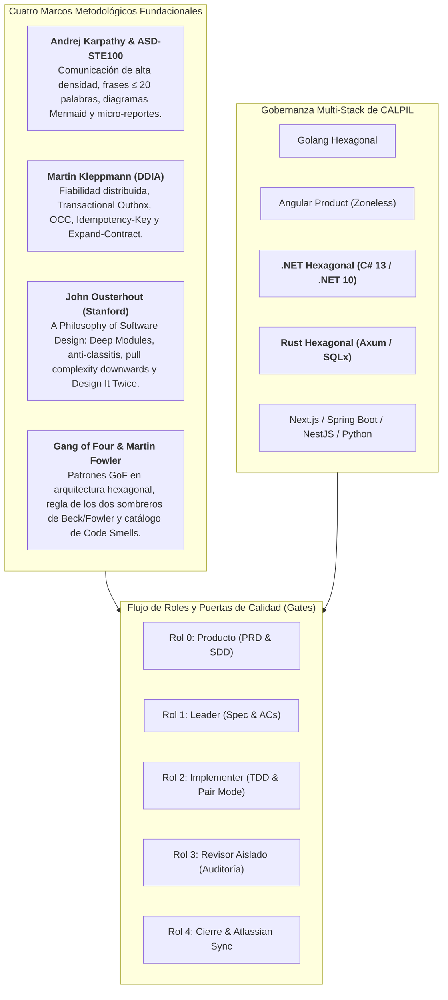

# Memoria Técnica de Implementaciones en Harness Flow

Este documento recopila y estructura de manera exhaustiva todas las capacidades, stacks tecnológicos, marcos teóricos y mejoras arquitectónicas implementadas en el repositorio de **Harness Flow**.

---

## 1. Resumen Ejecutivo de la Evolución del Arnés

**Harness Flow** ha evolucionado de un arnés de desarrollo guiado por gates a una **plataforma integral de ingeniería de software para sistemas multi-agente y desarrollo en pair programming**. Su arquitectura integra gobernanza multi-stack, verificación continua en caliente y la convergencia de cuatro marcos metodológicos de vanguardia:



---

## 2. Hito 1: Incorporación del Stack Tecnológico .NET Hexagonal (`dotnet-hexagonal`)

Se diseñó e integró formalmente el stack backend C# 13 / .NET 10 (LTS) bajo Clean Architecture / Arquitectura Hexagonal.

### Componentes Principales:
* **Manifiesto Declarativo**: [`stacks/dotnet-hexagonal/manifest.json`](file:///Users/alan/.hermes/skills/software-development/harness-flow/stacks/dotnet-hexagonal/manifest.json)
  * Detección por solución (`*.sln`, `*.slnx`, `*.csproj`), estructura de proyectos (`src/**/*.Domain`, `Application`, `Infrastructure`, `WebApi`) y dependencias clave (`Microsoft.AspNetCore`, `Dapper`, `Npgsql`).
  * Restricciones de arquitectura: pureza de Dominio en BCL sin dependencias externas, aislamiento de Application, Composition Root único en `Program.cs`, headers de seguridad y respuestas RFC 7807 (`application/problem+json`).
* **Reglas Normativas Modulares (`rules/`)**:
  * [`architecture.md`](file:///Users/alan/.hermes/skills/software-development/harness-flow/stacks/dotnet-hexagonal/rules/architecture.md): Límites de Clean Architecture en .NET.
  * [`dependencies.md`](file:///Users/alan/.hermes/skills/software-development/harness-flow/stacks/dotnet-hexagonal/rules/dependencies.md): Gobierno de paquetes NuGet, versiones estables LTS y prohibición de dependencias en Dominio.
  * [`security.md`](file:///Users/alan/.hermes/skills/software-development/harness-flow/stacks/dotnet-hexagonal/rules/security.md): Consultas SQL parametrizadas en Dapper, middlewares RFC 7807, headers HTTP y cero secretos en código.
  * [`testing.md`](file:///Users/alan/.hermes/skills/software-development/harness-flow/stacks/dotnet-hexagonal/rules/testing.md): Pruebas deterministas con xUnit, `WebApplicationFactory<Program>`, in-memory fakes y prohibición de `Thread.Sleep`.
* **9 Habilidades Operativas (`skills/`)**:
  * Implementadas con frontmatter YAML, descripción válida (35–1024 caracteres), 7 secciones obligatorias y procedimiento ejecutable de ≥ 5 pasos: `add-api-endpoint`, `add-feature`, `add-persistence`, `architecture-review`, `debug-targeted`, `dependency-review`, `prepare-release`, `security-review`, `write-tests`.
* **Herramientas de Auditoría**:
  * [`stacks/dotnet-hexagonal/scripts/check-architecture.py`](file:///Users/alan/.hermes/skills/software-development/harness-flow/stacks/dotnet-hexagonal/scripts/check-architecture.py): Validador AST/regex de límites entre proyectos `.csproj` y archivos `.cs`.
  * [`stacks/dotnet-hexagonal/scripts/validate-agent-skills.mjs`](file:///Users/alan/.hermes/skills/software-development/harness-flow/stacks/dotnet-hexagonal/scripts/validate-agent-skills.mjs): Validador de esquemas de skills.
* **Integración en `scripts/stack.py`**:
  * Scaffolding de estructura canónica (.Domain, .Application, .Infrastructure, .WebApi, Program.cs con middlewares).
  * Auditoría de versión de .NET en archivos `.csproj` frente a versión mínima `8.0.0` / `10.0.0`.
  * Plan de refactorización vertical para alinear soluciones .NET existentes.

---

## 3. Hito 2: Principios de Andrej Karpathy y Norma Aeroespacial ASD-STE100

A partir del análisis de las lecciones de Andrej Karpathy y el estándar Simplified Technical English (ASD-STE100), se rediseñó la interacción de los agentes para maximizar la densidad informativa y erradicar el *token bloat*.

### Documentación y Referencias:
* [`docs/principios-karpathy-ste100-harness-flow.md`](file:///Users/alan/.hermes/skills/software-development/harness-flow/docs/principios-karpathy-ste100-harness-flow.md): Informe exhaustivo de los 7 principios de Karpathy y su aplicación en software agentic.
* [`references/comunicacion-ste100-y-prompts.md`](file:///Users/alan/.hermes/skills/software-development/harness-flow/references/comunicacion-ste100-y-prompts.md): Manual normativo de comunicación técnica y prompts compactos.

### Principios Integrados:
1. **Comunicación de Alta Densidad sin Sobre-restricción (*Over-Constraining*)**:
   * Instrucciones breves y precisas; delegar la ejecución a la capacidad de razonamiento del LLM sin ahogarlo en micro-reglas redundantes.
2. **Regla de Oro ASD-STE100**:
   * Frases de **máximo 20 palabras**, en **voz activa**, con **una sola instrucción por frase** y sin sinónimos ambiguos.
   * Aplicada en redacción de criterios AC-n en specs, observaciones del revisor y micro-reportes.
3. **Diagramas Mermaid Prioritarios**:
   * En [`templates/sdd.md`](file:///Users/alan/.hermes/skills/software-development/harness-flow/templates/sdd.md), se prohíben descripciones en prosa de más de 3 líneas para flujos complejos; se exige modelar arquitecturas y secuencias con diagramas Mermaid (`flowchart` / `sequenceDiagram`).
4. **Micro-reportes de Pantalla de Instrumentos en Pair Mode**:
   * Formato telegráfico durante TDD:
     ```text
     [TEST: AC-1] Rojo: Esperaba HTTP 200, obtuvo 404.
     [CODE] Creado handler en crates/api/src/handlers/items.rs:18.
     [TEST: AC-1] Verde: 1 passed in 0.04s.
     [REFACTOR] Extraída validación a Domain::Item::validate. Verde confirmado.
     ```
5. **Optimización de Comandos Slash**:
   * Refactorizados [`commands/producto.md`](file:///Users/alan/.hermes/skills/software-development/harness-flow/commands/producto.md), [`commands/spec.md`](file:///Users/alan/.hermes/skills/software-development/harness-flow/commands/spec.md) e [`commands/implementar.md`](file:///Users/alan/.hermes/skills/software-development/harness-flow/commands/implementar.md) reduciendo hasta un 60% los tokens de prompt manteniendo el 100% de la fuerza prescriptiva.

---

## 4. Hito 3: Patrones de Datos Confiables y Escalables (DDIA - Martin Kleppmann)

Basado en la obra *Designing Data-Intensive Applications* de Martin Kleppmann, se incorporaron patrones fundamentales de fiabilidad distribuida y gestión de datos.

### Documentación y Referencias:
* [`references/patrones-datos-ddia.md`](file:///Users/alan/.hermes/skills/software-development/harness-flow/references/patrones-datos-ddia.md): Guía canónica de implementación en Go, C# .NET y Rust.

### Patrones Normativos Incorporados:
1. **Prevención de Doble Escritura (*Dual-Write*) mediante Transactional Outbox**:
   * Prohibición absoluta de guardar una entidad en base de datos y acto seguido publicar un evento en un broker (RabbitMQ/Kafka) en operaciones separadas.
   * Obligatoriedad de escribir el evento en una tabla local `outbox` dentro de la **misma transacción ACID** del negocio. Un worker en segundo plano (relay) lee y publica hacia el exterior con reintentos garantizando entrega *at-least-once*.
2. **Matriz Arquitectónica: ¿Kafka vs. Sin Kafka?**:
   * Se clarificó la frontera de diseño: **no incorporar Kafka prematuramente**.
   * Para la mayoría de servicios OLTP, PostgreSQL + Outbox Relay + índices b-tree resuelve la resiliencia con órdenes de magnitud menos complejidad operativa. Kafka solo se justifica formalmente cuando se superan 50.000 eventos/segundo, se requiere retención prolongada con *event sourcing* masivo o particionamiento horizontal por claves de ordenación causal.
3. **Control de Concurrencia Optimista (OCC - Optimistic Concurrency Control)**:
   * Prevención de pérdidas de actualización (*Lost Updates*) en entornos concurrentes mediante una columna `version INT DEFAULT 1`.
   * Actualizaciones atómicas condicionales: `UPDATE tabla SET campo = @val, version = version + 1 WHERE id = @id AND version = @expectedVersion`.
4. **Idempotencia de Red con `Idempotency-Key`**:
   * Endpoints mutadores (POST/PUT) soportan cabecera `Idempotency-Key` respaldada por una tabla de operaciones procesadas con índice único, devolviendo la respuesta almacenada en reintentos de red sin re-ejecutar efectos colaterales.
5. **Evolución de Esquemas sin Downtime (*Expand-Contract*)**:
   * Migraciones en fases desacopladas: Expandir (añadir columna nullable), Migrar/Escribir dualmente, Contraer (eliminar columna antigua).
6. **Integración en Agentes y Scripts**:
   * [`templates/sdd.md`](file:///Users/alan/.hermes/skills/software-development/harness-flow/templates/sdd.md): Sección obligatoria de clasificación de datos (OLTP vs OLAP) y diseño de Outbox/OCC.
   * [`agents/revisor.md`](file:///Users/alan/.hermes/skills/software-development/harness-flow/agents/revisor.md) y [`scripts/revision.py`](file:///Users/alan/.hermes/skills/software-development/harness-flow/scripts/revision.py): Auditoría automatizada que clasifica como **bloqueante** cualquier anti-patrón de Dual-Write detectado en el diff.

---

## 5. Hito 4: Incorporación del Stack Tecnológico Rust Hexagonal (`rust-hexagonal`)

Se diseñó e integró formalmente el stack backend Rust (edición 2021/2024) con Axum, Tokio y SQLx.

### Componentes Principales:
* **Manifiesto Declarativo**: [`stacks/rust-hexagonal/manifest.json`](file:///Users/alan/.hermes/skills/software-development/harness-flow/stacks/rust-hexagonal/manifest.json)
  * Detección por `Cargo.toml`, `Cargo.lock`, extensiones `.rs`, dependencias (`axum`, `tokio`, `sqlx`) y crates (`crates/domain`, `application`, `infrastructure`, `api`) o estructura de carpetas `src/(domain|application|infrastructure)`.
  * Restricciones de arquitectura: Pureza de Dominio en Rust estándar (sin Axum, SQLx, Tokio net), Application aislada por traits, Composition Root en `src/main.rs`, serialización RFC 7807 y pruebas sin sleep.
  * Configuración Context7 (`/tokio-rs/axum`), documentación oficial en [doc.rust-lang.org](https://doc.rust-lang.org/) y auditoría con `cargo audit`.
* **Reglas Normativas Modulares (`rules/`)**:
  * [`architecture.md`](file:///Users/alan/.hermes/skills/software-development/harness-flow/stacks/rust-hexagonal/rules/architecture.md): Límites de arquitectura hexagonal en Rust.
  * [`dependencies.md`](file:///Users/alan/.hermes/skills/software-development/harness-flow/stacks/rust-hexagonal/rules/dependencies.md): Dependencias centralizadas en workspace `[workspace.dependencies]`, versiones fijas y versionado de `Cargo.lock`.
  * [`security.md`](file:///Users/alan/.hermes/skills/software-development/harness-flow/stacks/rust-hexagonal/rules/security.md): Consultas parametrizadas con `sqlx::query!`, headers HTTP de seguridad, `x-correlation-id` y contenedores Docker sin privilegios (`appuser`).
  * [`testing.md`](file:///Users/alan/.hermes/skills/software-development/harness-flow/stacks/rust-hexagonal/rules/testing.md): Pruebas deterministas de dominio sin I/O, adaptador `InMemoryWorkItemRepository`, pruebas HTTP con `tower::ServiceExt::oneshot` y cero llamadas a `thread::sleep`.
* **9 Habilidades Operativas (`skills/`)**:
  * `add-api-endpoint`, `add-feature`, `add-persistence`, `architecture-review`, `debug-targeted`, `dependency-review`, `prepare-release`, `security-review`, `write-tests`.
  * 100% conformes con el validador [`validate-agent-skills.mjs`](file:///Users/alan/.hermes/skills/software-development/harness-flow/stacks/rust-hexagonal/scripts/validate-agent-skills.mjs).
* **Herramientas de Auditoría**:
  * [`stacks/rust-hexagonal/scripts/check-architecture.py`](file:///Users/alan/.hermes/skills/software-development/harness-flow/stacks/rust-hexagonal/scripts/check-architecture.py): Validador AST/regex de pureza de Dominio, aislamiento de Application, verificación de `Cargo.toml` por crate, composición en `main.rs` y testing determinista.
* **Integración en `scripts/stack.py`**:
  * Scaffolding de estructura canónica (Cargo.toml con Axum 0.8/Tokio, `src/main.rs`, `src/domain/`, `src/application/`, `src/infrastructure/`).
  * Detección y auditoría de edición mínima (`edition = "2021"`).
  * Plan de refactorización vertical guiado para proyectos Rust desalineados.
* **Pruebas de Integración y Regresión**:
  * Casos añadidos en [`tests/test_stack.py`](file:///Users/alan/.hermes/skills/software-development/harness-flow/tests/test_stack.py) para detección de stack, verificación sobre plantilla real de CALPIL (`calpil-rust-hexagonal-template`), captura de violaciones arquitectónicas y scaffolding.

---

## 6. Hito 5: Filosofía de Diseño de Software de John Ousterhout (*A Philosophy of Software Design*)

A partir del análisis del video de BettaTech (*¿Es este libro el Clean Code Moderno?*) y el libro de **John Ousterhout** (catedrático de Stanford), se implementaron los principios fundamentales de gestión de complejidad.

### Documentación y Referencias:
* [`references/filosofia-diseno-ousterhout.md`](file:///Users/alan/.hermes/skills/software-development/harness-flow/references/filosofia-diseno-ousterhout.md): Manual técnico con los 9 principios de Ousterhout y matriz de aplicación en el arnés.

### Principios Integrados en el Flujo:
1. **Módulos Profundos (*Deep Modules*) vs. Superficiales (*Shallow Modules*)**:
   * Los mejores componentes tienen una interfaz mínima y compacta, pero encapsulan una implementación rica y potente (ej. interfaz Unix `open`, `read`, `write`, `close`).
   * **Combate a la *Classitis***: Se refuta el dogma de Clean Code de forzar funciones microscópicas (<5 líneas). La atomización artificial fragmenta la lógica y dispara la carga cognitiva (*cognitive load*). En Harness Flow se prefieren funciones cohesivas y profundas (de 30 a 80 líneas) que completen el flujo en un único nivel de abstracción.
2. **Programación Estratégica (Inversión del 10%–20%)**:
   * En el bucle TDD del Implementer, la fase *Refactor* es una inversión obligatoria del 10% al 20% del esfuerzo para sanear interfaces y eliminar duplicación antes de pasar al siguiente AC.
3. **Ocultamiento de Información vs. Fuga de Información (*Information Leakage*)**:
   * Prohibición del anti-patrón de descomposición temporal (*Temporal Decomposition*, e.g., `Opener -> Reader -> Parser -> Writer`). Los módulos se estructuran en torno a invariantes y datos encapsulados.
4. **Empujar la Complejidad Hacia Abajo (*Pull Complexity Downwards*)**:
   * La infraestructura y los servicios absorben la dificultad (Outbox, reintentos, OCC); la API expone contratos limpios y el frontend jamás coordina transacciones complejas.
5. **Definir los Errores Fuera de la Existencia (*Define Errors Out of Existence*)**:
   * Rediseñar APIs para que casos límite normales (colecciones vacías, borrado idempotente) sean respuestas ordinarias válidas en lugar de detonar excepciones complejas y no testeadas.
6. **Diseñar Dos Veces (*Design It Twice*)**:
   * En [`templates/sdd.md`](file:///Users/alan/.hermes/skills/software-development/harness-flow/templates/sdd.md), cada decisión de arquitectura ($D-n$) debe contrastar al menos **dos alternativas radicalmente distintas** justificando la descartada.
7. **Detección de Métodos de Paso (*Pass-Through Methods*)**:
   * En [`agents/revisor.md`](file:///Users/alan/.hermes/skills/software-development/harness-flow/agents/revisor.md) y [`scripts/revision.py`](file:///Users/alan/.hermes/skills/software-development/harness-flow/scripts/revision.py), el revisor audita y clasifica como hallazgo mayor métodos o capas intermediarias que solo reenvían parámetros sin aportar abstracción.
8. **Comentarios de Abstracción Superior**:
   * Los comentarios y docstrings deben describir contratos, invariantes e intenciones (*what/why*), prohibiendo parafrasear la sintaxis del código (*how*).

---

## 7. Matriz de Trazabilidad de Archivos y Componentes

| Archivo / Componente | Tipo | Propósito y Contenido Principal |
| :--- | :--- | :--- |
| [`stacks/dotnet-hexagonal/manifest.json`](file:///Users/alan/.hermes/skills/software-development/harness-flow/stacks/dotnet-hexagonal/manifest.json) | Manifiesto | Configuración declarativa del stack .NET Hexagonal C# 13 / .NET 10 |
| [`stacks/dotnet-hexagonal/rules/*`](file:///Users/alan/.hermes/skills/software-development/harness-flow/stacks/dotnet-hexagonal/rules/) | Reglas | Reglas modulares de arquitectura, dependencias, seguridad y testing .NET |
| [`stacks/dotnet-hexagonal/skills/*`](file:///Users/alan/.hermes/skills/software-development/harness-flow/stacks/dotnet-hexagonal/skills/) | Habilidades | 9 skills operativas para ingeniería .NET (API, persistencia, release, tests, etc.) |
| [`stacks/dotnet-hexagonal/scripts/check-architecture.py`](file:///Users/alan/.hermes/skills/software-development/harness-flow/stacks/dotnet-hexagonal/scripts/check-architecture.py) | Script | Validador estricto de límites de Clean Architecture en .NET |
| [`stacks/rust-hexagonal/manifest.json`](file:///Users/alan/.hermes/skills/software-development/harness-flow/stacks/rust-hexagonal/manifest.json) | Manifiesto | Configuración declarativa del stack Rust Hexagonal (Axum, Tokio, SQLx) |
| [`stacks/rust-hexagonal/rules/*`](file:///Users/alan/.hermes/skills/software-development/harness-flow/stacks/rust-hexagonal/rules/) | Reglas | Reglas modulares de arquitectura, dependencias, seguridad y testing en Rust |
| [`stacks/rust-hexagonal/skills/*`](file:///Users/alan/.hermes/skills/software-development/harness-flow/stacks/rust-hexagonal/skills/) | Habilidades | 9 skills operativas de ingeniería Rust (API endpoints, persistencia SQLx, tests, etc.) |
| [`stacks/rust-hexagonal/scripts/check-architecture.py`](file:///Users/alan/.hermes/skills/software-development/harness-flow/stacks/rust-hexagonal/scripts/check-architecture.py) | Script | Validador estricto de pureza de dominio y límites hexagonales en Rust |
| [`references/comunicacion-ste100-y-prompts.md`](file:///Users/alan/.hermes/skills/software-development/harness-flow/references/comunicacion-ste100-y-prompts.md) | Referencia | Norma de comunicación técnica ASD-STE100 y optimización de prompts Karpathy |
| [`docs/principios-karpathy-ste100-harness-flow.md`](file:///Users/alan/.hermes/skills/software-development/harness-flow/docs/principios-karpathy-ste100-harness-flow.md) | Documento | Análisis de los 7 principios de Karpathy y su integración en Harness Flow |
| [`references/patrones-datos-ddia.md`](file:///Users/alan/.hermes/skills/software-development/harness-flow/references/patrones-datos-ddia.md) | Referencia | Patrones de datos DDIA (Transactional Outbox, OCC, Idempotencia, Kafka vs No-Kafka) |
| [`references/filosofia-diseno-ousterhout.md`](file:///Users/alan/.hermes/skills/software-development/harness-flow/references/filosofia-diseno-ousterhout.md) | Referencia | Guía de diseño de software de John Ousterhout (Deep Modules, anti-classitis, Design It Twice) |
| [`references/patrones-gof-y-refactoring.md`](file:///Users/alan/.hermes/skills/software-development/harness-flow/references/patrones-gof-y-refactoring.md) | Referencia | Patrones GoF en arquitectura hexagonal, regla de dos sombreros de Beck/Fowler y catálogo de Code Smells |
| [`references/design-patterns-gof.md`](file:///Users/alan/.hermes/skills/software-development/harness-flow/references/design-patterns-gof.md) | Referencia | Lectura cerrada de *Design Patterns* (capítulos 1 a 6): cuándo entra un patrón en cada fase. No repite el catálogo |
| [`references/context7-documentacion-oficial.md`](file:///Users/alan/.hermes/skills/software-development/harness-flow/references/context7-documentacion-oficial.md) | Referencia | Matriz de fuentes oficiales, bibliotecas Context7 y escáneres de seguridad por stack |
| [`templates/sdd.md`](file:///Users/alan/.hermes/skills/software-development/harness-flow/templates/sdd.md) | Plantilla | Diseño de arquitectura enriquecido con Mermaid, DDIA, Design It Twice y Deep Modules |
| [`templates/spec.md`](file:///Users/alan/.hermes/skills/software-development/harness-flow/templates/spec.md) | Plantilla | Especificación de features con regla STE100 (≤20 palabras), costuras en módulos profundos |
| [`agents/implementer.md`](file:///Users/alan/.hermes/skills/software-development/harness-flow/agents/implementer.md) | Agente | Directrices de TDD vertical, anti-classitis, inversión 10-20% y reporte ASD-STE100 |
| [`agents/revisor.md`](file:///Users/alan/.hermes/skills/software-development/harness-flow/agents/revisor.md) | Agente | Auditoría de dual-write, OCC, métodos pass-through, fuga de información e integridad de tests |
| [`scripts/revision.py`](file:///Users/alan/.hermes/skills/software-development/harness-flow/scripts/revision.py) | Script | Generador del briefing automatizado para subagentes revisores con cheques DDIA y Ousterhout |
| [`scripts/stack.py`](file:///Users/alan/.hermes/skills/software-development/harness-flow/scripts/stack.py) | Script | Gestor de stacks: detección, verificación, scaffolding, refactorización y auditoría |
| [`tests/test_stack.py`](file:///Users/alan/.hermes/skills/software-development/harness-flow/tests/test_stack.py) | Pruebas | Suite de tests automatizados para los 8 stacks, checkers de arquitectura y templates |
| [`README.md`](file:///Users/alan/.hermes/skills/software-development/harness-flow/README.md) y [`SKILL.md`](file:///Users/alan/.hermes/skills/software-development/harness-flow/SKILL.md) | Documentación | Actualización de catálogo activo, metodología y comandos oficiales del arnés |

---

## 8. Hito 6: Auditoría Integral y Estandarización de los 8 Stacks Tecnológicos

Se realizó una auditoría rigurosa y exhaustiva sobre la totalidad de los 8 stacks tecnológicos soportados en `harness-flow`:
1. `golang-hexagonal`
2. `angular-product`
3. `dotnet-hexagonal`
4. `rust-hexagonal`
5. `nextjs-product`
6. `springboot-hexagonal`
7. `nestjs-hexagonal`
8. `python-dataproduct`

### Hallazgos y Correcciones Implementadas:
1. **Sincronización de Manifiestos (`manifest.json`)**:
   * `nextjs-product`: Corregida discrepancia entre la habilidad declarada `changelog` y la habilidad real `add-api-endpoint`.
   * `springboot-hexagonal`: Corregida discrepancia entre `add-persistence` declarada y las habilidades reales existentes (`changelog` y `documentation-maintenance`).
   * `nestjs-hexagonal`: Añadidas 3 habilidades faltantes en la lista del manifiesto (`add-auth-authorization`, `delivery-change`, `observability-change`), completando las 9 habilidades operativas.
2. **Creación de Reglas Normativas Modulares (`rules/`)**:
   * En `stacks/nestjs-hexagonal/rules/` y `stacks/python-dataproduct/rules/`, se crearon los 4 estándares normativos obligatorios: `architecture.md`, `dependencies.md`, `security.md` y `testing.md`.
3. **Despliegue de Verificadores de Arquitectura (`check-architecture.py`)**:
   * Se diseñaron e implementaron los checkers AST y de regex arquitectónico faltantes en:
     * [`stacks/springboot-hexagonal/scripts/check-architecture.py`](file:///Users/alan/.hermes/skills/software-development/harness-flow/stacks/springboot-hexagonal/scripts/check-architecture.py)
     * [`stacks/nextjs-product/scripts/check-architecture.py`](file:///Users/alan/.hermes/skills/software-development/harness-flow/stacks/nextjs-product/scripts/check-architecture.py)
     * [`stacks/nestjs-hexagonal/scripts/check-architecture.py`](file:///Users/alan/.hermes/skills/software-development/harness-flow/stacks/nestjs-hexagonal/scripts/check-architecture.py)
     * [`stacks/python-dataproduct/scripts/check-architecture.py`](file:///Users/alan/.hermes/skills/software-development/harness-flow/stacks/python-dataproduct/scripts/check-architecture.py)
   * Se distribuyó el script [`validate-agent-skills.mjs`](file:///Users/alan/.hermes/skills/software-development/harness-flow/scripts/validate-agent-skills.mjs) a todos los directorios `stacks/*/scripts/`.
4. **Normalización y Validación de Plantillas CALPIL**:
   * Ejecutado `stack.py normalizar` sobre `calpil-nestjs-hexagonal-template` y `calpil-python-dataproduct-template` para desplegar las reglas en `.claude/rules/`.
   * Verificación en vivo de las 8 plantillas oficiales en `/Users/alan/Documents/Git/CALPIL`:
     * `calpil-golang-hexagonal-template`: **COMPLIANT** (100% confianza)
     * `calpil-angular-product-template`: **COMPLIANT** (100% confianza)
     * `calpil-dotnet-hexagonal-template`: **COMPLIANT** (100% confianza)
     * `calpil-rust-hexagonal-template`: **COMPLIANT** (100% confianza)
     * `calpil-nextjs-product-template`: **COMPLIANT** (100% confianza)
     * `calpil-springboot-hexagonal-template`: **COMPLIANT** (100% confianza)
     * `calpil-nestjs-hexagonal-template`: **COMPLIANT** (85% confianza)
     * `calpil-python-dataproduct-template`: **COMPLIANT** (100% confianza)

---

## 9. Hito 7: Patrones GoF y Refactorización Disciplinada (Martin Fowler, Kent Beck y Gang of Four)

A partir del análisis de las obras fundamentales de diseño orientado a objetos (*Design Patterns* de GoF, *Head First Design Patterns* y *Refactoring* de Martin Fowler), se integraron formalmente los patrones clásicos y la disciplina de saneamiento de código en el ciclo de vida de Harness Flow.

### Documentación y Referencias:
* [`references/patrones-gof-y-refactoring.md`](file:///Users/alan/.hermes/skills/software-development/harness-flow/references/patrones-gof-y-refactoring.md): Manual normativo de patrones GoF por capa hexagonal, regla de los dos sombreros y catálogo de los 24 *Code Smells*.

### Principios y Mecanismos Integrados:
1. **La Regla de los Dos Sombreros (*The Two Hats* - Kent Beck & Martin Fowler)**:
   * En el rol Implementer ([`agents/implementer.md`](file:///Users/alan/.hermes/skills/software-development/harness-flow/agents/implementer.md)), se separa estrictamente el trabajo:
     * **Sombrero 1 (Feature / Red -> Green)**: Test en costura pública y código mínimo, plano y directo. Prohibido introducir patrones GoF aquí.
     * **Sombrero 2 (Refactor to Patterns / Green -> Verde Saneado)**: Con el test pasando, se aplica la inversión del 10%–20% auditando *Code Smells* y refactorizando *hacia* el patrón solo cuando la duplicación o complejidad lo justifique.
2. **Catálogo de Code Smells en Auditoría del Revisor**:
   * En [`agents/revisor.md`](file:///Users/alan/.hermes/skills/software-development/harness-flow/agents/revisor.md) y [`scripts/revision.py`](file:///Users/alan/.hermes/skills/software-development/harness-flow/scripts/revision.py), se audita el diff contra 5 hedores críticos:
     * *Primitive Obsession* (Mayor): Identificadores o conceptos clave modelados con primitivos crudos sin Value Objects.
     * *Shotgun Surgery / Divergent Change* (Bloqueante/Mayor): Cambios dispersos en múltiples archivos para un solo concepto.
     * *Feature Envy* (Mayor): Métodos que manipulan atributos internos de otra clase.
     * *Speculative Generality / Over-Engineering* (Mayor): Abstracciones o fábricas prematuras no requeridas por los AC.
     * *Middle Man* (Mayor): Intermediarios vacíos que solo delegan sin transformar.
3. **Mapeo de Patrones GoF por Capa Hexagonal**:
   * *Adapter* en puertos de infraestructura (driving/driven).
   * *Strategy* y *State* en lógica de dominio para algoritmos intercambiables y máquinas de estado.
   * *Decorator / Proxy* en cross-cutting para Outbox, OCC, telemetría y reintentos.
   * *Factory / Builder* centralizado exclusivamente en el Composition Root (`main`).
4. **"Program to an Interface, Not an Implementation"**:
   * En [`templates/spec.md`](file:///Users/alan/.hermes/skills/software-development/harness-flow/templates/spec.md), los ACs se redactan contra contratos públicos y puertos desacoplados de detalles de implementación.

---

## 10. Hito 8: Auto-Normalización Automática (Nivel 1) y Feature #0 Prioritaria (Nivel 2)

Se diseñó e integró en el ciclo de arranque y ejecución de Harness Flow el mecanismo de **detección temprana, auto-normalización de entorno y priorización arquitectónica obligatoria**:

### Mecanismos Implementados:
1. **Auto-Normalización de Entorno (Nivel 1)**:
   * Al ejecutar [`scripts/estado.py`](file:///Users/alan/.hermes/skills/software-development/harness-flow/scripts/estado.py) o comandos de inicio, el arnés detecta el stack y verifica si faltan reglas (`.claude/rules/`), skills (`.claude/skills/`, `.agents/skills/`), `AGENTS.md` o `scripts/check-architecture.py`.
   * Si faltan, los instala automáticamente de inmediato mediante [`stack.auto_normalizar_y_asegurar_cumplimiento`](file:///Users/alan/.hermes/skills/software-development/harness-flow/scripts/stack.py), dejando el repositorio 100% listo para los agentes sin requerir intervención manual.
2. **Priorización de Normalización del Código Fuente (Nivel 2 - Feature #0)**:
   * Si el verificador de arquitectura AST/regex (`check-architecture.py`) detecta violaciones en el código existente:
     * El arnés crea automáticamente la **Feature #0 (`F-0: normalizacion-arquitectura-<stack>`)** al inicio del backlog (`feature_list.json`).
     * Todas las demás features abiertas (`F-1`, `F-2`, etc.) quedan automáticamente bloqueadas exigiendo `requiere: [0]`.
     * Se genera automáticamente el spec formal de refactorización (`docs/spec-feature-0-*.md`) con ACs que exigen que `check-architecture.py` finalice con 0 errores y sin regresiones en tests.
3. **Bloqueo Determinístico en Gates**:
   * [`scripts/gate.py approve-spec`](file:///Users/alan/.hermes/skills/software-development/harness-flow/scripts/gate.py) y [`scripts/worktree.py start`](file:///Users/alan/.hermes/skills/software-development/harness-flow/scripts/worktree.py) impiden aprobar o iniciar ramas de features de negocio ($n \neq 0$) mientras la Feature #0 no esté en estado `done`.
   * En [`scripts/estado.py`](file:///Users/alan/.hermes/skills/software-development/harness-flow/scripts/estado.py), se despliega un banner prominente de advertencia indicando que la Feature #0 es la única tarea permitida.
4. **Saneamiento de Dependencias con ID Cero**:
   * En [`scripts/comun.py`](file:///Users/alan/.hermes/skills/software-development/harness-flow/scripts/comun.py), se corrigió la evaluación de falsedad de `item or ""` para soportar enteros `0` en `requiere_declarados` y `bloqueos_feature`.

---

## 11. Hito 9: Fundamentos de Algoritmos y Estructuras de Datos (CLRS - Cormen, Leiserson, Rivest, Stein)

A partir del análisis del tratado canónico *Introduction to Algorithms* (CLRS) de Thomas H. Cormen, Charles E. Leiserson, Ronald L. Rivest y Clifford Stein, se integraron los fundamentos de complejidad asintótica, teoría de grafos y selección óptima de estructuras de datos en todas las fases del ciclo de vida de Harness Flow.

### Documentación y Referencias:
* [`references/algoritmos-y-estructuras-clrs.md`](file:///Users/alan/.hermes/skills/software-development/harness-flow/references/algoritmos-y-estructuras-clrs.md): Tratado normativo de complejidad asintótica ($O(1), O(\log N), O(N), O(N^2)$), catálogo de estructuras de datos canónicas según stack tecnológico y directivas de prevención de anti-patrones.

### Principios y Mecanismos Integrados:
1. **Modelado y Validación de Dependencias como Grafos Acíclicos Dirigidos (DAG)**:
   * En [`scripts/comun.py`](file:///Users/alan/.hermes/skills/software-development/harness-flow/scripts/comun.py):
     * `detectar_ciclos_dependencias(data)`: Implementación de DFS canónico de 3 colores ($O(V + E)$) para detectar aristas de retroceso (*back-edges*) en el backlog de features, reportando la secuencia exacta del ciclo si existe.
     * `orden_topologico_features(data)`: Implementación del algoritmo de Kahn basado en colas de grados de entrada ($O(V + E)$) para derivar la secuencia lineal determinista óptima de implementación de features.
   * En [`scripts/gate.py check`](file:///Users/alan/.hermes/skills/software-development/harness-flow/scripts/gate.py) y [`scripts/estado.py`](file:///Users/alan/.hermes/skills/software-development/harness-flow/scripts/estado.py): Detección y bloqueo inmediato si se introducen dependencias circulares en `feature_list.json`.
2. **Estimación de $N$ y Complejidad Asintótica en Decisiones de Arquitectura (SDD)**:
   * En [`templates/sdd.md`](file:///Users/alan/.hermes/skills/software-development/harness-flow/templates/sdd.md):
     * `## Componentes`: Obligatoriedad de estimar el orden de magnitud de $N$ (concurrencia, throughput, volumen en memoria) y justificar la elección de estructuras según la carga (Hash Tables $O(1)$, Heaps $O(\log N)$, B-Trees $O(\log N)$).
     * `## Datos e integraciones`: Especificación de índices eficientes y eliminación de consultas $N+1$ mediante batching / queries con cláusula `IN`.
     * `## Decisiones`: Inclusión explícita de la complejidad asintótica en el trade-off de decisiones no triviales ($D-n$).
3. **Optimización Asintótica en Refactorización TDD (Implementer)**:
   * En [`agents/implementer.md`](file:///Users/alan/.hermes/skills/software-development/harness-flow/agents/implementer.md): En Sombrero 2 (Refactor to Patterns), se aplican directivas de eficiencia de CLRS:
     * Pre-alocación obligatoria de colecciones con capacidad conocida (`make([]T, 0, cap)`, `Vec::with_capacity(cap)`) para evitar realocaciones geométricas $O(N)$.
     * Reemplazo de búsquedas lineales anidadas ($O(N^2)$) por índices o Lookups en Hash Sets / Maps ($O(1)$ amortizado / $O(N)$ total).
     * Prohibición de concatenación iterativa de strings (`+=`) en bucles no acotados; uso de `strings.Builder` o buffers contiguos.
     * Prevención de consultas $N+1$ agrupando accesos a persistencia en batch ($O(1)$ roundtrips de red).
4. **Auditoría de Complejidad y Anti-Patrones en el Revisor**:
   * En [`agents/revisor.md`](file:///Users/alan/.hermes/skills/software-development/harness-flow/agents/revisor.md) y [`scripts/revision.py`](file:///Users/alan/.hermes/skills/software-development/harness-flow/scripts/revision.py): El revisor aislado audita el diff y clasifica:
     * Consultas $N+1$ a base de datos o llamadas HTTP en bucles como **Bloqueante**.
     * Búsquedas lineales anidadas $O(N^2)$ y concatenación iterativa de cadenas como **Mayor**.
     * Reasignaciones dinámicas sin pre-alocación de capacidad como **Menor**.

---

## 12. Hito 10: Ingeniería de Inteligencia Artificial y Modelos Fundacionales (Chip Huyen)

A partir del análisis del tratado canónico *AI Engineering: Building Applications with Foundation Models* de Chip Huyen (O'Reilly, 2025; Stanford CS 329S / CS 25) y su reseña por BettaTech (*The AI book every developer should read*), se formalizaron los principios de ingeniería determinista para gobernar sistemas construidos sobre modelos de lenguaje probabilísticos.

### Documentación y Referencias:
* [`references/ai-engineering-chip-huyen.md`](file:///Users/alan/.hermes/skills/software-development/harness-flow/references/ai-engineering-chip-huyen.md): Tratado normativo de arquitectura de IA en 5 capas, estructuración jerárquica para *Prompt Caching*, mitigación de los 3 sesgos en *AI-as-a-Judge*, prevención de *Indirect Prompt Injection* y resiliencia con *Bounded Reflection*.

### Principios y Mecanismos Integrados:
1. **Contratos de Incertidumbre y Golden Datasets en PRD**:
   * En [`templates/prd.md`](file:///Users/alan/.hermes/skills/software-development/harness-flow/templates/prd.md):
     * Prohibición de requisitos ambiguos ("el agente responderá inteligentemente").
     * Exigencia de SLAs cuantificables de precisión y recall con fallbacks deterministas si la confianza decae.
     * Definición obligatoria de un **Golden Dataset** (20–50 casos representativos) antes de iniciar la construcción.
     * Diseño explícito de la ruta de escape **Human-in-the-Loop** para flujos no deterministas.
2. **Pipeline Defensivo Canónico de 5 Capas en Arquitectura (SDD)**:
   * En [`templates/sdd.md`](file:///Users/alan/.hermes/skills/software-development/harness-flow/templates/sdd.md):
     * Modelado obligatorio de las 5 capas: *Ingress Guardrail* $\rightarrow$ *Context Assembly & Prompt Caching* $\rightarrow$ *Model Router* $\rightarrow$ *Foundation Model con Structured Outputs* $\rightarrow$ *Egress Validator & Circuit Breaker*.
     * Jerarquización de prompts con prefijos estáticos para maximizar la tasa de acierto del **Prompt Caching** (reduciendo hasta 80% de latencia y costo).
     * Prohibición del parsing artesanal de texto libre; uso estricto de **JSON Schema** o **Tool Calling** nativo en interfaces de datos.
     * Justificación de decisiones $D-n$ mediante trade-offs de modelos (Model Routing) y matrices RAG vs. Fine-tuning.
3. **Resiliencia, TDD y Bounded Reflection en Implementación**:
   * En [`agents/implementer.md`](file:///Users/alan/.hermes/skills/software-development/harness-flow/agents/implementer.md):
     * Timeouts deterministas obligatorios y reintentos con *exponential backoff* y *jitter* ante errores de red o códigos 429/5xx.
     * Patrón **Bounded Reflection**: reintentos de auto-corrección ante fallos de validación de esquema acotados estrictamente a **máximo 2 ciclos** para erradicar bucles infinitos y consumo desmedido de tokens.
     * Sanitización de entradas no confiables mediante delimitadores semánticos explícitos (`<user_input>`) para neutralizar inyecciones de prompts.
4. **Auditoría Especializada y Neutralización de Sesgos en el Revisor (AI-as-a-Judge)**:
   * En [`agents/revisor.md`](file:///Users/alan/.hermes/skills/software-development/harness-flow/agents/revisor.md) y [`scripts/revision.py`](file:///Users/alan/.hermes/skills/software-development/harness-flow/scripts/revision.py):
     * **Mitigación activa de los 3 sesgos del juez IA**:
       1. *Position bias*: Evaluación atómica e independiente por AC-n.
       2. *Verbosity bias*: Brevedad extrema exigida por la norma aeroespacial ASD-STE100 ($\le 20$ palabras).
       3. *Self-enhancement bias*: Amnesia deliberada del subagente revisor, que arranca sin memoria de la sesión de implementación y evalúa el código en frío desde el árbol de git.
     * **Auditoría en el diff**:
       * Clasificación como **Bloqueante** de llamadas a APIs de LLMs sin timeouts ni backoff, o bucles agénticos sin parada estricta ($\le 2$).
       * Clasificación como **Mayor** del parsing de texto libre sin Structured Outputs y de la concatenación de prompts sin sanitizar.
5. **Formulación y Rebanado Vertical de Features de Negocio con IA (Ej. Mantenimiento Predictivo Industrial)**:
   * En [`references/ai-engineering-chip-huyen.md`](file:///Users/alan/.hermes/skills/software-development/harness-flow/references/ai-engineering-chip-huyen.md) y [`references/vertical-slice.md`](file:///Users/alan/.hermes/skills/software-development/harness-flow/references/vertical-slice.md):
     * Guía paso a paso para traducir requerimientos de negocio complejos (como *"Aplicar IA predictiva para mantenimiento de ascensores, sala de bombas y pozos de agua"*) en Vertical Slices punta a punta.
     * **Problem Framing**: Definición formal de la tarea analítica (Detección de anomalías no supervisada + Clasificación de riesgo con ventana de $K$ días), análisis de la **asimetría de pérdida** (alto recall para evitar costos catastróficos por fallas no previstas) y **regla del baseline heurístico obligatorio** (toda IA debe superar una regla simple determinista y contar con ella como fallback).
     * **Rebanado Vertical Canónico (`F-1` a `F-4`)**: Prohibición de historias horizontales (*"hacer modelo"*, *"diseñar pantalla"*); corte vertical por activo y funcionalidad (`F-1` walking skeleton de bomba con baseline y JSON Schema $\rightarrow$ `F-2` pozos de agua y achique $\rightarrow$ `F-3` ascensores por fatiga y vibración $\rightarrow$ `F-4` loop de confirmación técnica en terreno para calibración de Golden Datasets).
     * **Plantilla de ACs Predictivos** en [`templates/spec.md`](file:///Users/alan/.hermes/skills/software-development/harness-flow/templates/spec.md): Patrones Given/When/Then con salida feliz tipada, fallback heurístico ante timeout/error y persistencia de veredicto humano.

---

## 13. Hito 11: Microservicios y Sistemas Distribuidos (Sam Newman)

A partir del análisis del tratado canónico *Building Microservices: Designing Fine-Grained Systems* (2ª Edición, O'Reilly, 2021) y *Monolith to Microservices* de Sam Newman, reseñado por BettaTech (*Este libro me hizo madurar como ingeniero*), se integraron los principios de diseño y gobierno de sistemas distribuidos y microservicios en Harness Flow.

### Documentación y Referencias:
* [`references/microservicios-sam-newman.md`](file:///Users/alan/.hermes/skills/software-development/harness-flow/references/microservicios-sam-newman.md): Tratado normativo de los 7 principios de microservicios, encapsulamiento estricto *Database per Service*, selección pragmática de comunicación (Síncrono vs EDA bajo YAGNI), resiliencia distribuida y trazabilidad con *Correlation IDs*.

### Principios y Mecanismos Integrados:
1. **Regla de Oro: Database per Service y Bounded Contexts**:
   * En [`templates/sdd.md`](file:///Users/alan/.hermes/skills/software-development/harness-flow/templates/sdd.md): Prohibición absoluta de bases de datos compartidas (*Shared Database*) entre microservicios; interacción exclusiva vía APIs públicas o eventos. Delimitación de entidades por *Bounded Contexts* (DDD).
2. **Selección Pragmática de Comunicación (Síncrono vs EDA sin Dogmas)**:
   * En [`templates/sdd.md`](file:///Users/alan/.hermes/skills/software-development/harness-flow/templates/sdd.md): Se adopta el principio YAGNI de Newman: Request/Response síncrono (REST/gRPC) por defecto; Event-Driven Architecture (EDA) solo cuando el negocio exige desacoplamiento temporal, múltiples suscriptores o streaming masivo (ej. IoT).
3. **Resiliencia Distribuida y Prevención de Fallos en Cascada**:
   * En [`agents/implementer.md`](file:///Users/alan/.hermes/skills/software-development/harness-flow/agents/implementer.md) y [`templates/sdd.md`](file:///Users/alan/.hermes/skills/software-development/harness-flow/templates/sdd.md): Implementación obligatoria de *Circuit Breakers*, *Bulkheads*, timeouts agresivos (< 3s), reintentos con *exponential backoff* y *jitter*, y degradación grácil (*Graceful Degradation*).
4. **Trazabilidad Distribuida con Correlation IDs**:
   * Propagación mandatoria de `X-Correlation-ID` o W3C `traceparent` en todas las llamadas de red salientes y eventos para observabilidad end-to-end con OpenTelemetry.
5. **Despliegue Independiente y Evolución de Contratos (Expand-Contract)**:
   * En [`references/vertical-slice.md`](file:///Users/alan/.hermes/skills/software-development/harness-flow/references/vertical-slice.md): Cada rebanada vertical multi-servicio se planifica bajo el patrón de cambio paralelo (*Expand-Contract*) y se coordina con el subsistema [`scripts/multirepo.py`](file:///Users/alan/.hermes/skills/software-development/harness-flow/scripts/multirepo.py).
6. **Auditoría Automatizada en el Revisor Aislado**:
   * En [`agents/revisor.md`](file:///Users/alan/.hermes/skills/software-development/harness-flow/agents/revisor.md) y [`scripts/revision.py`](file:///Users/alan/.hermes/skills/software-development/harness-flow/scripts/revision.py): Detección y bloqueo estricto de accesos cruzados a bases de datos ajenas, llamadas remotas sin timeouts/circuit breakers, breaking changes destructivos y omisión de Correlation IDs.

---

## 14. Hito 12: Ingeniería de Software Pragmática y Design Docs (Gergely Orosz)

A partir del análisis del libro *The Software Engineer's Guidebook* (2023) y las publicaciones de *The Pragmatic Engineer* de Gergely Orosz, analizados por BettaTech (*"La habilidad más importante de un Ingeniero no es programar"*), se formalizaron los principios de ingeniería de software madura, entrega predecible y revisiones de código de alto impacto en Harness Flow.

### Documentación y Referencias:
* [`references/ingenieria-software-gergely-orosz.md`](file:///Users/alan/.hermes/skills/software-development/harness-flow/references/ingenieria-software-gergely-orosz.md): Tratado normativo de madurez técnica, estándar de Design Docs / RFCs, entrega predecible en incrementos de 1 a 3 días, disciplina de code review sin nitpicking y gestión de deuda técnica.

### Principios y Mecanismos Integrados:
1. **Estándar de Design Docs (RFCs de Big Tech) en PRD y SDD**:
   * En [`templates/prd.md`](file:///Users/alan/.hermes/skills/software-development/harness-flow/templates/prd.md) y [`templates/sdd.md`](file:///Users/alan/.hermes/skills/software-development/harness-flow/templates/sdd.md):
     * Formalización de Objetivos (Goals) asociados a métricas observables de negocio o experiencia.
     * Definición taxativa de No-Objetivos (Non-Goals) para neutralizar el *scope creep*.
     * Inclusión obligatoria de *Alternatives Considered* (Alternativas Evaluadas y Descartadas) en las decisiones técnicas $D-n$.
2. **Entrega Predecible (*Predictable Delivery*) en Rebanadas de 1 a 3 Días**:
   * En [`templates/prd.md`](file:///Users/alan/.hermes/skills/software-development/harness-flow/templates/prd.md) y [`references/vertical-slice.md`](file:///Users/alan/.hermes/skills/software-development/harness-flow/references/vertical-slice.md): Toda candidata `F-n` se acota a un incremento entregable en máximo 3 días con un *Walking Skeleton* (`F-1`) que valida la integración completa desde el día uno.
3. **Gestión Pragmática de Deuda Técnica (Regla del Boy Scout)**:
   * En [`agents/implementer.md`](file:///Users/alan/.hermes/skills/software-development/harness-flow/agents/implementer.md): Sustitución del mito de los "sprints de refactorización" por el pago continuo y gradual de la deuda técnica (inversión estratégica del 10%-20% en cada ciclo TDD).
4. **Disciplina de Code Review Pragmático (Sin Nitpicking)**:
   * En [`agents/revisor.md`](file:///Users/alan/.hermes/skills/software-development/harness-flow/agents/revisor.md) y [`scripts/revision.py`](file:///Users/alan/.hermes/skills/software-development/harness-flow/scripts/revision.py):
     * Prohibición del *nitpicking* cosmético de formato y estilo (delegado a linters automáticos).
     * Enfoque estricto en corrección de negocio (ACs), límites de arquitectura, seguridad, casos borde y rendimiento.
     * Severidad graduada (Bloqueante vs Menor) y respeto estricto del límite de 2 rondas por feature para evitar fricción y parálisis.
5. **Cultura de Post-Mortems Sin Culpa (*Blameless Post-Mortems*)**:
   * Institucionalización de lecciones aprendidas mediante [`scripts/leccion.py`](file:///Users/alan/.hermes/skills/software-development/harness-flow/scripts/leccion.py) y [`references/lecciones-del-arnes.md`](file:///Users/alan/.hermes/skills/software-development/harness-flow/references/lecciones-del-arnes.md) para blindar el sistema ante fallos recurrentes.

---

## 15. Hito 13: Construcción de Software, Formato y Estrategia de Errores (Steve McConnell - *Code Complete*)

A partir del tratado canónico *Code Complete, Second Edition* (Microsoft Press, 2004) de Steve McConnell, se integraron en Harness Flow las 7 partes del ciclo de construcción de software, el gobierno del layout mediante formateadores automáticos, la estrategia arquitectónica de errores y la programación defensiva sin burocracia de gates vacíos.

### Documentación y Referencias:
* [`references/code-complete-mcconnell.md`](file:///Users/alan/.hermes/skills/software-development/harness-flow/references/code-complete-mcconnell.md): Tratado normativo que cubre las siete partes de *Code Complete* adaptadas a los roles y flujos del arnés (prerrequisitos, diseño de clases y rutinas, datos y control, calidad y pruebas, integración y oficio).

### Principios y Mecanismos Integrados:
1. **El Formateador del Stack como Único Dueño del Layout**:
   * En [`references/code-complete-mcconnell.md`](file:///Users/alan/.hermes/skills/software-development/harness-flow/references/code-complete-mcconnell.md), [`SKILL.md`](file:///Users/alan/.hermes/skills/software-development/harness-flow/SKILL.md) y [`agents/revisor.md`](file:///Users/alan/.hermes/skills/software-development/harness-flow/agents/revisor.md): El formateador automático del stack (`gofmt`, `prettier`, `rustfmt`, `dotnet format`, etc.) es el dueño absoluto de indentación, llaves, espacios y ancho de columna. Prohibición estricta de debates cosméticos en el code review.
2. **Estrategia de Errores del Sistema (Corrección vs Robustez)**:
   * En [`templates/sdd.md`](file:///Users/alan/.hermes/skills/software-development/harness-flow/templates/sdd.md) (sección `## Componentes`): Incorporación de la directriz STE100 para definir la filosofía de fallos por subsistema:
     * *Corrección estricta*: Abortar, hacer rollback y fallar explícitamente en módulos de transacciones, dinero, folios y seguridad (prohibido inventar datos o disimular fallas).
     * *Robustez*: Degradar con fallbacks neutros e inocuos (listas vacías, caché previo) en subsistemas no críticos (UI, feeds, recomendaciones).
3. **La Barricada Defensiva y Protocolo Observable**:
   * En [`templates/sdd.md`](file:///Users/alan/.hermes/skills/software-development/harness-flow/templates/sdd.md) y [`agents/revisor.md`](file:///Users/alan/.hermes/skills/software-development/harness-flow/agents/revisor.md): Validación y conversión de datos sucios exclusivamente en los adaptadores/puertos de entrada; el interior asume datos limpios. Estandarización de errores públicos (ej. RFC 7807 `ProblemDetails` o tipos `DomainError`), prohibiendo la fuga de excepciones crudas de infraestructura.
4. **Checklist Semántico de Datos y Control (Partes III y IV)**:
   * Variables de un único propósito, ámbito y vida cortos, nombres descriptivos del dominio sin notación húngara obsoleta, tipos exactos (evitar flotantes en cuentas contables), camino feliz en el `if`, bucles con parada comprobada y tablas de decisión frente a escaleras de `if/else`.
5. **Auditoría Automatizada en el Revisor Aislado**:
   * En [`agents/revisor.md`](file:///Users/alan/.hermes/skills/software-development/harness-flow/agents/revisor.md): Detección y bloqueo como hallazgo mayor de errores silenciados (*swallowed errors* / `catch` vacíos), ruptura de la barricada defensiva e invención de datos ficticios en dominios de corrección.

---

## 16. Hito 14: Seguridad Web en el SDLC (OWASP Top 10, OWASP CLASP y OWASP ZAP)

A partir de los estándares internacionales de seguridad en aplicaciones de OWASP, se integró en Harness Flow la metodología *Shift-Left* de OWASP CLASP, el catálogo taxonómico de riesgos de OWASP Top 10 (2021) y la verificación dinámica automatizada (DAST) con OWASP ZAP.

### Documentación y Referencias:
* [`references/seguridad-owasp-y-zap.md`](file:///Users/alan/.hermes/skills/software-development/harness-flow/references/seguridad-owasp-y-zap.md): Tratado normativo completo de seguridad en el SDLC, modelado de amenazas, barricadas defensivas, casos de abuso y pruebas DAST.

### Principios y Mecanismos Integrados:
1. **Casos de Abuso (*Misuse Cases*) en el PRD**:
   * En [`templates/prd.md`](file:///Users/alan/.hermes/skills/software-development/harness-flow/templates/prd.md): Identificación obligatoria de vectores de abuso en `## La historia` y delimitación estricta de alcance y datos sensibles en `## Objetivos y no-objetivos` para erradicar el *scope creep* vulnerable.
2. **Fronteras de Confianza (*Trust Boundaries*) y Barricadas en el SDD**:
   * En [`templates/sdd.md`](file:///Users/alan/.hermes/skills/software-development/harness-flow/templates/sdd.md):
     * Modelado visual explícito de *Trust Boundaries* en el diagrama Mermaid de `## Componentes`.
     * Control de Acceso (A01) y prevención de *Tenant Crossing*.
     * Mitigación de SSRF (A10) en clientes HTTP salientes mediante whitelists de dominios y bloqueo de IPs privadas/metadata cloud.
     * Criptografía moderna (A02) y política estricta de *Zero Hardcoded Secrets* vía `.env` protegido.
3. **Criterios de Aceptación Negativos (*Negative ACs*) en Specs**:
   * En la planificación de features, exigencia de al menos un AC negativo comprobable (401/403/422/SQLi neutralizada) para endpoints o funciones protegidas.
4. **Auditoría Estricta en el Revisor Aislado**:
   * En [`agents/revisor.md`](file:///Users/alan/.hermes/skills/software-development/harness-flow/agents/revisor.md): Nueva sección de auditoría OWASP Top 10 clasificando como hallazgos **bloqueantes**: concatenación de comandos/SQL (A03), secretos quemados (A02) y fallas de control de acceso / tenant crossing (A01); y como **mayores**: SSRF (A10), fallos silenciados (A09) y omisión de tests negativos.
5. **Verificación Dinámica DAST con OWASP ZAP**:
   * En [`scripts/stack.py`](file:///Users/alan/.hermes/skills/software-development/harness-flow/scripts/stack.py): Soporte de escaneo dinámico vía CLI:
     ```bash
     $PY "$H/stack.py" auditar --dast [--openapi ruta/a/openapi.json] [--target-url http://localhost:8080]
     ```
     Ejecución con contenedor oficial `zaproxy/zap-stable` (`zap-api-scan.py` o `zap-baseline.py`) con detección y reporte de alertas.

---

## 17. Hito 15: Lectura de *Design Patterns* por fase (Gamma, Helm, Johnson, Vlissides)

A partir de *Design Patterns: Elements of Reusable Object-Oriented Software* (Addison-Wesley, 1994) se cerró la guía operativa de los seis capítulos. No se reescribió el catálogo de los 23 patrones y no se cambiaron gates, plantillas ni agentes. La guía dice cuándo un patrón entra en cada fase. La matriz de capa sigue en [`references/patrones-gof-y-refactoring.md`](file:///Users/alan/.hermes/skills/software-development/harness-flow/references/patrones-gof-y-refactoring.md).

### Documentación y Referencias:
* [`references/design-patterns-gof.md`](file:///Users/alan/.hermes/skills/software-development/harness-flow/references/design-patterns-gof.md): Lectura cerrada, capítulos 1 a 6. Enlazada desde `SKILL.md`, `README.md`, `docs/README.md` y una línea de estado en el catálogo.

### Qué fija cada capítulo:
1. **Capítulo 1 — Cuándo un patrón no entra**:
   * Un patrón es nombre, problema, solución y costo. Entra en un `D-n` solo si el eje ya está en el PRD, en una decisión o en un olor del código verde.
   * Las clases entran en el sombrero de refactor. El primer verde se queda en el código más simple.
   * No se crea una interfaz de un solo implementador. Una delegación que solo reenvía sigue siendo un middle man.
   * Los stacks CALPIL son el framework. Una feature no reinventa MVC ni la arquitectura del stack. El libro de 1994 no cubre concurrencia, distribución ni tiempo real.
2. **Capítulo 2 — Lexi no es el esqueleto**:
   * El editor del libro recorre ocho patrones. `F-1` no los instala juntos. Un eje real por candidata.
   * Composite solo si el dominio es un árbol. Strategy solo con dos algoritmos reales. Decorator solo si el envoltorio añade conducta que se apila.
   * Un kit de UI no pide Abstract Factory. Una plataforma es Adapter, no Bridge. Command solo si un AC pide deshacer. El iterador es el del lenguaje. Visitor solo si se suman análisis y los tipos de nodo no. Flyweight espera una medición. El dominio no recibe la ventana.
3. **Capítulo 3 — Crear en la raíz de composición**:
   * Se empieza con `new` en la raíz. Factory Method solo si la subclase ya existía por otra razón. Abstract Factory solo con dos familias reales de producto. Builder solo si el mismo proceso deja dos representaciones. Prototype solo si un AC duplica o registra ejemplares.
   * El `Instance()` global de Singleton se rechaza. La unicidad es inyección.
4. **Capítulo 4 — El envoltorio se distingue por la intención**:
   * Adapter de objeto, y solo cuando las dos interfaces ya existen. Bridge solo si la abstracción propia y la implementación ajena ya crecen las dos.
   * En Composite, añadir hijos vive en el tipo compuesto. Decorator añade conducta apilable y rompe la identidad. Facade define una interfaz nueva sobre un subsistema real, no un reenvío de una llamada.
   * Flyweight solo si se cumplen las cinco condiciones del capítulo y la memoria se midió. El proxy controla el acceso a un sujeto. El proxy remoto no es la frontera entre servicios. Decorator y Proxy no se usan como sinónimos.
5. **Capítulo 5 — Quién habla con quién**:
   * Chain of Responsibility solo si la cadena ya existe y una petición sin dueño es un error explícito del puerto.
   * Command para deshacer. Memento solo como foto estrecha dentro de ese comando, no como ceremonia de tres clases.
   * Interpreter solo para un lenguaje chico que escribe el usuario. El mediador es el caso de uso, no una clase dios. Observer se queda en la UI del stack.
   * State se transiciona solo. Strategy la elige quien llama. Template Method solo si la clase base ya existía y el framework obliga a redefinir un paso.
6. **Capítulo 6 — El catálogo no genera el programa**:
   * El catálogo es vocabulario y blanco del refactor. No hay un orden de aplicación que produzca la feature.
   * El primer verde se parece al problema. El patrón es la consolidación, cuando la expansión ya duele.
   * Dos intenciones reales en un mismo módulo profundo se quedan. Una sarta de clases con el nombre del patrón es classitis.

### Qué no cambió:
* Gates, plantillas y agentes. Los apéndices del libro (glosario, notación y clases de fundación) no se mapearon: los cubre el idioma del stack.

---

## 18. Hito 16: Paridad Total de Reglas Modulares Multi-LLM en Stacks CALPIL

Se erradicó la asimetría de reglas hacia Claude Code implementando paridad nativa y completa para todos los ecosistemas de LLM (OpenAI/Codex, Gemini/AGY, Grok, Kimi, Hermes, Cursor y Claude Code):

### Principios y Mecanismos Integrados:
1. **Espejado Multi-LLM de Reglas Modulares**:
   * En [`scripts/stack.py`](file:///Users/alan/.hermes/skills/software-development/harness-flow/scripts/stack.py): La función `normalizar_repositorio` ahora instala simultáneamente las reglas modulares (`architecture.md`, `dependencies.md`, `security.md`, `testing.md`) en:
     - `.claude/rules/` (formato nativo con globs para Claude Code).
     - `.agents/rules/` (estándar abierto interoperable para OpenAI Codex, Grok, Kimi y Hermes).
     - `.gemini/rules/` (para Google Gemini CLI y Antigravity AGY).
2. **Validador de Cumplimiento Tolerante e Interoperable**:
   * En `stack.py verificar_cumplimiento`: La verificación de reglas modulares (`rules_ok`) ahora comprueba la presencia en cualquiera de los tres directorios canónicos (`.claude/rules/`, `.agents/rules/` o `.gemini/rules/`), eliminando la dependencia rígida del directorio de Claude.
3. **Síntesis Arquitectónica en `AGENTS.md`**:
   * En `_generar_agents_md()`: Se extraen los límites arquitectónicos detallados directamente de `architecture.md` (descartando frontmatter específico de un solo host) e integrándolos en el cuerpo de `AGENTS.md`. Todo agente que consulte `AGENTS.md` absorbe de inmediato las restricciones de arquitectura hexagonal sin necesidad de tool calls adicionales.
4. **Cobertura de Pruebas Unitarias**:
   * En [`tests/test_stack.py`](file:///Users/alan/.hermes/skills/software-development/harness-flow/tests/test_stack.py): Se añadieron aserciones para la presencia de reglas en `.agents/rules/` y `.gemini/rules/` y un nuevo test `test_verificar_multi_llm_rules_ok` validando repositorios exclusivos de agentes no-Claude.

---

## 19. Estado de Verificación y Métricas de Calidad

* **Batería de Pruebas Automatizadas**: 282 tests de flujo core, producto, stack, gates, auditoría y documentación ejecutados pasando al 100%:
  ```bash
  PYTHONPATH=scripts:tests python3 -m unittest tests/test_producto.py tests/test_stack.py tests/test_estado.py tests/test_spec_acs.py tests/test_review_rondas.py tests/test_auditoria_tres.py tests/test_documentacion.py tests/test_clrs_algoritmos.py tests/test_prd_sdd_flujo.py tests/test_contexto.py tests/test_enmienda.py
  # Ran 282 tests in 27.517s - OK
  ```
* **Validación de Habilidades de Agentes**: 100% de las habilidades validadas en todos los stacks con `validate-agent-skills.mjs`.
* **Verificación de Arquitectura en las 8 Plantillas Reales de CALPIL**:
  * 8/8 plantillas evaluadas como **COMPLIANT** (Rules OK, Skills OK, Arquitectura OK).
