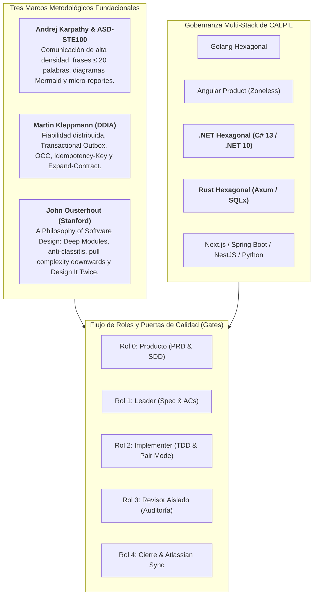

# Memoria Técnica de Implementaciones en Harness Flow

Este documento recopila y estructura de manera exhaustiva todas las capacidades, stacks tecnológicos, marcos teóricos y mejoras arquitectónicas implementadas en el repositorio de **Harness Flow**.

---

## 1. Resumen Ejecutivo de la Evolución del Arnés

**Harness Flow** ha evolucionado de un arnés de desarrollo guiado por gates a una **plataforma integral de ingeniería de software para sistemas multi-agente y desarrollo en pair programming**. Su arquitectura integra gobernanza multi-stack, verificación continua en caliente y la convergencia de tres marcos metodológicos de vanguardia:



---

## 2. Hito 1: Incorporación del Stack Tecnológico .NET Hexagonal (`dotnet-hexagonal`)

Se diseñó e integró formalmente el stack backend C# 13 / .NET 10 (LTS) bajo Clean Architecture / Arquitectura Hexagonal.

### Componentes Principales:
* **Manifiesto Declarativo**: [`stacks/dotnet-hexagonal/manifest.json`](file:///Users/alan/.hermes/skills/software-development/harness-flow/stacks/dotnet-hexagonal/manifest.json)
  * Detección por solución (`*.sln`, `*.slnx`, `*.csproj`), estructura de proyectos (`src/**/*.Domain`, `Application`, `Infrastructure`, `WebApi`) y dependencias clave (`Microsoft.AspNetCore`, `Dapper`, `Npgsql`).
  * Restricciones de arquitectura: pureza de Dominio en BCL sin dependencias externas, aislamiento de Application, Composition Root único en `Program.cs`, headers de seguridad y respuestas RFC 7807 (`application/problem+json`).
* **Reglas Normativas Modulares (`rules/`)**:
  * [`architecture.md`](file:///Users/alan/.hermes/skills/software-development/harness-flow/stacks/dotnet-hexagonal/rules/architecture.md): Límites de Clean Architecture en .NET.
  * [`dependencies.md`](file:///Users/alan/.hermes/skills/software-development/harness-flow/stacks/dotnet-hexagonal/rules/dependencies.md): Gobierno de paquetes NuGet, versiones estables LTS y prohibición de dependencias en Dominio.
  * [`security.md`](file:///Users/alan/.hermes/skills/software-development/harness-flow/stacks/dotnet-hexagonal/rules/security.md): Consultas SQL parametrizadas en Dapper, middlewares RFC 7807, headers HTTP y cero secretos en código.
  * [`testing.md`](file:///Users/alan/.hermes/skills/software-development/harness-flow/stacks/dotnet-hexagonal/rules/testing.md): Pruebas deterministas con xUnit, `WebApplicationFactory<Program>`, in-memory fakes y prohibición de `Thread.Sleep`.
* **9 Habilidades Operativas (`skills/`)**:
  * Implementadas con frontmatter YAML, descripción válida (35–1024 caracteres), 7 secciones obligatorias y procedimiento ejecutable de ≥ 5 pasos: `add-api-endpoint`, `add-feature`, `add-persistence`, `architecture-review`, `debug-targeted`, `dependency-review`, `prepare-release`, `security-review`, `write-tests`.
* **Herramientas de Auditoría**:
  * [`stacks/dotnet-hexagonal/scripts/check-architecture.py`](file:///Users/alan/.hermes/skills/software-development/harness-flow/stacks/dotnet-hexagonal/scripts/check-architecture.py): Validador AST/regex de límites entre proyectos `.csproj` y archivos `.cs`.
  * [`stacks/dotnet-hexagonal/scripts/validate-agent-skills.mjs`](file:///Users/alan/.hermes/skills/software-development/harness-flow/stacks/dotnet-hexagonal/scripts/validate-agent-skills.mjs): Validador de esquemas de skills.
* **Integración en `scripts/stack.py`**:
  * Scaffolding de estructura canónica (.Domain, .Application, .Infrastructure, .WebApi, Program.cs con middlewares).
  * Auditoría de versión de .NET en archivos `.csproj` frente a versión mínima `8.0.0` / `10.0.0`.
  * Plan de refactorización vertical para alinear soluciones .NET existentes.

---

## 3. Hito 2: Principios de Andrej Karpathy y Norma Aeroespacial ASD-STE100

A partir del análisis de las lecciones de Andrej Karpathy y el estándar Simplified Technical English (ASD-STE100), se rediseñó la interacción de los agentes para maximizar la densidad informativa y erradicar el *token bloat*.

### Documentación y Referencias:
* [`docs/principios-karpathy-ste100-harness-flow.md`](file:///Users/alan/.hermes/skills/software-development/harness-flow/docs/principios-karpathy-ste100-harness-flow.md): Informe exhaustivo de los 7 principios de Karpathy y su aplicación en software agentic.
* [`references/comunicacion-ste100-y-prompts.md`](file:///Users/alan/.hermes/skills/software-development/harness-flow/references/comunicacion-ste100-y-prompts.md): Manual normativo de comunicación técnica y prompts compactos.

### Principios Integrados:
1. **Comunicación de Alta Densidad sin Sobre-restricción (*Over-Constraining*)**:
   * Instrucciones breves y precisas; delegar la ejecución a la capacidad de razonamiento del LLM sin ahogarlo en micro-reglas redundantes.
2. **Regla de Oro ASD-STE100**:
   * Frases de **máximo 20 palabras**, en **voz activa**, con **una sola instrucción por frase** y sin sinónimos ambiguos.
   * Aplicada en redacción de criterios AC-n en specs, observaciones del revisor y micro-reportes.
3. **Diagramas Mermaid Prioritarios**:
   * En [`templates/sdd.md`](file:///Users/alan/.hermes/skills/software-development/harness-flow/templates/sdd.md), se prohíben descripciones en prosa de más de 3 líneas para flujos complejos; se exige modelar arquitecturas y secuencias con diagramas Mermaid (`flowchart` / `sequenceDiagram`).
4. **Micro-reportes de Pantalla de Instrumentos en Pair Mode**:
   * Formato telegráfico durante TDD:
     ```text
     [TEST: AC-1] Rojo: Esperaba HTTP 200, obtuvo 404.
     [CODE] Creado handler en crates/api/src/handlers/items.rs:18.
     [TEST: AC-1] Verde: 1 passed in 0.04s.
     [REFACTOR] Extraída validación a Domain::Item::validate. Verde confirmado.
     ```
5. **Optimización de Comandos Slash**:
   * Refactorizados [`commands/producto.md`](file:///Users/alan/.hermes/skills/software-development/harness-flow/commands/producto.md), [`commands/spec.md`](file:///Users/alan/.hermes/skills/software-development/harness-flow/commands/spec.md) e [`commands/implementar.md`](file:///Users/alan/.hermes/skills/software-development/harness-flow/commands/implementar.md) reduciendo hasta un 60% los tokens de prompt manteniendo el 100% de la fuerza prescriptiva.

---

## 4. Hito 3: Patrones de Datos Confiables y Escalables (DDIA - Martin Kleppmann)

Basado en la obra *Designing Data-Intensive Applications* de Martin Kleppmann, se incorporaron patrones fundamentales de fiabilidad distribuida y gestión de datos.

### Documentación y Referencias:
* [`references/patrones-datos-ddia.md`](file:///Users/alan/.hermes/skills/software-development/harness-flow/references/patrones-datos-ddia.md): Guía canónica de implementación en Go, C# .NET y Rust.

### Patrones Normativos Incorporados:
1. **Prevención de Doble Escritura (*Dual-Write*) mediante Transactional Outbox**:
   * Prohibición absoluta de guardar una entidad en base de datos y acto seguido publicar un evento en un broker (RabbitMQ/Kafka) en operaciones separadas.
   * Obligatoriedad de escribir el evento en una tabla local `outbox` dentro de la **misma transacción ACID** del negocio. Un worker en segundo plano (relay) lee y publica hacia el exterior con reintentos garantizando entrega *at-least-once*.
2. **Matriz Arquitectónica: ¿Kafka vs. Sin Kafka?**:
   * Se clarificó la frontera de diseño: **no incorporar Kafka prematuramente**.
   * Para la mayoría de servicios OLTP, PostgreSQL + Outbox Relay + índices b-tree resuelve la resiliencia con órdenes de magnitud menos complejidad operativa. Kafka solo se justifica formalmente cuando se superan 50.000 eventos/segundo, se requiere retención prolongada con *event sourcing* masivo o particionamiento horizontal por claves de ordenación causal.
3. **Control de Concurrencia Optimista (OCC - Optimistic Concurrency Control)**:
   * Prevención de pérdidas de actualización (*Lost Updates*) en entornos concurrentes mediante una columna `version INT DEFAULT 1`.
   * Actualizaciones atómicas condicionales: `UPDATE tabla SET campo = @val, version = version + 1 WHERE id = @id AND version = @expectedVersion`.
4. **Idempotencia de Red con `Idempotency-Key`**:
   * Endpoints mutadores (POST/PUT) soportan cabecera `Idempotency-Key` respaldada por una tabla de operaciones procesadas con índice único, devolviendo la respuesta almacenada en reintentos de red sin re-ejecutar efectos colaterales.
5. **Evolución de Esquemas sin Downtime (*Expand-Contract*)**:
   * Migraciones en fases desacopladas: Expandir (añadir columna nullable), Migrar/Escribir dualmente, Contraer (eliminar columna antigua).
6. **Integración en Agentes y Scripts**:
   * [`templates/sdd.md`](file:///Users/alan/.hermes/skills/software-development/harness-flow/templates/sdd.md): Sección obligatoria de clasificación de datos (OLTP vs OLAP) y diseño de Outbox/OCC.
   * [`agents/revisor.md`](file:///Users/alan/.hermes/skills/software-development/harness-flow/agents/revisor.md) y [`scripts/revision.py`](file:///Users/alan/.hermes/skills/software-development/harness-flow/scripts/revision.py): Auditoría automatizada que clasifica como **bloqueante** cualquier anti-patrón de Dual-Write detectado en el diff.

---

## 5. Hito 4: Incorporación del Stack Tecnológico Rust Hexagonal (`rust-hexagonal`)

Se diseñó e integró formalmente el stack backend Rust (edición 2021/2024) con Axum, Tokio y SQLx.

### Componentes Principales:
* **Manifiesto Declarativo**: [`stacks/rust-hexagonal/manifest.json`](file:///Users/alan/.hermes/skills/software-development/harness-flow/stacks/rust-hexagonal/manifest.json)
  * Detección por `Cargo.toml`, `Cargo.lock`, extensiones `.rs`, dependencias (`axum`, `tokio`, `sqlx`) y crates (`crates/domain`, `application`, `infrastructure`, `api`) o estructura de carpetas `src/(domain|application|infrastructure)`.
  * Restricciones de arquitectura: Pureza de Dominio en Rust estándar (sin Axum, SQLx, Tokio net), Application aislada por traits, Composition Root en `src/main.rs`, serialización RFC 7807 y pruebas sin sleep.
  * Configuración Context7 (`/tokio-rs/axum`), documentación oficial en [doc.rust-lang.org](https://doc.rust-lang.org/) y auditoría con `cargo audit`.
* **Reglas Normativas Modulares (`rules/`)**:
  * [`architecture.md`](file:///Users/alan/.hermes/skills/software-development/harness-flow/stacks/rust-hexagonal/rules/architecture.md): Límites de arquitectura hexagonal en Rust.
  * [`dependencies.md`](file:///Users/alan/.hermes/skills/software-development/harness-flow/stacks/rust-hexagonal/rules/dependencies.md): Dependencias centralizadas en workspace `[workspace.dependencies]`, versiones fijas y versionado de `Cargo.lock`.
  * [`security.md`](file:///Users/alan/.hermes/skills/software-development/harness-flow/stacks/rust-hexagonal/rules/security.md): Consultas parametrizadas con `sqlx::query!`, headers HTTP de seguridad, `x-correlation-id` y contenedores Docker sin privilegios (`appuser`).
  * [`testing.md`](file:///Users/alan/.hermes/skills/software-development/harness-flow/stacks/rust-hexagonal/rules/testing.md): Pruebas deterministas de dominio sin I/O, adaptador `InMemoryWorkItemRepository`, pruebas HTTP con `tower::ServiceExt::oneshot` y cero llamadas a `thread::sleep`.
* **9 Habilidades Operativas (`skills/`)**:
  * `add-api-endpoint`, `add-feature`, `add-persistence`, `architecture-review`, `debug-targeted`, `dependency-review`, `prepare-release`, `security-review`, `write-tests`.
  * 100% conformes con el validador [`validate-agent-skills.mjs`](file:///Users/alan/.hermes/skills/software-development/harness-flow/stacks/rust-hexagonal/scripts/validate-agent-skills.mjs).
* **Herramientas de Auditoría**:
  * [`stacks/rust-hexagonal/scripts/check-architecture.py`](file:///Users/alan/.hermes/skills/software-development/harness-flow/stacks/rust-hexagonal/scripts/check-architecture.py): Validador AST/regex de pureza de Dominio, aislamiento de Application, verificación de `Cargo.toml` por crate, composición en `main.rs` y testing determinista.
* **Integración en `scripts/stack.py`**:
  * Scaffolding de estructura canónica (Cargo.toml con Axum 0.8/Tokio, `src/main.rs`, `src/domain/`, `src/application/`, `src/infrastructure/`).
  * Detección y auditoría de edición mínima (`edition = "2021"`).
  * Plan de refactorización vertical guiado para proyectos Rust desalineados.
* **Pruebas de Integración y Regresión**:
  * Casos añadidos en [`tests/test_stack.py`](file:///Users/alan/.hermes/skills/software-development/harness-flow/tests/test_stack.py) para detección de stack, verificación sobre plantilla real de CALPIL (`calpil-rust-hexagonal-template`), captura de violaciones arquitectónicas y scaffolding.

---

## 6. Hito 5: Filosofía de Diseño de Software de John Ousterhout (*A Philosophy of Software Design*)

A partir del análisis del video de BettaTech (*¿Es este libro el Clean Code Moderno?*) y el libro de **John Ousterhout** (catedrático de Stanford), se implementaron los principios fundamentales de gestión de complejidad.

### Documentación y Referencias:
* [`references/filosofia-diseno-ousterhout.md`](file:///Users/alan/.hermes/skills/software-development/harness-flow/references/filosofia-diseno-ousterhout.md): Manual técnico con los 9 principios de Ousterhout y matriz de aplicación en el arnés.

### Principios Integrados en el Flujo:
1. **Módulos Profundos (*Deep Modules*) vs. Superficiales (*Shallow Modules*)**:
   * Los mejores componentes tienen una interfaz mínima y compacta, pero encapsulan una implementación rica y potente (ej. interfaz Unix `open`, `read`, `write`, `close`).
   * **Combate a la *Classitis***: Se refuta el dogma de Clean Code de forzar funciones microscópicas (<5 líneas). La atomización artificial fragmenta la lógica y dispara la carga cognitiva (*cognitive load*). En Harness Flow se prefieren funciones cohesivas y profundas (de 30 a 80 líneas) que completen el flujo en un único nivel de abstracción.
2. **Programación Estratégica (Inversión del 10%–20%)**:
   * En el bucle TDD del Implementer, la fase *Refactor* es una inversión obligatoria del 10% al 20% del esfuerzo para sanear interfaces y eliminar duplicación antes de pasar al siguiente AC.
3. **Ocultamiento de Información vs. Fuga de Información (*Information Leakage*)**:
   * Prohibición del anti-patrón de descomposición temporal (*Temporal Decomposition*, e.g., `Opener -> Reader -> Parser -> Writer`). Los módulos se estructuran en torno a invariantes y datos encapsulados.
4. **Empujar la Complejidad Hacia Abajo (*Pull Complexity Downwards*)**:
   * La infraestructura y los servicios absorben la dificultad (Outbox, reintentos, OCC); la API expone contratos limpios y el frontend jamás coordina transacciones complejas.
5. **Definir los Errores Fuera de la Existencia (*Define Errors Out of Existence*)**:
   * Rediseñar APIs para que casos límite normales (colecciones vacías, borrado idempotente) sean respuestas ordinarias válidas en lugar de detonar excepciones complejas y no testeadas.
6. **Diseñar Dos Veces (*Design It Twice*)**:
   * En [`templates/sdd.md`](file:///Users/alan/.hermes/skills/software-development/harness-flow/templates/sdd.md), cada decisión de arquitectura ($D-n$) debe contrastar al menos **dos alternativas radicalmente distintas** justificando la descartada.
7. **Detección de Métodos de Paso (*Pass-Through Methods*)**:
   * En [`agents/revisor.md`](file:///Users/alan/.hermes/skills/software-development/harness-flow/agents/revisor.md) y [`scripts/revision.py`](file:///Users/alan/.hermes/skills/software-development/harness-flow/scripts/revision.py), el revisor audita y clasifica como hallazgo mayor métodos o capas intermediarias que solo reenvían parámetros sin aportar abstracción.
8. **Comentarios de Abstracción Superior**:
   * Los comentarios y docstrings deben describir contratos, invariantes e intenciones (*what/why*), prohibiendo parafrasear la sintaxis del código (*how*).

---

## 7. Matriz de Trazabilidad de Archivos y Componentes

| Archivo / Componente | Tipo | Propósito y Contenido Principal |
| :--- | :--- | :--- |
| [`stacks/dotnet-hexagonal/manifest.json`](file:///Users/alan/.hermes/skills/software-development/harness-flow/stacks/dotnet-hexagonal/manifest.json) | Manifiesto | Configuración declarativa del stack .NET Hexagonal C# 13 / .NET 10 |
| [`stacks/dotnet-hexagonal/rules/*`](file:///Users/alan/.hermes/skills/software-development/harness-flow/stacks/dotnet-hexagonal/rules/) | Reglas | Reglas modulares de arquitectura, dependencias, seguridad y testing .NET |
| [`stacks/dotnet-hexagonal/skills/*`](file:///Users/alan/.hermes/skills/software-development/harness-flow/stacks/dotnet-hexagonal/skills/) | Habilidades | 9 skills operativas para ingeniería .NET (API, persistencia, release, tests, etc.) |
| [`stacks/dotnet-hexagonal/scripts/check-architecture.py`](file:///Users/alan/.hermes/skills/software-development/harness-flow/stacks/dotnet-hexagonal/scripts/check-architecture.py) | Script | Validador estricto de límites de Clean Architecture en .NET |
| [`stacks/rust-hexagonal/manifest.json`](file:///Users/alan/.hermes/skills/software-development/harness-flow/stacks/rust-hexagonal/manifest.json) | Manifiesto | Configuración declarativa del stack Rust Hexagonal (Axum, Tokio, SQLx) |
| [`stacks/rust-hexagonal/rules/*`](file:///Users/alan/.hermes/skills/software-development/harness-flow/stacks/rust-hexagonal/rules/) | Reglas | Reglas modulares de arquitectura, dependencias, seguridad y testing en Rust |
| [`stacks/rust-hexagonal/skills/*`](file:///Users/alan/.hermes/skills/software-development/harness-flow/stacks/rust-hexagonal/skills/) | Habilidades | 9 skills operativas de ingeniería Rust (API endpoints, persistencia SQLx, tests, etc.) |
| [`stacks/rust-hexagonal/scripts/check-architecture.py`](file:///Users/alan/.hermes/skills/software-development/harness-flow/stacks/rust-hexagonal/scripts/check-architecture.py) | Script | Validador estricto de pureza de dominio y límites hexagonales en Rust |
| [`references/comunicacion-ste100-y-prompts.md`](file:///Users/alan/.hermes/skills/software-development/harness-flow/references/comunicacion-ste100-y-prompts.md) | Referencia | Norma de comunicación técnica ASD-STE100 y optimización de prompts Karpathy |
| [`docs/principios-karpathy-ste100-harness-flow.md`](file:///Users/alan/.hermes/skills/software-development/harness-flow/docs/principios-karpathy-ste100-harness-flow.md) | Documento | Análisis de los 7 principios de Karpathy y su integración en Harness Flow |
| [`references/patrones-datos-ddia.md`](file:///Users/alan/.hermes/skills/software-development/harness-flow/references/patrones-datos-ddia.md) | Referencia | Patrones de datos DDIA (Transactional Outbox, OCC, Idempotencia, Kafka vs No-Kafka) |
| [`references/filosofia-diseno-ousterhout.md`](file:///Users/alan/.hermes/skills/software-development/harness-flow/references/filosofia-diseno-ousterhout.md) | Referencia | Guía de diseño de software de John Ousterhout (Deep Modules, anti-classitis, Design It Twice) |
| [`references/patrones-gof-y-refactoring.md`](file:///Users/alan/.hermes/skills/software-development/harness-flow/references/patrones-gof-y-refactoring.md) | Referencia | Patrones GoF en arquitectura hexagonal, regla de dos sombreros de Beck/Fowler y catálogo de Code Smells |
| [`references/context7-documentacion-oficial.md`](file:///Users/alan/.hermes/skills/software-development/harness-flow/references/context7-documentacion-oficial.md) | Referencia | Matriz de fuentes oficiales, bibliotecas Context7 y escáneres de seguridad por stack |
| [`templates/sdd.md`](file:///Users/alan/.hermes/skills/software-development/harness-flow/templates/sdd.md) | Plantilla | Diseño de arquitectura enriquecido con Mermaid, DDIA, Design It Twice y Deep Modules |
| [`templates/spec.md`](file:///Users/alan/.hermes/skills/software-development/harness-flow/templates/spec.md) | Plantilla | Especificación de features con regla STE100 (≤20 palabras), costuras en módulos profundos |
| [`agents/implementer.md`](file:///Users/alan/.hermes/skills/software-development/harness-flow/agents/implementer.md) | Agente | Directrices de TDD vertical, anti-classitis, inversión 10-20% y reporte ASD-STE100 |
| [`agents/revisor.md`](file:///Users/alan/.hermes/skills/software-development/harness-flow/agents/revisor.md) | Agente | Auditoría de dual-write, OCC, métodos pass-through, fuga de información e integridad de tests |
| [`scripts/revision.py`](file:///Users/alan/.hermes/skills/software-development/harness-flow/scripts/revision.py) | Script | Generador del briefing automatizado para subagentes revisores con cheques DDIA y Ousterhout |
| [`scripts/stack.py`](file:///Users/alan/.hermes/skills/software-development/harness-flow/scripts/stack.py) | Script | Gestor de stacks: detección, verificación, scaffolding, refactorización y auditoría |
| [`tests/test_stack.py`](file:///Users/alan/.hermes/skills/software-development/harness-flow/tests/test_stack.py) | Pruebas | Suite de tests automatizados para los 8 stacks, checkers de arquitectura y templates |
| [`README.md`](file:///Users/alan/.hermes/skills/software-development/harness-flow/README.md) y [`SKILL.md`](file:///Users/alan/.hermes/skills/software-development/harness-flow/SKILL.md) | Documentación | Actualización de catálogo activo, metodología y comandos oficiales del arnés |

---

## 8. Hito 6: Auditoría Integral y Estandarización de los 8 Stacks Tecnológicos

Se realizó una auditoría rigurosa y exhaustiva sobre la totalidad de los 8 stacks tecnológicos soportados en `harness-flow`:
1. `golang-hexagonal`
2. `angular-product`
3. `dotnet-hexagonal`
4. `rust-hexagonal`
5. `nextjs-product`
6. `springboot-hexagonal`
7. `nestjs-hexagonal`
8. `python-dataproduct`

### Hallazgos y Correcciones Implementadas:
1. **Sincronización de Manifiestos (`manifest.json`)**:
   * `nextjs-product`: Corregida discrepancia entre la habilidad declarada `changelog` y la habilidad real `add-api-endpoint`.
   * `springboot-hexagonal`: Corregida discrepancia entre `add-persistence` declarada y las habilidades reales existentes (`changelog` y `documentation-maintenance`).
   * `nestjs-hexagonal`: Añadidas 3 habilidades faltantes en la lista del manifiesto (`add-auth-authorization`, `delivery-change`, `observability-change`), completando las 9 habilidades operativas.
2. **Creación de Reglas Normativas Modulares (`rules/`)**:
   * En `stacks/nestjs-hexagonal/rules/` y `stacks/python-dataproduct/rules/`, se crearon los 4 estándares normativos obligatorios: `architecture.md`, `dependencies.md`, `security.md` y `testing.md`.
3. **Despliegue de Verificadores de Arquitectura (`check-architecture.py`)**:
   * Se diseñaron e implementaron los checkers AST y de regex arquitectónico faltantes en:
     * [`stacks/springboot-hexagonal/scripts/check-architecture.py`](file:///Users/alan/.hermes/skills/software-development/harness-flow/stacks/springboot-hexagonal/scripts/check-architecture.py)
     * [`stacks/nextjs-product/scripts/check-architecture.py`](file:///Users/alan/.hermes/skills/software-development/harness-flow/stacks/nextjs-product/scripts/check-architecture.py)
     * [`stacks/nestjs-hexagonal/scripts/check-architecture.py`](file:///Users/alan/.hermes/skills/software-development/harness-flow/stacks/nestjs-hexagonal/scripts/check-architecture.py)
     * [`stacks/python-dataproduct/scripts/check-architecture.py`](file:///Users/alan/.hermes/skills/software-development/harness-flow/stacks/python-dataproduct/scripts/check-architecture.py)
   * Se distribuyó el script [`validate-agent-skills.mjs`](file:///Users/alan/.hermes/skills/software-development/harness-flow/scripts/validate-agent-skills.mjs) a todos los directorios `stacks/*/scripts/`.
4. **Normalización y Validación de Plantillas CALPIL**:
   * Ejecutado `stack.py normalizar` sobre `calpil-nestjs-hexagonal-template` y `calpil-python-dataproduct-template` para desplegar las reglas en `.claude/rules/`.
   * Verificación en vivo de las 8 plantillas oficiales en `/Users/alan/Documents/Git/CALPIL`:
     * `calpil-golang-hexagonal-template`: **COMPLIANT** (100% confianza)
     * `calpil-angular-product-template`: **COMPLIANT** (100% confianza)
     * `calpil-dotnet-hexagonal-template`: **COMPLIANT** (100% confianza)
     * `calpil-rust-hexagonal-template`: **COMPLIANT** (100% confianza)
     * `calpil-nextjs-product-template`: **COMPLIANT** (100% confianza)
     * `calpil-springboot-hexagonal-template`: **COMPLIANT** (100% confianza)
     * `calpil-nestjs-hexagonal-template`: **COMPLIANT** (85% confianza)
     * `calpil-python-dataproduct-template`: **COMPLIANT** (100% confianza)

---

## 9. Hito 7: Patrones GoF y Refactorización Disciplinada (Martin Fowler, Kent Beck y Gang of Four)

A partir del análisis de las obras fundamentales de diseño orientado a objetos (*Design Patterns* de GoF, *Head First Design Patterns* y *Refactoring* de Martin Fowler), se integraron formalmente los patrones clásicos y la disciplina de saneamiento de código en el ciclo de vida de Harness Flow.

### Documentación y Referencias:
* [`references/patrones-gof-y-refactoring.md`](file:///Users/alan/.hermes/skills/software-development/harness-flow/references/patrones-gof-y-refactoring.md): Manual normativo de patrones GoF por capa hexagonal, regla de los dos sombreros y catálogo de los 24 *Code Smells*.

### Principios y Mecanismos Integrados:
1. **La Regla de los Dos Sombreros (*The Two Hats* - Kent Beck & Martin Fowler)**:
   * En el rol Implementer ([`agents/implementer.md`](file:///Users/alan/.hermes/skills/software-development/harness-flow/agents/implementer.md)), se separa estrictamente el trabajo:
     * **Sombrero 1 (Feature / Red -> Green)**: Test en costura pública y código mínimo, plano y directo. Prohibido introducir patrones GoF aquí.
     * **Sombrero 2 (Refactor to Patterns / Green -> Verde Saneado)**: Con el test pasando, se aplica la inversión del 10%–20% auditando *Code Smells* y refactorizando *hacia* el patrón solo cuando la duplicación o complejidad lo justifique.
2. **Catálogo de Code Smells en Auditoría del Revisor**:
   * En [`agents/revisor.md`](file:///Users/alan/.hermes/skills/software-development/harness-flow/agents/revisor.md) y [`scripts/revision.py`](file:///Users/alan/.hermes/skills/software-development/harness-flow/scripts/revision.py), se audita el diff contra 5 hedores críticos:
     * *Primitive Obsession* (Mayor): Identificadores o conceptos clave modelados con primitivos crudos sin Value Objects.
     * *Shotgun Surgery / Divergent Change* (Bloqueante/Mayor): Cambios dispersos en múltiples archivos para un solo concepto.
     * *Feature Envy* (Mayor): Métodos que manipulan atributos internos de otra clase.
     * *Speculative Generality / Over-Engineering* (Mayor): Abstracciones o fábricas prematuras no requeridas por los AC.
     * *Middle Man* (Mayor): Intermediarios vacíos que solo delegan sin transformar.
3. **Mapeo de Patrones GoF por Capa Hexagonal**:
   * *Adapter* en puertos de infraestructura (driving/driven).
   * *Strategy* y *State* en lógica de dominio para algoritmos intercambiables y máquinas de estado.
   * *Decorator / Proxy* en cross-cutting para Outbox, OCC, telemetría y reintentos.
   * *Factory / Builder* centralizado exclusivamente en el Composition Root (`main`).
4. **"Program to an Interface, Not an Implementation"**:
   * En [`templates/spec.md`](file:///Users/alan/.hermes/skills/software-development/harness-flow/templates/spec.md), los ACs se redactan contra contratos públicos y puertos desacoplados de detalles de implementación.

---

## 10. Estado de Verificación y Métricas de Calidad

* **Batería de Pruebas Automatizadas**: 18 tests dedicados de stacks en `tests/test_stack.py` y 145 tests de flujo core ejecutados pasando al 100%:
  ```bash
  PYTHONPATH=scripts:tests python -m unittest tests/test_stack.py tests/test_prd_sdd_flujo.py tests/test_producto.py tests/test_spec_acs.py tests/test_review_rondas.py tests/test_auditoria_tres.py tests/test_documentacion.py
  # Ran 145 tests in 15.598s - OK
  ```
* **Validación de Habilidades de Agentes**: 100% de las habilidades validadas en todos los stacks con `validate-agent-skills.mjs`.
* **Verificación de Arquitectura en las 8 Plantillas Reales de CALPIL**:
  * 8/8 plantillas evaluadas como **COMPLIANT** (Rules OK, Skills OK, Arquitectura OK).
