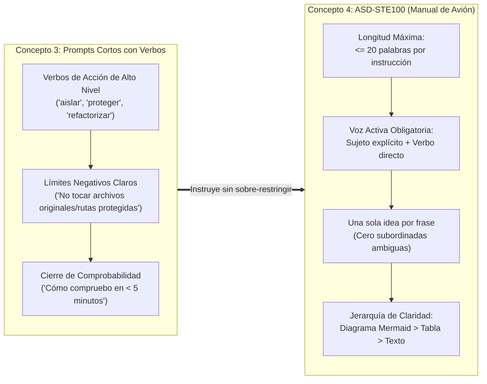
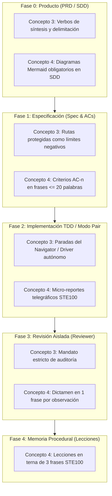

# Principios de Karpathy y Comunicación Aeroespacial ASD-STE100 en Harness Flow

Documento de análisis y guía de aplicación de los principios operativos de Andrej Karpathy para ingeniería con IA, con foco prioritario en el **Concepto 3 (Prompts cortos con verbos de alta densidad semántica)** y el **Concepto 4 (Explicación técnica estricta bajo norma ASD-STE100)** a lo largo de las distintas fases del arnés: PRD, SDD, Specs, Implementación TDD en Modo Pair, Revisión Aislada y Memoria Procedural.

---

## 1. Contexto y Fuentes Originales

El análisis se fundamenta en las declaraciones y flujos de trabajo compartidos por **Andrej Karpathy** (cofundador de OpenAI, ex-Director de IA en Tesla y educador) en X y Hacker News entre octubre y noviembre de 2026, condensados por Fran Salazar en:
- **Video:** [Cómo el ingeniero de IA #1 del mundo usa la IA](https://www.youtube.com/watch?v=qdYPYvqP0Yo)
- **Guía:** [Cómo usa la IA Andrej Karpathy: 7 principios con prompts para copiar](https://docs.google.com/document/d/1dQywZeVFDzVmGYEI3x6ZJ0jEsDZ4-aJTEIXNURlYfZg/edit?tab=t.0)

### Resumen de los 7 Principios de Karpathy

| # | Principio | Enfoque Central |
| :--- | :--- | :--- |
| **1** | **El director, no el operario** | Revisar cuesta mucho menos que producir. El humano juzga y aprueba; el agente ejecuta. Delimitar siempre lo que NO se puede tocar. |
| **2** | **Esfuerzo medio, no máximo** | Usar esfuerzo medio (`/effort medium`) por defecto para evitar sobre-pensamiento innecesario; subir a alto/máximo solo tras 2 fallos o en decisiones críticas. |
| **3** | **Prompts cortos, con verbos** | "Cada vez más cortos y más tontos". No sobre-restringir el modelo; usar verbos de alta densidad semántica y exigir comprobabilidad en < 5 min. |
| **4** | **Manual de avión (ASD-STE100)** | Estándar aeroespacial de inglés técnico simplificado: frases de máximo 20 palabras, voz activa, una sola idea por frase y diagramas sobre texto. |
| **5** | **Tus pruebas valen más que los benchmarks** | Desconfiar de benchmarks sintéticos públicos. Evaluar con tareas reales del propio trabajo diario. |
| **6** | **El software es envoltorio, lo que vale son los datos** | El código es efímero y barato de regenerar; la ventaja competitiva reside en los datos curados. |
| **7** | **Modelo caro que dirige, modelo barato que trabaja** | Modelo de frontera (Opus/Astra) para planificar y filtrar; modelo ágil (Sonnet/Haiku/Flash) para ejecutar volumen en paralelo. |

---

## 2. Análisis Profundo de los Conceptos Prioritarios



---

### Concepto 3: Prompts Cortos, con Verbos (Evitar la Sobre-restricción)

#### La Mecánica Cognitiva del LLM
Cuando se alimenta a un modelo con prompts gigantescos llenos de micro-requisitos condicionales y extensas listas de "cosas a tener en cuenta", se produce el fenómeno de **sobre-restricción (*over-constraining*)**:
1. El modelo divide su atención (*attention heads*) entre restricciones superficiales y la lógica de fondo.
2. Aumenta la probabilidad de parálisis, alucinación defensiva o pérdida del objetivo central en contextos largos.
3. Se desperdicia la capacidad pre-entrenada del modelo. Los LLMs de frontera ya dominan los estándares de la industria; un verbo técnico preciso como *"endurecer"* (`harden`), *"aislar"* (`isolate`) o *"normalizar"* (`normalize`) activa un subespacio semántico con decenas de mejores prácticas asociadas que no es necesario enumerar una a una.

#### La Estructura Canónica del Prompt Karpathy
Un prompt efectivo bajo esta norma posee tres elementos exactos:
1. **Objetivo en 3 a 6 verbos de acción:** *"Revisa, aísla, refactoriza y testea el endpoint de órdenes."*
2. **Límites negativos explícitos:** Qué NO tiene permitido tocar el agente (evita daños colaterales y cambios no deseados).
3. **Cierre de comprobabilidad inmediata:** *"Dime qué hiciste, qué decisiones tomaste por tu cuenta y cómo lo compruebo en menos de 5 minutos."*

---

### Concepto 4: Explicación Técnica Estricta (ASD-STE100)

#### Origen y Propósito
El estándar **ASD-STE100** (*Simplified Technical English*) fue desarrollado por la Asociación Europea de Industrias Aeroespaciales y de Defensa para manuales de mantenimiento de aviones comerciales y militares. Su premisa es simple: **en un manual técnico, la ambigüedad y la palabrería causan accidentes fatales**.

Los modelos de lenguaje tienden por defecto a la verborrea (*token bloat*), redactando párrafos decorativos y explicaciones redundantes. La norma STE100 corta de raíz la paja y eleva al máximo la densidad de información.

#### Las 4 Reglas de Oro en Español Técnico
1. **Longitud Estricta de Frases:**
   - Máximo **20 palabras** en instrucciones y criterios de aceptación.
   - Máximo **25 palabras** en descripciones arquitectónicas y contexto.
2. **Voz Activa Permanente:**
   - Siempre se nombra qué componente, servicio o actor realiza la acción.
   - ❌ *La orden será cancelada si el inventario resulta insuficiente.* (Pasiva).
   - ✅ *El servicio de inventario rechaza la orden con saldo cero.* (Activa, 10 palabras).
3. **Una Sola Idea por Frase:**
   - Prohibidas las oraciones compuestas con múltiples conectores coordinados ("y", "además", "donde a su vez").
4. **Término Único para el Mismo Concepto:**
   - Cero variedad estilística con sinónimos. Si la entidad se llama `WorkItem`, se denomina siempre `WorkItem`, nunca "tarea", "asunto", "registro" o "ticket".
5. **Prevalencia del Diagrama sobre la Prosa:**
   - Escala de Karpathy: `Diagrama interactivo / Mermaid > Tabla de estados > Texto plano`. Si una interacción involucra a más de dos capas o componentes, el texto se reemplaza por un diagrama.

---

## 3. Matriz de Aplicación en las Fases de Harness Flow



---

### Fase 0: Producto — PRD y SDD (`scripts/producto.py`)

#### Aplicación del Concepto 3 (Prompt de Generación)
Al inicializar o refinar el PRD/SDD, el usuario y el orquestador utilizan mandatos concisos de verbos directos:

```text
Sintetiza, delimita y estructura el PRD para [funcionalidad].
Define los datos de entrada, los datos de salida y genera las candidatas F-1..F-n.
Al terminar, indícame cómo compruebo cada candidata en menos de 5 minutos.
No toques arquitectura técnica ni selecciones de base de datos todavía.
```

#### Aplicación del Concepto 4 (Estructura de `docs/sdd.md`)
- **Prohibición de Prosa Larga:** Prohibidos párrafos explicativos de más de 3 líneas.
- **Diagramas de Secuencia y Arquitectura Obligatorios:** Los flujos entre adaptadores, casos de uso y dominio se modelan en diagramas Mermaid.
- **Registro de Decisiones (ADR):** Cada decisión arquitectónica se redacta en exactamente 3 frases activas:
  1. *Problema:* Qué limitación o requerimiento fuerza la decisión.
  2. *Decisión:* Qué componente o patrón se adopta.
  3. *Consecuencia:* Qué compromiso o compensación (*trade-off*) se asume.

---

### Fase 1: Especificación de Features — Spec & ACs (`templates/spec.md`)

#### Aplicación del Concepto 4 en Criterios de Aceptación (AC-n)
Los criterios de aceptación son la piedra angular de la verificación determinista en Harness Flow (`gate.py verify`). Cada AC debe ser una instrucción atómica bajo ASD-STE100:

| Tipo de Redacción | Ejemplo | Evaluación |
| :--- | :--- | :--- |
| **❌ Anti-patrón Verboso** (34 palabras) | *"Cuando el usuario final ingrese al sistema mediante el formulario de autenticación habiendo ingresado credenciales incorrectas, el sistema deberá capturar el evento y desplegar una alerta visual de error de tipo RFC 7807 sin exponer el stack trace."* | Ambigua, mezcla transporte, UI y seguridad en una frase pasiva. |
| **✅ Norma ASD-STE100** (3 frases de <= 10 palabras) | 1. *El controlador rechaza credenciales inválidas.*<br>2. *El controlador devuelve HTTP 401 con RFC 7807.*<br>3. *La respuesta oculta el stack trace y detalles internos.* | Precisa, atómica, directamente traducible a pruebas unitarias y de integración. |

#### Aplicación del Concepto 3 en Límites de la Feature
El spec delimita explícitamente los **límites negativos** de Karpathy:
- **Rutas Prohibidas:** `docs/prd/**`, `docs/sdd.md`, `.env`, archivos de otras features.
- **Cierre de Verificación:** Costura pública exacta (`archivo:línea`) donde se valida cada AC.

---

### Fase 2: Implementación TDD y Modo Pair (`commands/implementar.md`)

#### Aplicación del Concepto 4 en Micro-Reportes de Pair Mode
Durante el ciclo TDD (`1 test -> Red -> código mínimo -> Green -> Refactor`), el agente actúa como Driver y emite su reporte de avance. Siguiendo a Karpathy, se prohíbe el texto conversacional y se adopta el formato de **pantalla de instrumentos**:

```markdown
✅ Pasa: "WorkItemRepository_Save_PersistsRecord"
⚙️ Decisión: Usar Dapper con parámetro tipado @Id.
🔍 Comprobación: dotnet test --filter Name=WorkItemRepository_Save (65ms).
❓ ¿Seguimos con "WorkItemService_Create"?
```

#### Aplicación del Concepto 3 en Instrucciones del Navigator
El usuario puede comandar ráfagas de ciclos sin micro-gestión mediante verbos agrupados:
> *"Haz 3: codifica, compila y testea los siguientes 3 casos de la lista."*

La IA avanza en los 3 ciclos sin detenerse a dar explicaciones teóricas intermedias, pausando únicamente ante las **5 paradas críticas** acordadas (decisiones no previstas, 2 fallos consecutivos sin verde, alcance no pedido, etc.).

---

### Fase 3: Reviewer Aislado (`scripts/revision.py` y `agents/revisor.md`)

#### Aplicación del Concepto 3 (Mandato de Revisión)
El briefing de revisión generado para el subagente aislado instruye con verbos directos:

```text
Audita, contrasta y dictamina la feature #<id> contra su spec y su git diff.
No propongas reescrituras cosméticas de código funcional.
Reporta únicamente fallos de criterios AC-n, roturas de arquitectura y vulnerabilidades.
Al terminar, emite veredicto: approved o changes_requested.
```

#### Aplicación del Concepto 4 (Formato de `docs/review-<id>.md`)
Las observaciones del revisor adoptan la estructura de reporte de incidentes aeronáuticos:
- `[Archivo:Línea] [Componente] [Acción requerida en <= 20 palabras]`
- *Ejemplo:* `src/Application/WorkItemService.cs:45`: *El caso de uso importa la clase concreta de infraestructura DapperWorkItemRepository. Debe depender exclusivamente de la interfaz IWorkItemRepository.*

---

### Fase 4: Memoria Procedural y Lecciones (`scripts/leccion.py`)

Las lecciones aprendidas registradas en el arnés se inyectan continuamente en los briefs de futuras sesiones (`contexto.py brief`). Si las lecciones fueran párrafos extensos, saturarían la ventana de contexto de los modelos.

#### Estructura STE100 Obligatoria (Terna de 3 Frases):
1. **Contexto / Problema (<= 15 palabras):** *En proyectos Go, time.Sleep en pruebas causa fallos intermitentes no deterministas.*
2. **Causa Raíz (<= 15 palabras):** *El planificador del sistema operativo introduce variabilidad temporal impredecible entre hilos.*
3. **Regla Operativa (<= 20 palabras):** *Sincroniza goroutines mediante canales o sync.WaitGroup en lugar de esperas de tiempo.*

---

## 4. Plantilla de Configuración para Agentes (`CLAUDE.md` / `AGENTS.md`)

Basado en el bonus de Karpathy, esta directriz sintetiza el contrato operativo para cualquier agente de codificación integrado en Harness Flow:

```markdown
# Directrices de Operación (Estándar Karpathy / STE100)

1. Rol: Tú implementas y pruebas; el usuario dirige y aprueba. No pidas que el usuario ejecute comandos o edite archivos: hazlo tú.
2. Límites Negativos: Prohibido modificar rutas protegidas (docs/prd/**, docs/sdd.md, .env) sin confirmación explícita.
3. Nivel de Esfuerzo: Opera en esfuerzo medio por defecto. Escala a alto únicamente tras dos intentos fallidos sin verde en TDD o en decisiones arquitectónicas.
4. Prompts Cortos: Interpreta verbos de acción según las mejores prácticas del stack. Pregunta solo cuando existan dos interpretaciones que alteren radicalmente la arquitectura.
5. Regla ASD-STE100: Redacta instrucciones y reportes con frases de máximo 20 palabras, voz activa y una sola idea por frase.
6. Diagramas Primero: Ante interacciones complejas entre módulos, genera diagramas Mermaid en lugar de descripciones en texto.
7. Comprobación Rápida: Al concluir una acción, reporta siempre: qué hiciste, qué decidiste por tu cuenta y cómo se comprueba en menos de 5 minutos.
```

---

## 5. Conclusión y Beneficios para Harness Flow

La integración de los **Conceptos 3 y 4 de Karpathy** en Harness Flow resuelve dos problemas fundamentales del desarrollo asistido por agentes:
1. **Elimina la sobre-restricción:** Los prompts con verbos fuertes permiten al modelo desplegar toda su competencia técnica sin verse asfixiado por micro-instrucciones rígidas.
2. **Elimina el ruido y la ambigüedad:** La norma aeroespacial ASD-STE100 garantiza que los criterios de aceptación, los micro-reportes de TDD y los informes de revisión sean 100% verificables, concisos y libres de palabrería.
