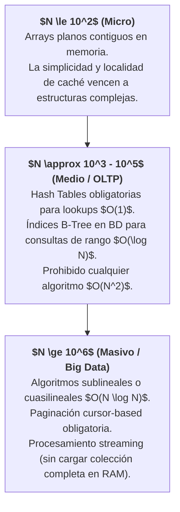
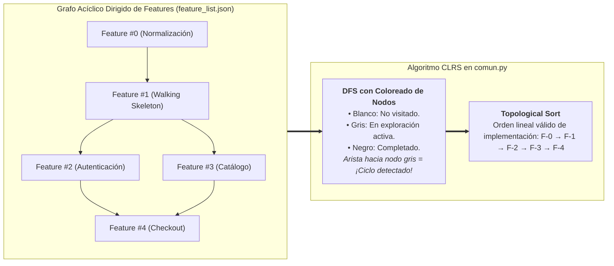

# Algoritmos y Estructuras de Datos (CLRS — Cormen, Leiserson, Rivest, Stein)

Este documento establece la normativa técnica de análisis asintótico, selección de estructuras de datos y prevención de anti-patrones algorítmicos para **Harness Flow**, fundamentado en la obra de referencia mundial:
* **Introduction to Algorithms** (*CLRS* — Thomas H. Cormen, Charles E. Leiserson, Ronald L. Rivest, Clifford Stein, MIT Press).
* Cursos oficiales **MIT 6.006** (Introduction to Algorithms) y **MIT 6.046J** (Design and Analysis of Algorithms).

---

## 1. El Principio Rector: La Escala del Problema ($N$)

La idoneidad de un algoritmo o estructura de datos depende radicalmente del **orden de magnitud de la entrada ($N$)**. Diseñar sin estimar $N$ es diseñar a ciegas:



### Regla de Oro en Harness Flow:
Todo diseño de arquitectura en el SDD y todo Criterio de Aceptación (AC) que manipule colecciones debe explicitar el orden de magnitud de $N$.

---

## 2. Complejidad Asintótica de Estructuras Fundamentales

| Estructura de Datos | Búsqueda (Promedio) | Inserción (Promedio) | Eliminación | Caso de Uso Principal en el Arnés | Anti-patrón a Evitar |
| :--- | :---: | :---: | :---: | :--- | :--- |
| **Array / Slice Contiguo** | $O(N)$ | $O(1)$ amort. al final | $O(N)$ | Colecciones pequeñas ($N<100$) o de solo lectura secuencial. | Búsqueda por clave o `contains()` en un bucle ($O(N^2)$). |
| **Hash Table (`Map`/`Dictionary`)** | $O(1)$ | $O(1)$ | $O(1)$ | Búsqueda directa por ID, cachés de idempotencia, deduplicación. | Usar claves no hashables o ignorar colisiones y degradación a $O(N)$. |
| **B-Tree / B+Tree** | $O(\log N)$ | $O(\log N)$ | $O(\log N)$ | Índices primarios y secundarios en bases de datos relacionales en disco. | Escaneos de tabla completa (*Full Table Scan*) sin índice. |
| **Binary Heap (Priority Queue)** | $O(1)$ peek | $O(\log N)$ | $O(\log N)$ extract | Planificadores de tareas, colas de reintentos con backoff, top-K. | Re-ordenar una lista completa (`Sort` $O(N \log N)$) en cada inserción. |
| **Double-Ended Queue (`Deque`)** | $O(N)$ | $O(1)$ ambos extremos | $O(1)$ | Colas FIFO de eventos o buffers circulares. | Usar arrays con `pop(0)` o `shift()` que desplazan memoria en $O(N)$. |
| **Grafo Acíclico Dirigido (DAG)** | $O(V + E)$ DFS | $O(1)$ nodo/arista | $O(V + E)$ | Dependencias de features (`requiere`), pipelines de CI/CD, Reactividad. | Ciclos no detectados que provoquen bloqueos infinitos (*Deadlocks*). |

---

## 3. Catálogo de Anti-Patrones Algorítmicos Comunes

El Implementer (Rol 2) debe evitar activamente y el Revisor (Rol 3) debe bloquear en el `git diff` los siguientes anti-patrones:

### 1. La Trampa Cuadrática Oculta: Búsqueda en Bucle Anidado ($O(N \cdot M)$)
* **El Problema**: Iterar sobre una lista y por cada elemento invocar una búsqueda lineal (`includes`, `contains`, `IndexOf`, `in`).
  ```typescript
  // INEFICIENTE: O(N * M) -> Con 10.000 items hace 100.000.000 operaciones
  const pendientes = ordenes.filter(o => idsValidados.includes(o.id));
  ```
* **Solución CLRS (Hash Set)**:
  ```typescript
  // ÓPTIMO: O(N + M) -> Con 10.000 items hace 20.000 operaciones
  const setValidados = new Set(idsValidados);
  const pendientes = ordenes.filter(o => setValidados.has(o.id));
  ```

### 2. El Problema de la Consulta $N+1$ en Persistencia
* **El Problema**: Consultar una entidad padre y luego ejecutar una query individual en base de datos por cada hijo dentro de un bucle. Multiplica la latencia de red por $N$.
* **Solución CLRS**: Ejecutar una única consulta con batching (`WHERE id IN (...)`) o un `JOIN`, reduciendo las transferencias de red a $O(1)$ llamadas.

### 3. Re-alocación Sucesiva de Memoria (*Memory Thrashing*)
* **El Problema**: Añadir elementos a un slice/vector sin pre-alocar la capacidad cuando se conoce el tamaño de antemano. Provoca sucesivas alocaciones de memoria y copias completas en el heap.
* **Solución CLRS**: Pre-alocar capacidad inicial:
  * Go: `make([]T, 0, count)`
  * Rust: `Vec::with_capacity(count)`
  * C#: `new List<T>(count)`

### 4. Concatenación Ineficiente de Cadenas en Bucles
* **El Problema**: Hacer `str += fragmento` en un bucle. Dado que los strings son inmutables en la mayoría de lenguajes, cada concatenación aloca un nuevo string y copia el anterior, generando complejidad cuadrática $O(N^2)$ en memoria.
* **Solución CLRS**: Usar buffers mutables especializados: `strings.Builder` en Go, `StringBuilder` en C#/Java, o `join` en JS/Python ($O(N)$ tiempo total).

---

## 4. Guía de Estructuras Idiomáticas por Stack

### 1. Golang (`golang-hexagonal`)
```go
// 1. Pre-alocación obligatoria cuando se conoce el tamaño
resultados := make([]domain.Order, 0, len(dtos))

// 2. Hash Set idiomático en Go (struct{} no consume memoria)
set := make(map[string]struct{}, len(ids))
for _, id := range ids {
    set[id] = struct{}{}
}
if _, exists := set[target]; exists {
    // lookup O(1)
}

// 3. Concatenación eficiente de texto
var sb strings.Builder
sb.Grow(estimadoBytes) // Pre-alocación de buffer
sb.WriteString("...")
```

### 2. TypeScript / Angular (`angular-product` / `nestjs-hexagonal`)
```typescript
// 1. Usar Map y Set nativos para lookups rápidos
const itemIndex = new Map<string, Item>(items.map(i => [i.id, i]));
const item = itemIndex.get(id); // O(1)

// 2. Evitar pop(0)/shift() en arrays gigantes; usar índices o colas
// 3. Signals: memoización automática basada en grafos de reactividad (DAG)
const filteredItems = computed(() => {
  const query = this.searchQuery().toLowerCase();
  return this.items().filter(i => i.name.toLowerCase().includes(query));
});
```

### 3. Rust (`rust-hexagonal`)
```rust
// 1. BTreeMap cuando se requiere iterar por claves ordenadas (O(log N))
// 2. HashMap cuando solo se requiere lookup puro (O(1))
use std::collections::{HashMap, HashSet};

let mut set = HashSet::with_capacity(ids.len());
for id in ids {
    set.insert(id);
}

// 3. Iteradores lazy sin alocaciones intermedias innecesarias
let activos: Vec<_> = items
    .into_iter()
    .filter(|item| item.is_active())
    .collect();
```

### 4. C# .NET (`dotnet-hexagonal`)
```csharp
// 1. HashSet con capacidad especificada
var set = new HashSet<string>(ids.Count);

// 2. Zero-allocation en parsing de strings y buffers con ReadOnlySpan<T>
public bool EsCodigoValido(ReadOnlySpan<char> codigo) {
    return codigo.Length == 8 && codigo.StartsWith("PRD_");
}
```

### 5. Python (`python-dataproduct`)
```python
from collections import deque
import heapq

# 1. Cola FIFO O(1) en extremos
cola = deque(maxlen=1000)
cola.append(item)
elemento = cola.popleft() # O(1), a diferencia de list.pop(0) que es O(N)

# 2. Min-Heap para los K elementos de menor latencia
heap = []
for score, val in stream:
    heapq.heappush(heap, (score, val))
```

---

## 5. Algoritmos de Grafos en el Core de Harness Flow

Harness Flow implementa algoritmos de CLRS para su propia orquestación:



1. **Detección de Ciclos de Dependencia**:
   * Si una feature $A$ requiere $B$, $B$ requiere $C$ y $C$ requiere $A$, el arnés detecta el ciclo mediante el coloreado de aristas traseras (*Back Edges*) de CLRS y aborta antes de que el backlog colapse en interbloqueo.
2. **Ordenación Topológica (*Topological Sort*)**:
   * Entrega la secuencia matemática óptima para avanzar los slices verticales sin violar dependencias entre microservicios.
