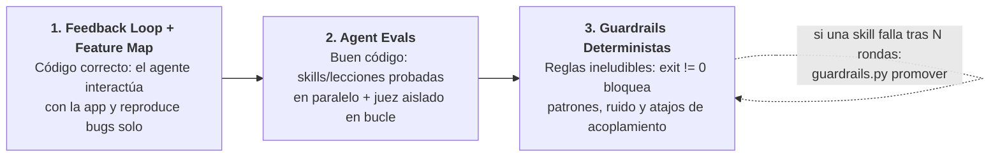

# Autonomía y Confianza en Agentes: Feedback Loop, Agent Evals y Guardrails

Esta referencia integra en **Harness Flow** los **3 mecanismos** que permiten escalar de supervisar manualmente a unos pocos agentes a operar decenas en paralelo con confianza verificable (resumidos en *"Así usa la IA una ingeniera de SpaceX"*, sobre el flujo de Lauren Tan en GrokBot / SpaceX y Cursor):

> **Tesis central:** trabajar con muchos agentes no significa *controlar* más pasos a mano, sino **construir un sistema donde los agentes comprueben su propio trabajo, evalúen empíricamente sus instrucciones y no puedan saltarse las reglas críticas.**



---

## 1. Mecanismo 1 — Feedback Loop e Interacción Autónoma + Feature Map (`scripts/feature_map.py`)

### Problema que resuelve
Cuando un agente escribe código y dice "listo" sin probar la aplicación real, el humano se convierte en el **cuello de botella** al descubrir fallos al hacer clic o al tener que guiar al agente pantalla por pantalla para reproducir un bug.

### Cómo opera en Harness Flow
1. **Pruebas automáticas en la costura pública** (TDD vertical + `gate.py verify`).
2. **Interacción directa con la aplicación viva** (Playwright, Chrome DevTools MCP, HTTP/curl, CLI o emulador): el agente realiza la acción, observa el resultado real y, si falla, usa ese error para corregirse y reintentar (acotado por la parada 4: máximo 2 intentos sin verde antes de preguntar).
3. **Feature Map (`harness/feature-map.json`)**: mapa vivo y versionado que indica a cualquier agente:
   - **Dónde vive** cada funcionalidad (`repos`, `archivos_clave`),
   - **Cómo acceder a ella** (`rutas_ui`, `endpoints`, `pasos_acceso`, más `app.start_command` y `app.base_url`),
   - **Cómo verificarla** de forma autónoma (`como_verificar`).

### Regla activa por defecto (`rules.require_feature_map: true`)
- `init.py` crea el esqueleto `harness/feature-map.json`.
- `contexto.py brief --feature <id>` inyecta el bloque `FEATURE MAP Y FEEDBACK LOOP` con las entradas relacionadas de la feature.
- **`gate.py close --status done` BLOQUEA (exit 1)** cuando `rules.require_feature_map` es `true` (valor por defecto) y:
  - Una feature declara costuras expuestas (`ui`, `componente`, `pantalla`, `vista`, `endpoint`, `api`, `http`, `rest`, `grpc`, `graphql`, `bff`, `webhook`, `cli`) pero no tiene una entrada válida en `harness/feature-map.json`.
  - Una ficha `--kind bug` no incluye una sección `## Reproduccion` (o `Reproduccion:`) en `docs/impl-<id>.md` con **evidencia verificable** (comando en backticks, `archivo:linea`, respuesta HTTP/exit code o ruta de captura/log) que demuestre que el agente reprodujo el fallo antes del fix.

### Comandos
```bash
# Inicializar el mapa en un proyecto existente
$PY "$H/feature_map.py" init --start-cmd "npm run dev" --base-url "http://localhost:3000" --verificador playwright

# Registrar o actualizar una funcionalidad (obligatorio antes de cerrar features UI/endpoint)
$PY "$H/feature_map.py" registrar \
  --id registro-usuarios \
  --nombre "Registro de usuarios" \
  --feature 1 \
  --repo front-web --repo ms-auth-service \
  --ruta-ui "/registro" \
  --endpoint "POST /api/v1/users/register" \
  --paso "Abrir /registro, completar formulario y enviar" \
  --como-verificar "npx playwright test e2e/registro.spec.ts" \
  --archivo "src/features/auth/ui/register.tsx"

# Buscar como acceder a una funcionalidad al recibir un bug
$PY "$H/feature_map.py" buscar registro

# Listar y validar el mapa completo o para una feature
$PY "$H/feature_map.py" list
$PY "$H/feature_map.py" verificar --feature 1
```

---

## 2. Mecanismo 2 — Agent Evals para Skills y Lecciones (`scripts/evals.py`)

### Problema que resuelve
El Feedback Loop asegura **código correcto** (funciona), no necesariamente **buen código** (escalable y mantenible). Convertir cada error en una skill/lección (`leccion.py`) es el primer paso, pero acumular decenas de skills sin medirlas termina generando instrucciones contradictorias, desactualizadas o ignoradas.

### Bucle host-neutral de evaluación y mejora
Siguiendo el mismo patrón aislado de `revision.py --briefing` + `gate.py revision`:

1. **Definir el examen (`evals.py init <skill>`)**: crea `harness/evals/<skill>.json` (o `<skill-dir>/evals.json` con `--global`) con tareas realistas, rúbrica ponderada (`C-1`, `peso`, `obligatorio: true|false`), señales prohibidas, umbral (`0.85`), número de corridas paralelas por caso (`3`) y tope de rondas de mejora (`3`).
2. **Lanzar N ejecutores en paralelo (`evals.py briefing <skill> --fase ejecutar`)**: el coordinador lanza `K` subagentes independientes por caso con la skill cargada y **sin revelar la rúbrica**:
   - **AGY / Gemini:** `invoke_subagent(TypeName="self", Model="inherit")` o `swarm(action="add", n=K)` (en Gemini CLI: sesiones nuevas `gemini -m gemini-4-argon -p ...`).
   - **Claude Code:** tool `Agent` en paralelo.
   - **Hermes:** `delegate_task` en paralelo.
   - **Grok:** `spawn_subagent` en paralelo.
   - **Codex / Kimi:** `codex exec` / `Agent` en paralelo.
3. **Evaluar con juez aislado (`evals.py briefing <skill> --fase juez`)**: un subagente juez sin historial de los ejecutores califica cada corrida con evidencia verificable y produce un JSON estructurado.
4. **Sellar y decidir iteración (`evals.py registrar <skill> --resultado <json>`)**:
   - Valida cobertura completa de todos los casos y corridas, evidencia no vacía, criterios obligatorios y señales prohibidas.
   - Guarda `skill_sha256` y `suite_sha256` en `<skill>-resultados.json`: **si editas `SKILL.md` después, la eval pasa automáticamente a `STALE`** (sin falsos verdes).
   - **Exit 0 (`PASS`)** si supera el umbral sin fallos obligatorios; **Exit 1 (`FAIL`)** con lista de brechas para refinar `SKILL.md` y repetir la ronda `N+1`.
   - Si al llegar a `max_rondas_mejora` los agentes siguen fallando una regla, indica explícitamente **promoverla a guardrail determinista** (`guardrails.py promover`).

### Higiene de skills y regla opt-in (`rules.require_skill_eval`)
- `leccion.py list` muestra junto a cada skill su estado de eval (`[eval: PASS 92%]`, `[eval: FAIL ...]`, `[eval: STALE]`).
- `evals.py estado` audita todas las skills y avisa sobre acumulación (>15 skills), exceso de líneas (>250) y posibles solapamientos/contradicciones entre skills.
- En `harness/feature_list.json`, `"require_skill_eval": true` (opt-in, `false` por defecto) hace que `gate.py close` **bloquee** el cierre si la lección declarada en `--leccion` no tiene una eval aprobada y fresca.

### Comandos
```bash
$PY "$H/evals.py" init mi-leccion --umbral 0.85 --corridas 3
$PY "$H/evals.py" briefing mi-leccion --fase ejecutar
$PY "$H/evals.py" briefing mi-leccion --fase juez --ronda 1
$PY "$H/evals.py" registrar mi-leccion --resultado /tmp/juez-r1.json --ronda 1
$PY "$H/evals.py" estado
```

---

## 3. Mecanismo 3 — Guardrails Deterministas y Arquitectura con Raíles (`scripts/guardrails.py`)

### Problema que resuelve
Por muy bien escrita y evaluada que esté una skill, sigue siendo lenguaje natural: un agente puede olvidarla, malinterpretarla o tomar el **camino más corto** aunque acople módulos o rompa estándares. Un guardrail no *pide*: **bloquea** con `exit != 0` antes de que el cambio pueda cerrarse.

### Qué protege por defecto y cómo se configura (`harness/guardrails.json`)
1. **Defaults seguros activos por defecto** (compatibles con las normas de `harness-flow`):
   - `no-eval-dinamico` (`eval(`, `new Function(` en JS/TS)
   - `no-html-crudo` (`dangerouslySetInnerHTML`, `bypassSecurityTrustHtml`, `Html.Raw`)
   - `no-pickle-inseguro` (`pickle.load` / `pickle.loads`)
   - `no-debugger` (`debugger`, `pdb.set_trace()`, `breakpoint()`)
   - `no-jwt-alg-none` (`alg: "none"`)
   - `py-no-bare-except` (`except:` desnudo en Python)
   - `go-no-sleep-en-tests` (`time.Sleep` en `*_test.go` en `golang-hexagonal`)
   - `angular-no-ngif-ngfor-legacy` (aviso `*ngIf`/`*ngFor` en `angular-product`)
2. **Política de comentarios de código (3 perfiles):**
   - **`anti-ruido` (por defecto, compatible con Ousterhout/McConnell):** bloquea comentarios de narración/diario generados por IA (`// Changed ...`, `// Updated ...`, `// Step 1:`, `// Aquí creamos...`, `// ... rest of code`) en código de producción, permitiendo comentarios legítimos de invariantes y contratos.
   - **`sin-comentarios` (perfil estricto SpaceX, `guardrails.py init --perfil spacex`):** bloquea todo comentario agregado en código de producción (salvo directivas técnicas de compilador/linter como `//go:build`, `# noqa`, `// @ts-` o doc comments `///` / `/**`).
   - **`off`:** desactiva la comprobación de comentarios.
3. **Fronteras entre funcionalidades ("el camino más corto es el correcto"):**
   - Regla `aislamiento-entre-features` (activa por defecto) + sección declarativa `fronteras` en `harness/guardrails.json`: impide que archivos bajo `features/<modulo>/**` importen capas internas (`domain`, `application`, `infrastructure`, `data-access`, `ui`) de otro módulo.
4. **Reglas declarativas por proyecto y promoción desde skills:**
   - Cualquier patrón prohibido del proyecto (ej. `useEffect` en React/Next.js, incluido en `--perfil spacex`) o comando linter (`comandos`) se declara en `harness/guardrails.json`.
   - `guardrails.py promover --desde-skill <clase> ...` convierte una regla que fallaba en una skill en un guardrail bloqueante y registra su trazabilidad en `history.md`.
5. **Exenciones auditadas (nunca silenciosas):**
   - En línea: `harness-ignore-guardrail: <rule-id> <motivo de al menos 10 caracteres>`. Un marcador sin id exacto o sin motivo es rechazado.
   - Desactivar una regla default exige decisión explícita del usuario: `guardrails.py desactivar --id <id> --motivo "<por que>" --yes`.

### Integración automática en los gates
- `contexto.py brief`: lista los guardrails bloqueantes activos antes de escribir código.
- `gate.py verify --feature <id>`: audita el diff y comandos guardrail y escribe `## Guardrails deterministas` en `docs/verify-<id>.md` (exit 1 si hay bloqueos o error de medición).
- `revision.py --briefing`: imprime `ALERTAS AUTOMATICAS DE GUARDRAILS DETERMINISTAS`.
- `gate.py close --status done`: **BLOQUEA** el cierre si hay violaciones `block`, configuración inválida o un comando guardrail que no pudo medir.

### Comandos
```bash
# Inicializar con perfil estandar (anti-ruido) o estricto SpaceX (sin-comentarios + no-use-effect)
$PY "$H/guardrails.py" init --perfil estandar
$PY "$H/guardrails.py" init --perfil spacex --forzar

# Auditar la feature o los cambios locales
$PY "$H/guardrails.py" check --feature 1

# Agregar regla nueva o promover una regla desde una skill/leccion
$PY "$H/guardrails.py" agregar --id no-any --patron ":\s*any\b" --glob "**/*.ts" --mensaje "Prohibido any explicito"
$PY "$H/guardrails.py" promover --desde-skill react-hooks --id no-use-effect --patron "\b(?:React\.)?useEffect\s*\(" --glob "**/*.tsx" --mensaje "Prohibido useEffect; deriva estado o usa handlers"

# Desactivar una regla default (solo con el SI del usuario)
$PY "$H/guardrails.py" desactivar --id no-debugger --motivo "Motivo explicito auditado" --yes

# Listar reglas activas
$PY "$H/guardrails.py" list
```

---

## 4. Mapeo por Rol en Harness Flow

| Rol | Feedback Loop + Feature Map | Agent Evals | Guardrails Deterministas |
| --- | --- | --- | --- |
| **0. Producto (PRD/SDD)** | Define verificación autónoma de flujos observables | — | Diseña arquitectura por funcionalidad con raíles y fronteras en el SDD |
| **1. Leader (Spec)** | Vincula AC UI/endpoint al Feature Map; en bugs exige reproducción | Consulta `leccion.py list` con badges de eval | Revisa `guardrails.json` antes de aprobar el spec |
| **2. Implementer** | Verifica en la app real; reproduce bugs en rojo y documenta `## Reproduccion`; actualiza Feature Map | Si edita/crea una skill, corre `evals.py` | Corre `guardrails.py check --feature <id>` antes de commitear |
| **3. Revisor Aislado** | Audita alertas de Feature Map y evidencia de reproducción | Revisa alertas sobre skills nuevas/modificadas | Audita `ALERTAS AUTOMATICAS DE GUARDRAILS DETERMINISTAS` |
| **4. Cierre (`gate.py`)** | `close` bloquea sin Feature Map en UI/endpoints ni reproducción en bugs (`require_feature_map: true`) | `close` bloquea si `require_skill_eval: true` y la lección no está `PASS` y fresca | `verify` y `close` bloquean con `exit 1` ante cualquier violación `block` |
