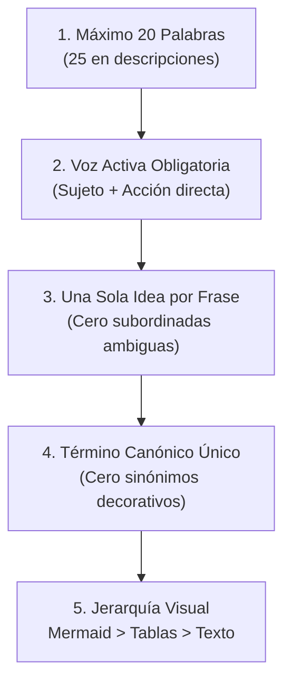

# Comunicación Técnica ASD-STE100 y Prompts de Alta Densidad en Harness Flow

Referencia normativa de estilo, redacción técnica y arquitectura de prompts basada en los principios operativos de **Andrej Karpathy** y el estándar aeroespacial **ASD-STE100** (*Simplified Technical English*).

---

## 1. Principios Operativos de Karpathy

Los 7 principios sintetizados por Karpathy definen la relación óptima entre el ingeniero (Director) y el modelo de lenguaje (Operador/Constructor):

1. **El Director, no el Operario:** El costo de revisar un resultado es órdenes de magnitud menor que producirlo. El humano juzga y aprueba; el agente ejecuta. Es obligatorio fijar límites negativos claros: qué **no** puede tocar el agente.
2. **Esfuerzo Medio, no Máximo:** Configurar `/effort medium` por defecto. Más esfuerzo cognitivo no siempre equivale a mejor código y puede generar sobre-pensamiento. Escalar a alto o máximo solo ante dos fallos consecutivos o decisiones arquitectónicas irreversibles.
3. **Prompts Cortos, con Verbos (Densidad sin Sobre-restricción):** Prompts concisos con verbos fuertes de ingeniería evitan sobre-restringir (*over-constrain*) al modelo. Se exige siempre una comprobación en menos de 5 minutos.
4. **Manual de Avión (ASD-STE100):** Explicaciones e instrucciones redactadas bajo estándar técnico aeronáutico: frases de máximo 20 palabras, voz activa, una idea por frase y diagramas sobre texto.
5. **Pruebas Propias sobre Benchmarks:** No confiar en benchmarks públicos saturados. Evaluar modelos contra tareas reales y medibles del proyecto.
6. **El Software es el Envoltorio, los Datos son el Valor:** El código se regenera en minutos; la ventaja y el activo permanente son los esquemas, specs y datos curados.
7. **Modelo Caro que Dirige, Modelo Barato que Trabaja:** Modelos de razonamiento profundo (Opus, Astra) para planificar, revisar y orquestar; modelos de alta velocidad (Sonnet, Haiku, Flash) para ejecutar volumen en paralelo.

---

## 2. La Norma ASD-STE100 en Español Técnico

Los modelos de lenguaje tienden por defecto a la verborrea (*token bloat*), redactando párrafos decorativos y explicaciones redundantes. La norma ASD-STE100 elimina el ruido cognitivo y maximiza la verificabilidad en cada rol del arnés.

### Las 5 Reglas Fundamentales



1. **Longitud Máxima de Frase:**
   - **Instrucciones, ACs y Reglas:** Máximo **20 palabras** por oración.
   - **Descripciones de Contexto y SDD:** Máximo **25 palabras** por oración.
2. **Voz Activa Permanente:**
   - Se declara explícitamente qué componente, servicio o actor ejecuta la acción.
   - ❌ *La solicitud será rechazada por el middleware si el token no es válido.* (Pasiva, 13 palabras).
   - ✅ *El middleware rechaza la solicitud cuando el token es inválido.* (Activa, 10 palabras).
3. **Una Sola Idea por Frase:**
   - Prohibido encadenar cláusulas con "y", "además", "donde a su vez". Cada requerimiento se expresa en una frase atómica separada por punto.
4. **Término Canónico Único (Glosario sin Variaciones):**
   - Una palabra para una sola cosa. Si la entidad de dominio se llama `WorkItem`, jamás se le llama "tarea", "ticket", "asunto" o "ítem de trabajo".
5. **Jerarquía Visual de Claridad:**
   - Escala: `Diagrama interactivo / Mermaid > Tabla estructurada > Lista con viñetas > Texto plano`. Si una interacción técnica involucra a más de dos capas, se grafica obligatoriamente en Mermaid.

---

## 3. Arquitectura de Prompts Cortos (Concepto 3)

### Estructura Canónica de 3 Partes

```text
[Objetivo técnico en 3 a 6 verbos de acción] + [Límites negativos explícitos] + [Cierre de comprobabilidad en < 5 min]
```

1. **Verbos de Alta Densidad Semántica:**
   - Palabras como *aislar*, *desacoplar*, *endurecer*, *normalizar*, *refactorizar*, *parametrizar*, *verificar* y *sincronizar* activan paquetes completos de mejores prácticas sin necesidad de micro-instrucciones redundantes.
2. **Límites Negativos (Qué NO Tocar):**
   - Protege rutas maestras: `"No toques docs/prd/**, docs/sdd.md ni .env sin aprobación explícita."`
   - Previene sobre-ingeniería: `"No agregues repositorios ni abstracciones genéricas no requeridas por los AC."`
3. **Cierre de Comprobabilidad Inmediata:**
   - `"Al terminar: (1) qué hiciste, (2) qué decisiones tomaste por tu cuenta, (3) cómo compruebo el resultado en menos de 5 minutos."`

---

## 4. Guía de Aplicación por Fase de Harness Flow

### Fase 0: Producto (PRD y SDD)

* **Mandato Conciso:**
  ```text
  Sintetiza, delimita y estructura el PRD para [problema].
  Define entradas, salidas y genera las candidatas F-1..F-n con su comprobación en < 5 min.
  No diseñes arquitectura técnica todavía.
  ```
* **SDD (`docs/sdd.md`):**
  - Diagrama Mermaid obligatorio para arquitectura de componentes y secuencia de datos.
  - Decisiones de arquitectura (ADR / D-n) en terna de exactamente 3 frases:
    1. *Problema:* Qué restricción obliga a decidir.
    2. *Decisión y Alternativa Descartada:* Qué se elige y qué se rechaza.
    3. *Consecuencia:* Qué compensación técnica se asume.

### Fase 1: Especificación de Features (Spec & ACs)

* **Criterios de Aceptación (AC-n) en STE100:**
  - Cada AC debe cumplir la regla de <= 20 palabras, en voz activa y con costura pública explícita.
  - **Ejemplo Canónico:**
    ```markdown
    - AC-1 [costura: endpoint]: El controlador rechaza credenciales inválidas. Devuelve HTTP 401 con ProblemDetails RFC 7807. `verificar: dotnet test --filter Name=Auth_InvalidCredentials`
    ```

### Fase 2: Implementación TDD y Modo Pair

* **Micro-Reportes de Pantalla de Instrumentos (Driver):**
  - Durante los ciclos TDD, la IA emite reportes telegráficos libres de prosa conversacional:
    ```markdown
    ✅ Pasa: "WorkItemRepository_Save_PersistsRecord"
    ⚙️ Decisión: Usar Dapper con parámetro tipado @Id.
    🔍 Comprobación: dotnet test --filter Name=WorkItemRepository_Save (65ms).
    ❓ ¿Continuamos con "WorkItemService_Create"?
    ```
* **Comandos en Ráfaga (Navigator):**
  - El usuario puede comandar bloques de trabajo usando verbos agrupados: `"Haz 3: codifica, compila y testea los siguientes 3 casos de la lista."`

### Fase 3: Reviewer Aislado (`docs/review-<id>.md`)

* **Mandato de Revisión:**
  ```text
  Audita, contrasta y dictamina la feature #<id> contra su spec y su git diff.
  Reporta únicamente violaciones de ACs, seguridad y arquitectura.
  Emite veredicto: approved o changes_requested.
  ```
* **Dictamen Telegráfico:**
  - Una fila por AC con cita exacta `archivo:linea`.
  - Hallazgos redactados en una sola frase activa de <= 20 palabras:
    - *`src/Application/Service.cs:42`: El caso de uso importa la implementación concreta de infraestructura DapperRepository.*

### Fase 4: Memoria Procedural y Lecciones (`scripts/leccion.py`)

* **Terna de 3 Frases STE100 Obligatoria:**
  1. **Problema (<= 15 palabras):** *time.Sleep en tests unitarios Go provoca carreras intermitentes no deterministas.*
  2. **Causa (<= 15 palabras):** *El planificador del sistema operativo introduce retrasos temporales impredecibles.*
  3. **Regla (<= 20 palabras):** *Sincroniza goroutines mediante canales o sync.WaitGroup en lugar de pausas temporales.*

---

## 5. Plantilla Universal para Agentes (`CLAUDE.md` / `AGENTS.md`)

```markdown
# Directrices de Comunicación y Operación (Estándar Karpathy / STE100)

1. Rol: Tú implementas y pruebas; el usuario dirige y aprueba. No pidas al usuario que ejecute comandos ni que edite archivos: hazlo tú.
2. Límites Negativos: Prohibido modificar rutas protegidas (docs/prd/**, docs/sdd.md, .env) sin confirmación explícita.
3. Nivel de Esfuerzo: Esfuerzo medio por defecto. Escala a alto solo tras dos intentos fallidos sin verde en TDD o en decisiones arquitectónicas.
4. Prompts Cortos: Interpreta verbos de acción según las mejores prácticas del stack. Pregunta solo ante ambigüedades de diseño crítico.
5. Regla ASD-STE100: Redacta instrucciones y micro-reportes con frases de máximo 20 palabras, voz activa y una sola idea por frase.
6. Diagramas Primero: Modela interacciones entre componentes en diagramas Mermaid antes de redactar texto explicativo.
7. Comprobación en 5 Minutos: Al concluir cada paso, reporta: qué hiciste, qué decidiste por tu cuenta y cómo se comprueba el resultado.
```
