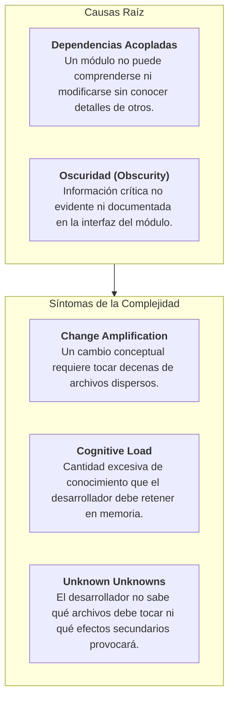
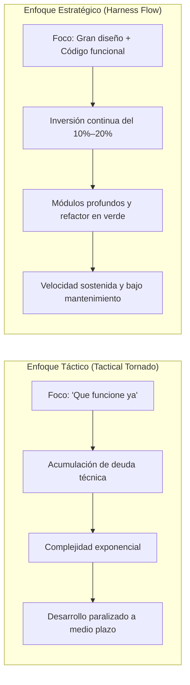
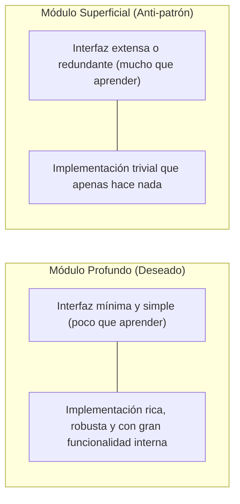
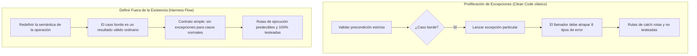

# Filosofía de Diseño de Software de John Ousterhout en Harness Flow

Este documento establece las directrices normativas de diseño de software adoptadas por **Harness Flow**, basadas en la obra ***A Philosophy of Software Design*** (2.ª edición, Yaknyam Press) de **John Ousterhout** (catedrático de Ciencias de la Computación en la Universidad de Stanford).

Ousterhout propone un enfoque empírico y riguroso para combatir la complejidad del software, superando los dogmas de la literatura clásica como *Clean Code* mediante abstracciones profundas, ocultamiento efectivo de información e inversión estratégica continua.

---

## 1. La Naturaleza de la Complejidad

> [!IMPORTANT]
> **Definición fundamental**: La complejidad es cualquier aspecto en la estructura de un sistema de software que dificulta su comprensión, razonamiento y modificación.

La complejidad no surge de una única decisión desafortunada; es **acumulativa e incremental** (*muerte por mil cortes*). Se manifiesta a través de tres síntomas medibles:



* **Unknown Unknowns (El peor síntoma)**: Ocurre cuando un desarrollador o agente cree haber completado una tarea de forma segura, pero rompe un contrato oculto o una invariante no documentada en otra parte del sistema.
* **Meta de Harness Flow**: Reducir a cero los *Unknown Unknowns* mediante contratos explícitos, costuras públicas profundas y límites arquitectónicos verificables en caliente.

---

## 2. Programación Estratégica vs. Táctica (*Tactical Tornado*)



* **El Tactical Tornado**: El programador o IA que solo busca el camino más corto para poner un test en verde agregando *hacks*, parámetros redundantes o parches locales. Cada victoria táctica empeora el sistema.
* **La Regla del 10%–20% de Inversión Estratégica**:
  * En Harness Flow, el código funcional no es suficiente.
  * En cada iteración del bucle TDD (fase *Refactor*), es **obligatorio** invertir del 10% al 20% del esfuerzo en simplificar la interfaz, extraer duplicaciones conceptuales y compactar la lógica antes de pasar al siguiente criterio de aceptación (AC).

---

## 3. Módulos Profundos (*Deep Modules*) vs. Módulos Superficiales (*Shallow Modules*)

La mejor métrica de diseño de un módulo (clase, estructura, función, paquete o microservicio) es la relación entre el **beneficio funcional que aporta** y el **coste cognitivo de aprender y usar su interfaz**:



### El Combate contra la *Classitis* y las *Micro-functions*
* **El error de Clean Code**: Forzar que toda función tenga menos de 5 a 10 líneas y que cada clase sea microscópica.
* **El problema real**: La atomización artificial fragmenta la lógica en un laberinto de micro-métodos superficiales. El desarrollador debe saltar entre 15 archivos para entender un único flujo de negocio, disparando la carga cognitiva y los *unknown unknowns*.
* **Norma en Harness Flow**:
  * Se prefieren **funciones y métodos profundos y cohesivos** (de 30 a 80 líneas si es necesario), siempre que mantengan un único nivel de abstracción y resuelvan el problema de principio a fin.
  * No fragmentes una función si la partición solo genera métodos superficiales que nadie más llamará.

---

## 4. Ocultamiento de Información vs. Fuga de Información (*Information Leakage*)

* **Information Hiding**: Cada módulo debe encapsular una o pocas decisiones de diseño complejas (ej. algoritmo de compresión, formato de persistencia, mecanismo de reintentos) de modo que ninguna otra parte del sistema conozca esos detalles.
* **Information Leakage**: Ocurre cuando un detalle técnico se dispersa por múltiples componentes.
  * *Ejemplo*: Si el esquema de columnas de la base de datos se refleja directamente en las respuestas HTTP del frontend, cualquier cambio en la tabla fuerza a tocar la API y la UI (*Change Amplification*).
* **Anti-patrón: Descomposición Temporal (*Temporal Decomposition*)**:
  * Diseñar clases u objetos basados únicamente en el orden cronológico en que ocurren los eventos (ej. `FileOpener -> FileScanner -> FileParser -> OutputWriter`).
  * En su lugar, diseña en torno al **conocimiento y la invariante**: un único módulo de lectura y estructuración profunda que encapsule todo el formato del archivo.

---

## 5. Empujar la Complejidad Hacia Abajo (*Pull Complexity Downwards*)

> [!TIP]
> **Principio de Asimetría de Esfuerzo**: Es mucho más valioso que la implementación interna de un módulo sea compleja si eso simplifica la vida de sus 50 llamadores, a que la implementación sea simple forzando a los 50 llamadores a coordinar la complejidad.

* **Anti-patrón**: Exponer banderas de configuración raras o requerir que el llamador ejecute 4 métodos en un orden específico para que la operación funcione.
* **Enfoque Harness Flow**: Los adaptadores de infraestructura y servicios de aplicación absorben la resiliencia (reintentos exponenciales, idempotencia con clave, bloqueo optimista OCC y persistencia en Outbox). La API expone un contrato atómico y el cliente jamás coordina la transacción.

---

## 6. Definir los Errores Fuera de la Existencia (*Define Errors Out of Existence*)

El manejo de excepciones es el principal responsable de la proliferación de rutas de ejecución no probadas y con bugs latentes en producción.



### Ejemplos Prácticos en el Arnés:
1. **Borrado idempotente**: Invocar `DELETE /items/123` cuando el recurso no existe no debe lanzar un error 500 ni exigir pre-consultas; devuelve 204 No Content o 200 OK porque la meta ("que el recurso no exista") se cumple.
2. **Substrings y colecciones**: Consultar un rango que excede los límites devuelve los elementos disponibles o colección vacía, en lugar de lanzar `IndexOutOfBoundsException`.
3. **Búsquedas vacías**: Un repositorio que no encuentra registros devuelve `Option::None`, `null` controlado o lista vacía, no una excepción de infraestructura que obligue a `try/catch` redundantes.

---

## 7. Diferente Capa, Diferente Abstracción (*Pass-Through Methods*)

En una arquitectura por capas (como la Arquitectura Hexagonal de CALPIL), cada capa adyacente debe proporcionar una **abstracción diferente y cualitativamente superior**:

* **Pass-Through Method (Método de Paso - Anti-patrón)**:
  * Un método que solo toma parámetros y los reenvía idénticos a otro método con la misma firma sin alterar la abstracción ni aportar lógica de negocio.
  ```csharp
  // ANTI-PATRÓN: Pass-through method inútil
  public Task<ItemDto> GetItem(Guid id) => _repository.GetItem(id);
  ```
* **Diagnóstico**: Si una capa solo delega llamadas 1:1 sin traducir contratos ni aplicar reglas, esa capa es superficial y debe ser consolidada o eliminada.

---

## 8. Diseñar Dos Veces (*Design It Twice*)

La primera solución técnica que viene a la mente suele ser la más evidente, pero raramente es la más profunda o mantenible.

* **Obligación en Harness Flow (Rol 0.5 SDD)**:
  * Toda decisión arquitectónica ($D-n$) en [`docs/sdd.md`](file:///Users/alan/.hermes/skills/software-development/harness-flow/docs/sdd.md) debe formular y contrastar al menos **dos enfoques de diseño radicalmente distintos** antes de elegir uno.
  * Formato normativo de decisión:
    ```markdown
    - D1: <Decisión elegida orientada a módulo profundo>.
      Descartada: <Alternativa contrastada>, porque <análisis de trade-off y causa de rechazo>.
      Consecuencia: <Efecto en la implementación o modelo de datos>.
    ```

---

## 9. Comentarios en un Nivel Distinto de Abstracción

Los comentarios no deben usarse para repetir la sintaxis del lenguaje ni para justificar código defectuoso, sino para capturar lo que el código **no puede decir por sí mismo**:

* **Lo que NO debe escribirse**:
  ```go
  // Incrementa el contador en 1 (REDUNDANTE: parafrasea el código)
  counter++
  ```
* **Lo que SÍ debe escribirse**:
  ```go
  // Invariante: counter debe ser estrictamente monótono para asegurar
  // la ordenación causal de eventos en el log sin colisiones en OCC.
  counter++
  ```
* **Docstrings de Módulos Profundos**: Deben describir **el contrato, la intención y las invariantes previas/posteriores** (*what* y *why*), omitiendo los detalles internos de implementación (*how*).

---

## 10. Matriz Operativa por Rol en Harness Flow

| Rol / Fase | Principio de Ousterhout | Criterio de Verificación / Gate |
| :--- | :--- | :--- |
| **Rol 0: Producto** | Unknown Unknowns & No Temporal Decomposition | El PRD define Vertical Slices ($F-n$) basados en valor de usuario de punta a punta. Prohibido crear candidatas por capas temporales ("hacer tablas primero"). |
| **Rol 0.5: SDD** | Design It Twice & Deep Interfaces | Cada decisión $D-n$ contrasta al menos 2 alternativas. Los puertos hexagonales son profundos y los adaptadores absorben la complejidad distribuida (Outbox, OCC, Idempotencia). |
| **Rol 1: Leader** | Deep Public Seams & Strategic Scope | La costura de prueba (`[costura: ...]`) apunta a la interfaz pública del módulo profundo. El plan vertical tiene ≤5 pasos atómicos. |
| **Rol 2: Implementer** | Anti-Classitis & Define Errors Out of Existence | Prohibido crear micro-funciones artificiales. Ciclos TDD con 10–20% de refactorización estratégica. Diseñar métodos sin excepciones para casos límite normales. |
| **Rol 3: Revisor** | Pass-Through Detection & Information Leakage | Audita el diff detectando métodos de paso inútiles, fuga de modelos de BD hacia el dominio o APIs externas, y comentarios redundantes. |
