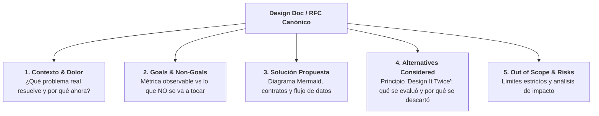
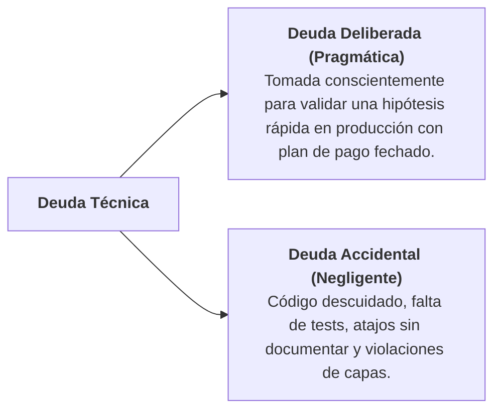

# Ingeniería de Software Pragmática y Design Docs (Gergely Orosz)

Esta guía formaliza los principios de madurez profesional, entrega predecible, diseño técnico y revisiones pragmáticas expuestos por **Gergely Orosz** (*The Software Engineer's Guidebook*, 2023; y *The Pragmatic Engineer*) y analizados por **BettaTech** en *"La habilidad más importante de un Ingeniero no es programar"*.

---

## 1. Tesis Central: La Madurez Más Allá del Código

> *"Tipear código es solo el vehículo mecánico final; hoy en día, hasta un modelo de lenguaje puede autocompletar sintaxis. Lo que define a un ingeniero maduro (Senior, Tech Lead, Staff) es la **resolución sistemática de problemas, el diseño previo en Design Docs asíncronos, la descomposición de proyectos en entregas predecibles, las revisiones sin nitpicking y la gestión disciplinada de la deuda técnica**."* — Gergely Orosz

| Dimensión | Enfoque de Codificador Novato | Ingeniería de Software Madura (Gergely Orosz) |
| :--- | :--- | :--- |
| **Inicio del trabajo** | Salta directamente al editor de código a escribir código. | Redacta y acuerda primero un **Design Doc / RFC** breve y estructurado. |
| **Definición de alcance** | Acepta requisitos vagos y sufre *scope creep* ("ya que estamos..."). | Fija **Objetivos (Goals)** y **No-Objetivos (Non-Goals)** explícitos. |
| **Entrega de proyectos** | "Grandes lanzamientos" después de semanas de trabajo en silos. | **Entrega predecible (*Predictable Delivery*)** en rebanadas de 1 a 3 días con *Walking Skeleton* inicial. |
| **Code Review** | Discute estilo, espacios y nombres cosméticos (*nitpicking*). | Audita corrección de negocio, casos borde, límites de capas, seguridad y rendimiento; delega el estilo a linters. |
| **Deuda técnica** | Ignora la deuda o pide "sprints de refactorización" que el negocio nunca aprueba. | **Regla del Boy Scout**: paga la deuda gradualmente en cada tarea (inversión continua del 10%-20%). |
| **Gestión de fallos** | Busca culpables individuales cuando algo falla. | **Blameless Post-Mortems**: analiza brechas en el proceso y refuerza los *gates* del sistema. |

---

## 2. El Estándar de Design Docs (RFCs en Big Tech)

Gergely Orosz documenta la estructura utilizada en empresas de alto rendimiento (Uber, Google, Stripe) para alinear decisiones técnicas antes de programar. En Harness Flow, esta estructura rige las fases de **PRD** y **SDD**:

### Reglas de Redacción de Design Docs:
1. **Concisión y Claridad:** Un buen documento de diseño no supera 2 a 5 páginas. Si requiere 20 páginas, el problema es demasiado grande y debe subdividirse.
2. **Alternativas Consideradas Obligatorias:** Un diseño que solo presenta una opción no es un diseño; es una justificación a posteriori. Debe contrastar al menos dos enfoques viables con sus *trade-offs*.
3. **Métricas de Impacto:** Todo documento debe vincular la decisión técnica con una métrica observable (ej. latencia, disponibilidad, reducción de errores, tiempo de ciclo).

---

## 3. Entrega Predecible (*Predictable Project Delivery*)

Orosz advierte que las estimaciones fallan cuando las tareas son invisibles y se prolongan durante semanas:

1. **La Regla de los Incrementos de 1 a 3 Días**:
   * Ninguna tarea o feature debe planificarse para tomar más de 3 días de trabajo concentrado.
   * Si una iniciativa requiere semanas, se descompone en **Vertical Slices (`F-1`, `F-2`, `F-3`)**.
2. **Walking Skeleton Primero (`F-1`)**:
   * El primer incremento conecta todas las capas (`UI/API -> Dominio -> Persistencia -> Tests`).
   * Valida la integración de extremo a extremo desde el primer día, eliminando el riesgo de "sorpresas de integración" al final del proyecto.

---

## 4. Gestión Pragmática de Deuda Técnica

Gergely Orosz clasifica la deuda técnica para gestionarla de forma inteligente:

### La Regla del Boy Scout y la Inversión del 10%-20%:
* **Los "sprints de refactor puro" son una fantasía:** El negocio rara vez aprueba detener el desarrollo de producto durante 2 semanas solo para refactorizar.
* **Pago incremental continuo:** En cada feature o corrección, el ingeniero invierte un 10% a 20% del esfuerzo en limpiar el área tocada, eliminar código muerto, extraer duplicación y endurecer tests (Sombrero 2 de TDD en Harness Flow).

---

## 5. Code Reviews Pragmáticos (Sin Nitpicking)

Gergely Orosz dedica un capítulo fundamental a la higiene en revisiones de código:

### A. Lo que NUNCA debe hacerse en un Code Review:
* **No hacer *Nitpicking* cosmético:** No discutir comas, tabulaciones, orden de imports ni convenciones de formato. Para eso existen linters automáticos (`check-architecture.py`, ESLint, Ruff, dotnet format, gofmt).
* **No imponer preferencias subjetivas de estilo:** Si el código es correcto, seguro y cumple la arquitectura, el revisor no debe exigir "escríbelo como a mí me gusta".

### B. Enfoque del Revisor Maduro:
1. **Corrección de Negocio:** ¿El diff cumple exactamente lo que exige cada Criterio de Aceptación (AC-n)?
2. **Límites de Arquitectura:** ¿Respeta los límites de capas del stack (Hexagonal/Clean Architecture)?
3. **Casos Borde y Seguridad:** ¿Qué pasa si la lista viene vacía? ¿Hay riesgo de inyección o timeout?
4. **Severidad Graduada:** Clasificar todo hallazgo objetivamente:
   * **Bloqueante / Mayor:** Rompe un AC, la arquitectura o la seguridad.
   * **Menor / Informativo:** Sugerencias u observaciones no bloqueantes que van a *Observaciones* y **NO detienen la aprobación**.
5. **Límite de Rondas (Máximo 2):** Si el código tiene sus ACs verdes y no hay hallazgos bloqueantes, se aprueba. No abrir rondas infinitas por detalles menores.

---

## 6. Cultura de Aprendizaje sin Culpa (*Blameless Post-Mortems*)

Cuando un fallo o regresión llega a producción:
* **El individuo nunca es el culpable:** La culpa es del proceso y de los *gates* del sistema que permitieron que el error pasara desapercibido.
* **Captura Institucional en la Base de Conocimiento (`leccion.py`):**
  * Toda regresión o incidente debe documentarse con:
    1. *Síntoma y Causa Raíz.*
    2. *Por qué los tests existentes no lo detectaron.*
    3. *Nuevo gate, test o regla automática incorporada para garantizar que nunca vuelva a ocurrir.*

---

## 7. Mapeo en las Fases de Harness Flow

| Fase de Harness Flow | Rol Responsable | Directiva de Gergely Orosz |
| :--- | :--- | :--- |
| **0. PRD** | Producto | Aplica estructura RFC: Contexto, Goals, Non-Goals explícitos y métricas de negocio observables. |
| **0. SDD** | Arquitecto / Producto | Documenta *Alternatives Considered* en cada decisión $D-n$ con opción descartada y justificación; registra deuda técnica deliberada. |
| **Plan Mode (Candidatas `F-n`)** | Leader | Descompone en entregas predecibles de 1 a 3 días con `F-1` como walking skeleton. |
| **Implementer (TDD)** | Sombrero 1 y Sombrero 2 | Regla del Boy Scout (10%-20% en saneamiento de deuda técnica); tests enfocados en costuras públicas estables. |
| **Revisor Aislado** | Subagente Revisor | Code Review pragmático sin *nitpicking*; severidad graduada (Bloqueante vs Menor); límite estricto de 2 rondas. |
| **Cierre y Lecciones** | Rol Cierre (`leccion.py`) | *Blameless Post-Mortems*: institucionalización de lecciones aprendidas para inmunizar el sistema contra fallos recurrentes. |
