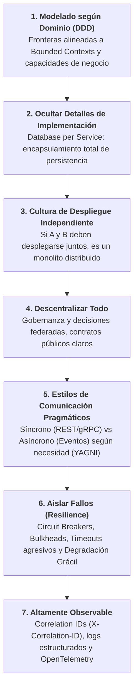
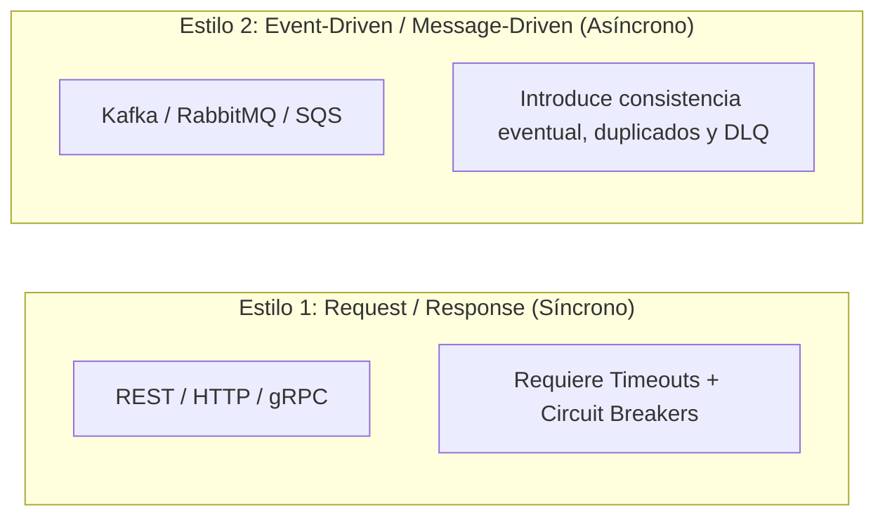

# Microservicios y Sistemas Distribuidos: Principios de Sam Newman

Esta guía condensa los fundamentos de diseño, descomposición y gobierno de arquitecturas distribuidas expuestos por **Sam Newman** (*Building Microservices: Designing Fine-Grained Systems*, 2ª Edición, O'Reilly, 2021; y *Monolith to Microservices*, O'Reilly, 2020) y analizados en **BettaTech** (*Este libro me hizo madurar como ingeniero*).

---

## 1. Tesis Central: Madurez Arquitectónica y la Regla "Monolith First"

> *"Los microservicios no son un objetivo en sí mismos ni una medalla técnica; son un mecanismo de autonomía organizacional para equipos grandes con un costo operativo y de red altísimo. Si puedes resolver el problema con un Monolito Modular bien estructurado, hazlo."* — Sam Newman

| Dimensión | Monolito Modular | Microservicios (Fine-Grained Systems) |
| :--- | :--- | :--- |
| **Cuándo usarlo** | Proyectos nuevos, dominios en descubrimiento, equipos pequeños ($\le 5-10$ ingenieros). | Múltiples equipos autónomos, necesidades extremas de escala divergente o aislamiento de fallos críticos. |
| **Comunicación** | Llamadas a métodos en memoria dentro del mismo proceso ($0$ latencia, consistencia ACID inmediata). | Red física (HTTP/gRPC/Brokers) sujeta a latencia, fallos parciales y consistencia eventual. |
| **Persistencia** | Base de datos unificada con esquemas y transacciones ACID. | **Database per Service**: Bases de datos privadas por servicio; prohibidos joins cruzados. |
| **Operación** | Un solo artefacto de despliegue, observabilidad sencilla y transacciones locales. | Despliegue independiente, trazabilidad distribuida (OpenTelemetry), redes y orquestación. |

---

## 2. Los 7 Principios Canónicos de Sam Newman

---

## 3. Database per Service: La Regla de Oro

El anti-patrón más destructivo en microservicios es la **Base de Datos Compartida (*Shared Database*)**:
* **Prohibición Absoluta:** Un microservicio `A` NUNCA se conecta directamente a la base de datos o tablas del microservicio `B`.
* **Consecuencias del acoplamiento a nivel de datos:** Rompe la autonomía de despliegue, impide evolucionar o migrar esquemas, y bloquea el aislamiento de transacciones.
* **Mecanismos autorizados de interacción:**
  1. *APIs Públicas (REST / gRPC)* para consultas o comandos síncronos.
  2. *Eventos de Dominio / Mensajería* para propagación de cambios de estado.
  3. *Transactional Outbox Pattern* (ver `references/patrones-datos-ddia.md`) para sincronización fiable sin *dual-writes*.

---

## 4. Estilos de Comunicación: Síncrono vs. Asíncrono (YAGNI)

Sam Newman advierte contra imponer **Event-Driven Architecture (EDA)** por dogma. Toda integración debe justificarse en el SDD bajo una decisión $D-n$ pragmática:

### Matriz de Decisión:
* **Usa Síncrono (REST / gRPC)** cuando:
  * El llamador necesita el resultado inmediatamente para continuar (ej. autenticación, cobro de tarjeta, validación transaccional).
  * El sistema tiene baja complejidad operativa y se busca depuración directa.
  * **Defensa obligatoria:** Timeouts agresivos (ej. 2s) y *Circuit Breakers* para prevenir fallos en cascada.
* **Usa Asíncrono (Event-Driven)** cuando:
  * El emisor no necesita esperar la respuesta (ej. notificación por email, telemetría IoT de sensores).
  * Múltiples servicios independientes reaccionan a un mismo evento (ej. al publicar `VentaCerrada`, reaccionan Facturación, Despacho y Fidelización).
  * Procesamiento pesado en background que debe desacoplarse temporalmente del cliente.

---

## 5. Resiliencia Distribuida: Protección contra Fallos en Cascada

En sistemas distribuidos, la red es intrínsecamente no confiable. Sam Newman exige 4 patrones de aislamiento:

1. **Circuit Breaker (Cortacircuitos)**:
   * Supervisa la tasa de errores de llamadas remotas.
   * Si las fallas superan un umbral (ej. 5 fallos consecutivos o 50% de error en 10s), **abre el circuito** de inmediato, devolviendo una respuesta de fallback rápida sin saturar la red ni agotar recursos locales.
2. **Bulkheads (Mamparos de Aislamiento)**:
   * Separa pools de conexiones HTTP, hilos y recursos de memoria por cada servicio aguas abajo.
   * El colapso del servicio de notificaciones no debe agotar el pool de conexiones del servicio de pagos.
3. **Timeouts Agresivos y Reintentos con Backoff + Jitter**:
   * Prohibidas las llamadas de red con timeout infinito o por defecto de 60 segundos.
   * Toda llamada debe tener un timeout explícito corto (ej. 500ms - 3000ms).
4. **Degradación Grácil (*Graceful Degradation*)**:
   * Si el servicio predictivo o recomendador está caído, la aplicación muestra una respuesta por defecto o heurística básica en lugar de lanzar un error 500.

---

## 6. Observabilidad y Correlation IDs

Para diagnosticar incidentes que cruzan múltiples microservicios:
* **`X-Correlation-ID` o W3C `traceparent` obligatorio**:
  * Todo request que entra por el API Gateway o punto de entrada genera un identificador único de correlación (`UUID`).
  * Este identificador DEBE propagarse en los encabezados de todas las llamadas HTTP aguas abajo y en los metadatos de todos los eventos publicados.
  * Todo log estructurado debe incluir el `correlation_id` para permitir rastrear la petición completa en herramientas como Jaeger, Grafana Tempo o Cloud Trace.

---

## 7. Despliegue Independiente y Evolución de Contratos (Expand-Contract)

Sam Newman establece la **prueba ácida** del microservicio:
> *"Si para poner en producción un cambio necesitas coordinar y desplegar el servicio A y el servicio B simultáneamente, tienes un monolito distribuido."*

### Patrón Expand-Contract (Parallel Change) para Servicios:
1. **Fase Expand (Añadir sin romper)**: El servicio productor añade el nuevo endpoint, campo o evento `v2`, manteniendo el endpoint o evento `v1` 100% operativo y retrocompatible.
2. **Fase Migrate (Transición gradual)**: Los servicios consumidores migran a su propio ritmo a la versión `v2`.
3. **Fase Contract (Retirar lo viejo)**: Una vez verificado que ningún consumidor usa la `v1`, se retira el código y los endpoints antiguos.

---

## 8. Mapeo en las Fases de Harness Flow

| Fase de Harness Flow | Rol Responsable | Directiva de Microservicios (Sam Newman) |
| :--- | :--- | :--- |
| **0. PRD** | Producto | Evalúa **Monolith First**; delimita entidades por **Bounded Contexts**; define capacidades de negocio. |
| **0. SDD** | Arquitecto / Producto | Modela **Database per Service** (prohibida BD compartida); documenta la elección de **Síncrono vs EDA** en decisiones $D-n$ con alternativa descartada; especifica **Circuit Breakers** y **Correlation IDs**. |
| **Plan Mode (Candidatas `F-n`)** | Leader | Aplica **Independent Deployability** mediante *Expand-Contract*; usa el subsistema `multirepo.py` para slices multi-servicio. |
| **Implementer (TDD)** | Sombrero 1 y Sombrero 2 | TDD con Service Tests aislados y fakes en adaptadores; propaga `X-Correlation-ID`; implementa timeouts y circuit breakers en clientes HTTP/gRPC. |
| **Revisor Aislado** | Subagente Revisor | Audita el diff y clasifica como **Bloqueante**: acceso a base de datos ajena, falta de timeouts/circuit breakers, y breaking changes en contratos. |
| **Gates Automatizados** | `gate.py` / `multirepo.py` | Audita que los cambios multi-repositorio sincronicen sus SHAs y manifiestos de forma atómica antes del cierre. |
