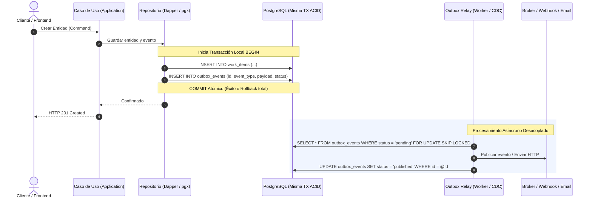
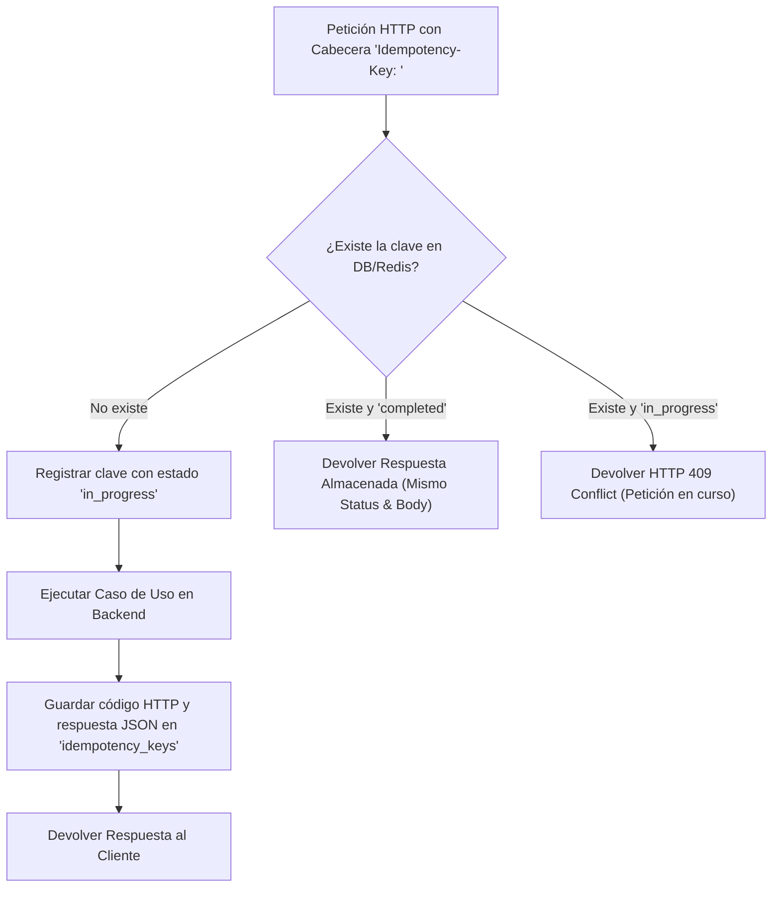
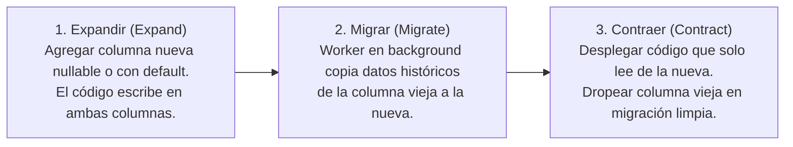

# Patrones de Confiabilidad y Sistemas de Datos (DDIA) en Harness Flow

Referencia técnica y guía de implementación de patrones de arquitectura de datos basados en **Martin Kleppmann** (*Designing Data-Intensive Applications - DDIA*) para backends en **Golang**, **.NET**, **Spring Boot**, **NestJS** y frontends en **Angular**.

---

## 1. El Problema del Dual-Write y la Falacia de la Red Confiable

En sistemas distribuidos y APIs web, uno de los errores arquitectónicos más frecuentes y destructivos es la **doble escritura no atómica (*Dual-Write*)**:

```text
❌ ANTI-PATRÓN DUAL-WRITE:
1. db.Save(order)           -> Éxito en PostgreSQL.
2. messageBroker.Publish()   -> Fallo de red / Timeout / Caída de broker.
RESULTADO: La base de datos tiene la orden, pero ningún consumidor fue notificado. Inconsistencia permanente.
```

Incluso si se invierte el orden (primero publicar y luego guardar en BD), si la base de datos falla por una violación de restricción única, el evento ya viajó por la red y no se puede cancelar. **Dos sistemas de almacenamiento independientes no pueden coordinar una transacción atómica sin incurrir en cuellos de botella severos (como Two-Phase Commit / 2PC)**.

---

## 2. Patrón 1: Transactional Outbox (Persistencia y Eventos Atómicos)

### Concepto
En lugar de escribir en dos sistemas distintos, el servicio escribe **la entidad de negocio y el evento en la misma base de datos relacional y dentro de la misma transacción local ACID**.



### Esquema SQL Canónico de la Tabla Outbox
```sql
CREATE TABLE IF NOT EXISTS outbox_events (
    id UUID PRIMARY KEY,
    aggregate_type VARCHAR(64) NOT NULL,
    aggregate_id VARCHAR(64) NOT NULL,
    event_type VARCHAR(128) NOT NULL,
    payload JSONB NOT NULL,
    created_at TIMESTAMPTZ NOT NULL DEFAULT NOW(),
    processed_at TIMESTAMPTZ NULL,
    status VARCHAR(16) NOT NULL DEFAULT 'pending', -- pending, published, failed
    retry_count INT NOT NULL DEFAULT 0,
    last_error TEXT NULL
);

CREATE INDEX IF NOT EXISTS idx_outbox_events_pending 
ON outbox_events (created_at) 
WHERE status = 'pending';
```

---

### Implementación en Golang (`pgx`)

```go
package adapter

import (
	"context"
	"encoding/json"
	"fmt"
	"github.com/google/uuid"
	"github.com/jackc/pgx/v5"
	"github.com/jackc/pgx/v5/pgxpool"
)

type PostgresWorkItemRepository struct {
	pool *pgxpool.Pool
}

func (r *PostgresWorkItemRepository) SaveWithOutbox(ctx context.Context, item WorkItemEntity, event DomainEvent) error {
	tx, err := r.pool.Begin(ctx)
	if err != nil {
		return fmt.Errorf("iniciar transaccion: %w", err)
	}
	defer tx.Rollback(ctx)

	// 1. Guardar entidad de negocio
	const qEntity = `
		INSERT INTO work_items (id, title, status, version, updated_at)
		VALUES ($1, $2, $3, $4, NOW())
		ON CONFLICT (id) DO UPDATE 
		SET title = EXCLUDED.title, status = EXCLUDED.status, version = work_items.version + 1;
	`
	if _, err := tx.Exec(ctx, qEntity, item.ID, item.Title, item.Status, item.Version); err != nil {
		return fmt.Errorf("insertar entidad: %w", err)
	}

	// 2. Guardar evento en Outbox (Misma Transacción)
	payloadBytes, err := json.Marshal(event)
	if err != nil {
		return fmt.Errorf("serializar evento outbox: %w", err)
	}

	const qOutbox = `
		INSERT INTO outbox_events (id, aggregate_type, aggregate_id, event_type, payload, status)
		VALUES ($1, $2, $3, $4, $5, 'pending');
	`
	if _, err := tx.Exec(ctx, qOutbox, uuid.New(), "WorkItem", item.ID.String(), event.EventType(), payloadBytes); err != nil {
		return fmt.Errorf("insertar outbox: %w", err)
	}

	return tx.Commit(ctx)
}
```

---

### Implementación en C# / .NET 10 (`Dapper` + `Npgsql`)

```csharp
namespace Calpil.Template.Infrastructure.Persistence.Dapper;

using System.Data;
using System.Text.Json;
using Dapper;
using Npgsql;

public class DapperWorkItemRepository : IWorkItemRepository
{
    private readonly NpgsqlDataSource _dataSource;

    public DapperWorkItemRepository(NpgsqlDataSource dataSource)
    {
        _dataSource = dataSource;
    }

    public async Task SaveWithOutboxAsync(WorkItem item, IDomainEvent @event, CancellationToken ct)
    {
        await using var connection = await _dataSource.OpenConnectionAsync(ct);
        await using var transaction = await connection.BeginTransactionAsync(IsolationLevel.ReadCommitted, ct);

        try
        {
            // 1. Persistir Entidad de Negocio
            const string sqlEntity = @"
                INSERT INTO work_items (id, title, status, version, updated_at)
                VALUES (@Id, @Title, @Status, @Version, NOW())
                ON CONFLICT (id) DO UPDATE 
                SET title = EXCLUDED.title, status = EXCLUDED.status, version = work_items.version + 1;";

            await connection.ExecuteAsync(sqlEntity, new {
                Id = item.Id.Value,
                Title = item.Title,
                Status = item.Status.ToString(),
                Version = item.Version
            }, transaction);

            // 2. Persistir Evento en Outbox (Misma Transacción Local)
            const string sqlOutbox = @"
                INSERT INTO outbox_events (id, aggregate_type, aggregate_id, event_type, payload, status)
                VALUES (@Id, @AggregateType, @AggregateId, @EventType, @Payload::jsonb, 'pending');";

            var outboxRecord = new {
                Id = Guid.NewGuid(),
                AggregateType = "WorkItem",
                AggregateId = item.Id.Value.ToString(),
                EventType = @event.GetType().Name,
                Payload = JsonSerializer.Serialize(@event, @event.GetType())
            };

            await connection.ExecuteAsync(sqlOutbox, outboxRecord, transaction);

            await transaction.CommitAsync(ct);
        }
        catch
        {
            await transaction.RollbackAsync(ct);
            throw;
        }
    }
}
```

---

## 3. Patrón 2: Idempotency-Key (Tolerancia a Reintentos de Red)

### El Problema de la Red No Confiable (Capítulo 8 DDIA)
En internet, un *timeout* significa únicamente que el cliente no recibió respuesta; no significa que el servidor no procesó la solicitud. Si el cliente reintenta la mutación sin clave de idempotencia, se crean entidades duplicadas o se efectúan múltiples cobros.

### Flujo del Middleware de Idempotencia


### Esquema SQL de Idempotencia
```sql
CREATE TABLE IF NOT EXISTS idempotency_keys (
    idempotency_key VARCHAR(128) PRIMARY KEY,
    user_id VARCHAR(64) NULL,
    request_path VARCHAR(256) NOT NULL,
    request_hash VARCHAR(64) NOT NULL, -- SHA256 del cuerpo para validar que no cambió la intención
    response_status INT NULL,
    response_body JSONB NULL,
    created_at TIMESTAMPTZ NOT NULL DEFAULT NOW(),
    expires_at TIMESTAMPTZ NOT NULL DEFAULT NOW() + INTERVAL '24 hours'
);
```

### Interceptor en Angular (`HttpClient`)
En el cliente web, un interceptor adjunta automáticamente una clave UUID v4 única para cualquier método mutante (`POST`, `PUT`, `PATCH`), reutilizándola únicamente si se trata de un reintento automático por fallo transitorio de red:

```typescript
import { inject } from '@angular/core';
import { HttpInterceptorFn, HttpRequest, HttpHandlerFn } from '@angular/common/http';

export const idempotencyInterceptor: HttpInterceptorFn = (req: HttpRequest<unknown>, next: HttpHandlerFn) => {
  const mutatingMethods = ['POST', 'PUT', 'PATCH'];
  if (!mutatingMethods.includes(req.method)) {
    return next(req);
  }

  // Si ya tiene clave no la sobreescribe (soporte para reintentos del mismo comando)
  if (req.headers.has('Idempotency-Key')) {
    return next(req);
  }

  const idempotencyKey = crypto.randomUUID();
  const clonedRequest = req.clone({
    headers: req.headers.set('Idempotency-Key', idempotencyKey)
  });

  return next(clonedRequest);
};
```

---

## 4. Patrón 3: Optimistic Concurrency Control (OCC)

### El Problema de las Actualizaciones Perdidas (*Lost Updates*)
Cuando dos usuarios o workers leen el mismo registro simultáneamente, lo modifican en memoria y lo guardan, la última escritura sobrescribe ciegamente a la primera sin que nadie se entere (*Lost Update*).

```text
Usuario A: Lee WorkItem #1 (Status: Todo, Versión: 1)
Usuario B: Lee WorkItem #1 (Status: Todo, Versión: 1)
Usuario A: Cambia a "InProgress", guarda -> BD tiene versión 2.
Usuario B: Cambia a "Done", guarda -> Sobrescribe versión 2 sin ver el cambio de A.
```

### Solución DDIA: Versionado de Entidad en Base de Datos
Cada tabla de entidad cuenta con una columna entera `version INT NOT NULL DEFAULT 1`. Al actualizar, el comando SQL exige que la versión en base de datos coincida con la versión que el usuario leyó:

```sql
UPDATE work_items
SET title = @Title,
    status = @Status,
    version = version + 1,
    updated_at = NOW()
WHERE id = @Id AND version = @ExpectedVersion;
```

Si filas afectadas = 0: **Conflicto de concurrencia detectado**. El servidor devuelve **HTTP 409 Conflict** bajo RFC 7807:

```json
{
  "type": "https://httpstatuses.com/409",
  "title": "Conflicto de concurrencia",
  "status": 409,
  "detail": "El registro fue modificado por otro proceso mientras editabas. Por favor recarga los datos más recientes.",
  "instance": "/api/v1/work-items/123",
  "extensions": {
    "currentVersion": 2,
    "attemptedVersion": 1
  }
}
```

---

## 5. Patrón 4: CQRS y Desacoplamiento de Lectura/Escritura

Kleppmann demuestra que intentar servir búsquedas complejas, filtros y vistas agregadas desde el mismo modelo de tablas altamente normalizadas saturará el pool de conexiones con *table locks* y contención.

### La Separación de Responsabilidades:
1. **Modelo de Comandos (Escritura):**
   - Altamente normalizado en PostgreSQL.
   - Enfoque transaccional ACID estricto.
   - Invariantes de negocio protegidos en el Dominio.
2. **Modelo de Consultas (Lectura):**
   - Denormalizado y optimizado para la pantalla o consumidor final.
   - Proyecciones rápidas servidas mediante vistas materializadas locales o réplicas de lectura sin bloqueo.

---

## 6. Evolución de Esquemas sin Downtime (*Expand-Contract*)

Nunca modifiques una base de datos de producción eliminando o renombrando columnas en un solo commit o migración:



---

## 7. Criterio de Decisión Tecnológica: ¿Con o Sin Kafka? (Regla YAGNI)

| Necesidad Arquitectónica | Solución Recomendada (Sin Kafka) | Solución a Gran Escala (Con Kafka) |
| :--- | :--- | :--- |
| **Outbox Relay** | Worker local en Go/.NET ejecutando `SELECT ... FOR UPDATE SKIP LOCKED` cada 1s. | Conector Debezium leyendo el WAL de PostgreSQL y emitiendo a topics de Kafka. |
| **Idempotencia** | Tabla relacional `idempotency_keys` en PostgreSQL con índice único. | Mensajes particionados por clave de negocio + filtro de duplicados en consumidor. |
| **Escalabilidad** | Escalar verticalmente PostgreSQL o usar réplicas de lectura (`Read Replicas`). | Event Streaming distribuido con clúster Kafka y particiones por entidad. |

> **Regla en Harness Flow:** Nunca propongas Apache Kafka a menos que el SDD demuestre un volumen de millones de eventos por segundo o múltiples microservicios desacoplados consumiendo el mismo flujo de datos.
