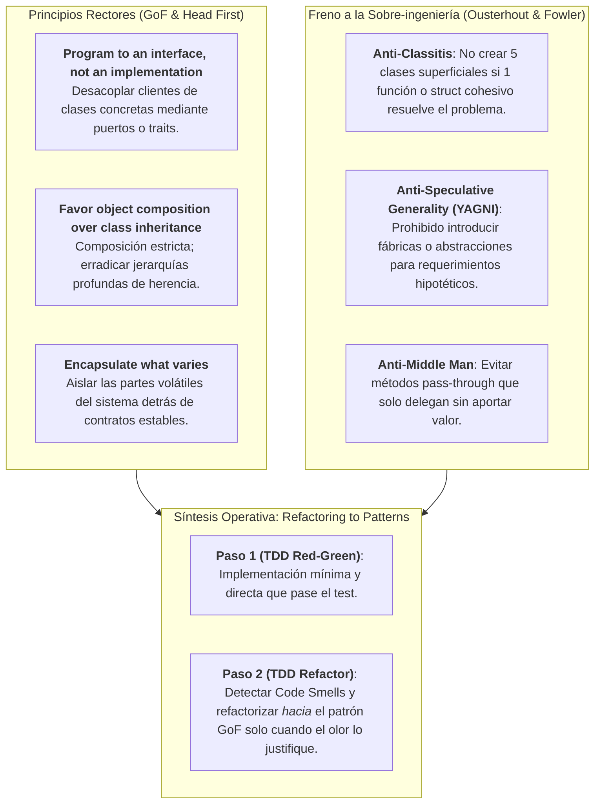

# Patrones GoF y Refactorización (Martin Fowler & Gang of Four)

Este documento establece la normativa técnica de diseño orientado a objetos, patrones de arquitectura y disciplina de refactorización para **Harness Flow**, integrando los marcos clásicos:
* **Gang of Four (GoF)**: *Design Patterns: Elements of Reusable Object-Oriented Software* (Erich Gamma, Richard Helm, Ralph Johnson, John Vlissides).
* **Head First Design Patterns** (Eric Freeman, Elisabeth Robson, Bert Bates, Kathy Sierra).
* **Refactoring: Improving the Design of Existing Code** (Martin Fowler, con Kent Beck).
* **Refactoring to Patterns** (Joshua Kerievsky).
* **A Philosophy of Software Design** (John Ousterhout, Stanford).

Cuándo un patrón entra en cada fase del arnés, sin repetir este catálogo: [`design-patterns-gof.md`](design-patterns-gof.md). Capítulo 1 cerrado. El resto se agrega ahí.

---

## 1. Principios Fundamentales de Diseño y Tensión Dialéctica

El diseño en Harness Flow persigue módulos profundos (*Deep Modules*) con interfaces compactas y un mínimo de indirección. La aplicación de patrones GoF debe ser **estratégica y guiada por necesidad comprobada**, erradicando la proliferación artificial de clases (*classitis*).



---

## 2. La Regla de los Dos Sombreros (*The Two Hats* - Kent Beck & Martin Fowler)

Durante el ciclo de desarrollo en el Implementer (Rol 2), el ingeniero o agente **nunca debe usar dos sombreros simultáneamente**:

```mermaid
stateDiagram-v2
    [*] --> Sombrero1: Test en costura pública
    state "Sombrero 1: Añadir Funcionalidad" as Sombrero1 {
        Red --> Green: Código mínimo y directo
        note right of Green: Cero patrones complejos aquí.<br/>Meta: Que el test pase.
    }
    Sombrero1 --> Sombrero2: Test en verde confirmado
    state "Sombrero 2: Refactorización (10%-20%)" as Sombrero2 {
        AuditarOlores --> AplicarTecnica: Detectar Code Smell
        AplicarTecnica --> ReVerificarVerde: Transformación sin alterar semántica
        note right of ReVerificarVerde: La prueba DEBE seguir en verde<br/>sin modificar el test.
    }
    Sombrero2 --> [*]: AC completado
```

### Reglas de Ejecución:
1. **Bajo el Sombrero 1 (Feature)**:
   * Escribir el test en la costura pública (**Rojo**).
   * Escribir el código más simple, plano y directo posible para que el test compile y pase (**Verde**).
   * **Prohibición**: No crear jerarquías de clases, fábricas abstractas ni estrategias en este paso.
2. **Bajo el Sombrero 2 (Refactorización)**:
   * Con el test en verde, auditar el código contra el catálogo de *Code Smells*.
   * Aplicar técnicas de refactorización de Fowler con transformaciones pequeñas y atómicas.
   * **Invariante**: Los tests existentes **no se modifican**. Si un refactor altera la aserción de un test, no es refactorización; es un cambio de comportamiento.

---

## 3. Catálogo de Code Smells de Martin Fowler y sus Técnicas Correctivas

El Revisor (Rol 3) y el Implementer (Rol 2) deben identificar activamente los 5 grupos de hedores de Fowler:

### 1. Bloaters (Engrosadores de Código)
Código, métodos y clases que han crecido tanto que se vuelven inmanejables:
* **Long Method**: Función $>30$ líneas que realiza múltiples tareas a distintos niveles de abstracción.
  * *Técnica*: `Extract Function / Method`. Dividir conservando el flujo principal en el mismo nivel.
* **Large Class**: Clase o struct con demasiadas responsabilidades o variables de instancia.
  * *Técnica*: `Extract Class / Struct`. Agrupar campos fuertemente cohesionados.
* **Primitive Obsession**: Uso de tipos primitivos (`string`, `int`, `uuid`) para conceptos ricos de negocio (Email, CUIT, IBAN, Dinero, Coordenadas).
  * *Técnica*: `Replace Data Value with Object` $\rightarrow$ Introducir **Value Objects** inmutables con validación en constructor.
* **Long Parameter List**: Métodos con más de 3–4 parámetros.
  * *Técnica*: `Introduce Parameter Object` o `Preserve Whole Object`. Agrupar en un DTO / Command tipado.
* **Data Clumps**: Grupos de datos que siempre viajan juntos (ej. `calle`, `numero`, `ciudad`, `codigo_postal`).
  * *Técnica*: `Extract Class / Value Object`.

### 2. Object-Orientation Abusers (Abusadores de OO)
Uso incorrecto o incompleto del polimorfismo:
* **Switch Statements / Complex Conditionals**: Cadenas `if-else` o `switch` repetidas en múltiples sitios evaluando el mismo tipo o enum.
  * *Técnica*: `Replace Conditional with Polymorphism` o `Replace Type Code with Strategy / State`.
* **Temporary Field**: Atributos de clase que solo tienen valor en ciertas ramas de ejecución.
  * *Técnica*: `Extract Class` o `Introduce Null Object`.
* **Refused Bequest**: Una subclase que hereda métodos o datos del padre pero no los usa o lanza `NotImplementedException`.
  * *Técnica*: `Replace Inheritance with Delegation` (favorecer composición).

### 3. Change Preventers (Frenos al Cambio)
Estructuras donde un cambio simple genera un efecto dominó incontrolable:
* **Divergent Change**: Una misma clase se modifica frecuentemente por razones completamente distintas (violación del SRP).
  * *Técnica*: `Extract Class`. Separar por ejes de cambio.
* **Shotgun Surgery**: Un cambio conceptual requiere hacer decenas de modificaciones minúsculas en archivos dispersos.
  * *Técnica*: `Move Function / Method` y `Move Field`. Reagrupar la lógica dispersa en un único módulo cohesivo.

### 4. Dispensables (Elementos Redundantes y Desperdicio)
Código que no aporta valor y cuya eliminación simplifica el sistema:
* **Speculative Generality (YAGNI)**: Clases abstractas, interfaces con una única implementación o parámetros no utilizados creados "por si acaso en el futuro".
  * *Técnica*: `Collapse Hierarchy`, `Inline Class`, eliminar código muerto.
* **Middle Man / Pass-Through Methods**: Métodos que simplemente reenvían la llamada a otro objeto sin aportar valor, validación ni abstracción.
  * *Técnica*: `Remove Middle Man` o `Inline Method`.
* **Duplicate Code**: Lógica repetida en múltiples ubicaciones con ligera variación.
  * *Técnica*: `Extract Function`, `Form Template Method` o `Pull Up Method`.
* **Comments as Deodorant**: Comentarios que explican *qué* hace un bloque de código confuso en lugar de extraerlo a una función con nombre semántico.
  * *Técnica*: `Extract Function` con nombre auto-descriptivo; reservar comentarios solo para decisiones arquitectónicas (*why*).

### 5. Couplers (Acopladores Excesivos)
* **Feature Envy**: Un método parece más interesado en los datos o métodos de otra clase que en los suyos propios.
  * *Técnica*: `Move Method`. Trasladar el método hacia la clase cuyos datos manipula.
* **Inappropriate Intimacy**: Clases que acceden directamente a detalles privados o internos de otras.
  * *Técnica*: `Hide Delegate` o `Encapsulate Field`.
* **Message Chains**: Cadenas de navegación excesivas (`a.getB().getC().getD().doSomething()`).
  * *Técnica*: `Hide Delegate` respetando la Ley de Deméter (Principio de Mínimo Conocimiento).

---

## 4. Matriz de Patrones GoF en Arquitectura Hexagonal

En Harness Flow, los patrones GoF se ubican en capas precisas de la arquitectura:

| Patrón GoF | Capa Hexagonal | Propósito Principal en el Arnés | Anti-patrón a Evitar |
| :--- | :--- | :--- | :--- |
| **Adapter** | Infraestructura | Implementa puertos del Dominio (Driven: DB, Kafka; Driving: HTTP, CLI). Permite inyectar fakes en tests. | Acoplar el Dominio a tipos de bibliotecas de terceros. |
| **Strategy** | Dominio / Aplicación | Encapsula algoritmos intercambiables (cálculo de impuestos, descuentos, enrutamiento). | Crear una estrategia para un único algoritmo invariable (YAGNI). |
| **State** | Dominio | Modela máquinas de estado finitas en entidades de ciclo de vida complejo (órdenes: borrador, pagada, enviada). | Flags booleanos múltiples (`is_draft`, `is_paid`, etc.) en la entidad. |
| **Decorator / Proxy** | Infraestructura / Cross-Cutting | Inyecta Transactional Outbox, OCC, telemetría OpenTelemetry, caching y reintentos sin ensuciar la entidad. | Introducir lógica de negocio dentro del Decorator. |
| **Composite** | Dominio | Evalúa reglas de negocio compuestas (filtros booleanos AND/OR, árboles de especificación). | Jerarquías rígidas y complejas sin necesidad de anidamiento. |
| **Facade** | Aplicación | Expone una interfaz simplificada (*Deep Module*) sobre un subsistema complejo o librería externa. | Crear una Facade microscópica que no oculte complejidad real. |
| **Factory / Builder** | Composition Root (`main`) | Centraliza la instanciación y ensamblado del grafo de dependencias en el arranque de la app. | Esparcir Factories en el Dominio o usar Reflection indiscriminada. |

---

## 5. Implementación Canónica por Stack Tecnológico

### 1. Adapter en Go (`golang-hexagonal`)
```go
// Dominio: Puerto secundario (driven port)
type OrderRepository interface {
    Save(ctx context.Context, order *domain.Order) error
}

// Infraestructura: Adaptador SQL
type PostgresOrderAdapter struct {
    db *sql.DB
}

func (a *PostgresOrderAdapter) Save(ctx context.Context, order *domain.Order) error {
    // SQL parametrizado
    return nil
}
```

### 2. Strategy en C# .NET (`dotnet-hexagonal`)
```csharp
// Dominio: Puerto de estrategia
public interface ITaxStrategy
{
    TaxResult CalculateTax(Money subtotal, CustomerLocation location);
}

// Implementación de regla concreta
public sealed class DomesticTaxStrategy : ITaxStrategy
{
    public TaxResult CalculateTax(Money subtotal, CustomerLocation location) =>
        new TaxResult(subtotal * 0.19m);
}
```

### 3. State & Traits en Rust (`rust-hexagonal`)
```rust
// Dominio: Tipado de estados a nivel de compilador (Typestate Pattern)
pub struct Draft;
pub struct Published;

pub struct Article<State> {
    id: ArticleId,
    content: String,
    state: std::marker::PhantomData<State>,
}

impl Article<Draft> {
    pub fn publish(self) -> Article<Published> {
        Article {
            id: self.id,
            content: self.content,
            state: std::marker::PhantomData,
        }
    }
}
```

### 4. Decorator en TypeScript / NestJS (`nestjs-hexagonal`)
```typescript
// Aplicación: Decorator para métricas y Outbox sobre un CommandHandler
export class LoggingOrderServiceDecorator implements CreateOrderUseCase {
    constructor(
        private readonly inner: CreateOrderUseCase,
        private readonly logger: Logger
    ) {}

    async execute(cmd: CreateOrderCommand): Promise<void> {
        this.logger.info(`Iniciando orden ${cmd.orderId}`);
        await this.inner.execute(cmd);
        this.logger.info(`Orden ${cmd.orderId} creada con éxito`);
    }
}
```

### 5. Value Objects / Primitive Obsession en Python (`python-dataproduct`)
```python
from dataclasses import dataclass
import re

@dataclass(frozen=True)
class Email:
    value: str

    def __post_init__(self):
        if not re.match(r"^[^@]+@[^@]+\.[^@]+$", self.value):
            raise ValueError(f"Email inválido: {self.value}")
```

---

## 6. Checklist de Auditoría para el Revisor (Rol 3)

Antes de aprobar un cambio, el revisor debe contrastar el diff contra este checklist:

1. **¿Hay olores Bloater?**:
   * ¿Existen funciones con $>30$ líneas de control de flujo denso? $\rightarrow$ Exigir `Extract Function`.
   * ¿Se usan strings primitivos para representar identidades de dominio? $\rightarrow$ Exigir `Value Object`.
2. **¿Hay olores Coupler o Middle Man?**:
   * ¿Hay métodos que solo delegan a otra clase sin validación ni transformación? $\rightarrow$ Exigir `Remove Middle Man`.
3. **¿Hay Speculative Generality?**:
   * ¿Hay interfaces con un único implementador sin propósito de testing? $\rightarrow$ Recomendar `Collapse Hierarchy`.
4. **¿Se respetó la Regla de los Dos Sombreros?**:
   * ¿Los tests unitarios de la costura pública permanecen intactos mientras el código interno se refinó? $\rightarrow$ Cumple refactorización pura.
