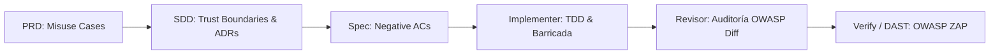

# Seguridad de Aplicaciones Web: OWASP Top 10, OWASP CLASP y OWASP ZAP en Harness Flow

Este documento establece la normativa técnica y operativa para garantizar la seguridad del software en Harness Flow a lo largo de todo el ciclo de vida (SDLC), integrando:
1. **OWASP Top 10 (2021)** como catálogo taxonómico de riesgos críticos y vectores de ataque.
2. **OWASP CLASP** (*Comprehensive, Lightweight Application Security Process*) como metodología *Shift-Left* basada en roles, actividades preventivas y casos de abuso (*misuse cases*).
3. **OWASP ZAP** (*Zed Attack Proxy*) como herramienta de verificación dinámica (DAST) automatizada para APIs y aplicaciones web.

---

## 1. Filosofía de Seguridad y el Modelo CLASP en Harness Flow

En la ingeniería de software pragmática, **la seguridad no es un parche que se agrega al final** de la construcción mediante un pentest tardío. El principio rector de CLASP es *Shift-Left*: desplazar las consideraciones defensivas a las fases tempranas donde corregir un defecto cuesta órdenes de magnitud menos (McConnell, Cap. 3).

CLASP articula 5 perspectivas operativas que se integran en los roles existentes del arnés:

| Perspectiva CLASP | Qué significa | Cómo se aplica en Harness Flow |
| :--- | :--- | :--- |
| **1. Conceptos** | Principios universales de seguridad. | Mínimo privilegio, defensa en profundidad, barricada defensiva (McConnell Cap. 8) y diseño seguro (Ousterhout). |
| **2. Roles** | Asignación de responsabilidades de seguridad según el sombrero. | **Rol Producto** (Casos de abuso en PRD), **Arquitecto** (Límites de confianza en SDD), **Implementer** (TDD defensivo), **Revisor** (Auditoría OWASP en diff). |
| **3. Actividades** | Prácticas concretas de ingeniería por fase. | Modelado de amenazas, *Negative Acceptance Criteria*, prepared statements, escaneo SAST de dependencias y DAST con ZAP. |
| **4. Integración de Procesos** | Seguridad sin fricción en metodologías iterativas. | La seguridad se valida dentro de los ciclos de feature `F-n`, sin congelar el flujo ni crear comités burocráticos. |
| **5. Gestión de Vulnerabilidades** | Registro histórico y aprendizaje. | Toda vulnerabilidad o hallazgo bloqueante se institucionaliza mediante [`scripts/leccion.py`](../scripts/leccion.py). |

---

## 2. OWASP Top 10: Matriz de Amenazas y Contramedidas por Capa

```
+-------------------------------------------------------------------------+
|                        ZONA PÚBLICA (Internet / Clientes)               |
+-------------------------------------------------------------------------+
                                    |
            [BARRICADA DE ENTRADA: Validadores / Sanitizadores]
                                    |
                                    v
+-------------------------------------------------------------------------+
| PUERTOS & ADAPTADORES (BFF / Controllers / Consumidores)                |
| - A01: Autenticación & Autorización (RBAC / Tenant Crossing)           |
| - A05: Headers de Seguridad (CSP, HSTS) & Cookies seguras               |
| - A10: Anti-SSRF en Clientes HTTP Salientes (Whitelists)                |
+-------------------------------------------------------------------------+
                                    | (Datos limpios y tipados)
                                    v
+-------------------------------------------------------------------------+
| DOMINIO & CASOS DE USO (Hexagonal Core)                                 |
| - A04: Lógica de Negocio Inmune por Diseño                              |
| - A03: Value Objects inmutables autovalidados (Anti-Inyección)          |
| - A02: Cifrado en Reposo / Zero Hardcoded Secrets                       |
+-------------------------------------------------------------------------+
                                    | (Prepared Statements)
                                    v
+-------------------------------------------------------------------------+
| PERSISTENCIA & SERVICIOS EXTERNOS (Bases de Datos / Brokers)           |
| - A03: Consultas SQL/NoSQL parametrizadas al 100%                       |
| - A06: Auditoría de Dependencias y CVEs (stack.py auditar)              |
| - A09: Logs de Auditoría Estructurados (sin secretos ni PII)            |
+-------------------------------------------------------------------------+
```

### A01:2021 — Broken Access Control (Control de Acceso Deficiente)
* **El Riesgo:** Usuarios que acceden a datos o funciones no autorizadas: *IDOR (Insecure Direct Object References)*, cruce de organizaciones/tenants (*Tenant Crossing*), o escalamiento horizontal/vertical de privilegios.
* **En el SDD:** Todo endpoint debe especificar explícitamente el requisito de autenticación y el rol/permiso mínimo (RBAC/ABAC).
* **En el Código:** Las consultas a bases de datos **siempre** deben incluir el filtro del tenant o usuario propietario autenticado (`WHERE tenant_id = :current_tenant AND id = :resource_id`), nunca consultar solo por `id` numérico expuesto en la URL.
* **En los Specs:** Toda feature que exponga datos debe incluir un *Negative AC* que pruebe el acceso con un token no autorizado y verifique un código `403 Forbidden` o `404 Not Found`.

### A02:2021 — Cryptographic Failures (Fallas Criptográficas)
* **El Riesgo:** Transmisión o almacenamiento de datos confidenciales (passwords, tarjetas, PII) en texto plano o con algoritmos obsoletos (MD5, SHA1, DES).
* **En el Código:**
  * Uso mandatorio de algoritmos modernos: **Argon2id** o **Bcrypt** para credenciales de acceso; **AES-256-GCM** o **ChaCha20-Poly1305** para cifrado en reposo.
  * **Zero Hardcoded Secrets:** Prohibición absoluta de cadenas de conexión, API keys o certificados en código fuente o archivos commiteados. Las credenciales se inyectan en tiempo de ejecución vía variables de entorno (`.env` protegido y en `.gitignore`).

### A03:2021 — Injection (Inyecciones: SQL, NoSQL, OS, XSS)
* **El Riesgo:** Interpretar datos no confiables como comandos o sentencias ejecutables en bases de datos, sistemas operativos o navegadores.
* **En el Código:**
  * **SQL/NoSQL:** Uso obligatorio de **Prepared Statements** o bindings de parámetros del ORM/driver. Prohibida toda concatenación de cadenas (`"SELECT * FROM users WHERE name = '" + name + "'"`).
  * **Comandos del Sistema Operativo:** Prohibido el uso de `shell=True` o ejecución de comandos pasando strings de usuario. Usar listas de argumentos tipadas (`subprocess.run(["ls", clean_dir])`).
  * **XSS en Frontends:** Uso de los motores de plantillas con escape automático (Angular, React/Next.js). Prohibido el uso de `bypassSecurityTrustHtml`, `dangerouslySetInnerHTML` o manipulación cruda del DOM con `innerHTML`.

### A04:2021 — Insecure Design (Diseño Inseguro)
* **El Riesgo:** Vulnerabilidades inherentes a la falta de análisis de amenazas antes de programar (no es un error de sintaxis, sino una falla conceptual).
* **En el SDD:**
  * Definir límites de tasa (*Rate Limiting*) en endpoints de autenticación y operaciones costosas.
  * Barricada defensiva en puertos: validación de esquemas y tipos antes de interactuar con el dominio.
  * Filosofía de fallos declarada: **Corrección estricta** para módulos que mueven dinero o identidad.

### A05:2021 — Security Misconfiguration (Configuración Insegura)
* **El Riesgo:** Funcionalidades innecesarias habilitadas, cuentas/passwords por defecto, cabeceras HTTP de seguridad ausentes o mensajes de error que exponen stack traces.
* **En el Stack:**
  * Configurar cabeceras de seguridad mandatorias: `Content-Security-Policy` (CSP), `Strict-Transport-Security` (HSTS), `X-Content-Type-Options: nosniff`, `X-Frame-Options: DENY`.
  * Cookies de sesión obligatorias con flags: `Secure`, `HttpOnly`, `SameSite=Lax` o `SameSite=Strict`.
  * Manejador centralizado de errores: los errores externos devuelven `ProblemDetails` estandarizados sin revelar rutas de disco ni tecnologías internas.

### A06:2021 — Vulnerable and Outdated Components (Componentes Vulnerables)
* **El Riesgo:** Uso de bibliotecas o dependencias externas con vulnerabilidades conocidas y catalogadas (CVEs).
* **En el Arnés:**
  * Ejecución continua de auditoría de seguridad mediante `stack.py auditar` (`npm audit`, `cargo audit`, `govulncheck`, `dotnet list package --vulnerable`).
  * Consulta de APIs vigentes en Context7 y bloqueo inmediato en el revisor aislado ante paquetes con vulnerabilidades críticas o altas.

### A07:2021 — Identification and Authentication Failures (Fallas de Identificación)
* **El Riesgo:** Suplantación de identidad, ataques de diccionario, session fixation o tokens sin revocación.
* **En el Código:**
  * Bloqueo progresivo ante reintentos fallidos de login.
  * Tokens JWT validados rigurosamente: verificar algoritmo (`alg != "none"`), firma con clave pública/secreto seguro, emisor (`iss`), audiencia (`aud`) y expiración (`exp` $\le 15$ min con refresh tokens rotativos).
  * Destrucción explícita de sesiones en el servidor al ejecutar logout.

### A08:2021 — Software and Data Integrity Failures (Fallas de Integridad)
* **El Riesgo:** Consumo de datos serializados no confiables (deserialización insegura de Java, Python `pickle`, etc.) o artefactos de despliegue no firmados.
* **En el Código:**
  * Prohibido el uso de `pickle.loads` o deserializadores binarios crudos sobre datos que provengan de la red o del usuario. Usar formatos estructurados deterministas: JSON Schema o Protocol Buffers.

### A09:2021 — Security Logging and Monitoring Failures (Fallas de Registro)
* **El Riesgo:** Ataques que pasan desapercibidos por falta de trazas de auditoría o eventos de seguridad no registrados.
* **En el Código:**
  * Registrar con nivel `WARN` o `ERROR`: fallos de autenticación, accesos denegados (403), validaciones de esquema fallidas y cambios de permisos.
  * **Regla de Privacidad en Logs:** PROHIBIDO registrar passwords, tokens de autenticación completos, números de tarjeta o datos personales identificables (PII).

### A10:2021 — Server-Side Request Forgery / SSRF (Falsificación de Peticiones del Servidor)
* **El Riesgo:** El servidor web realiza peticiones HTTP salientes hacia URLs provistas por el usuario sin validar el destino, accediendo a microservicios internos, bases de datos o metadatos cloud (`http://169.254.169.254`).
* **En el Código:**
  * Whitelist estricta de dominios/protocolos permitidos en clientes HTTP salientes.
  * Resolución DNS previa bloqueando rangos privados y locales: `127.0.0.0/8`, `10.0.0.0/8`, `172.16.0.0/12`, `192.168.0.0/16`, `169.254.169.254` y `::1`.

---

## 3. Guía de Ejecución de OWASP CLASP por Fase



### 3.1. Fase PRD (Rol Producto)
1. **Casos de Abuso (*Misuse Cases*):** Además del flujo feliz, el PRD debe responder:
   * *¿Cómo podría un usuario malicioso o no autorizado intentar abusar de esta feature?*
   * *Ejemplo:* En una feature de "Descarga de Facturas", el caso de abuso es: *"Un usuario autenticado cambia el ID de factura en la URL para descargar la factura de otra empresa"*.
2. **Delimitación de Datos y No-Objetivos:**
   * Declarar en `## Objetivos y no-objetivos` qué datos sensibles se tocan y qué queda fuera de alcance para evitar expansiones peligrosas.

### 3.2. Fase SDD (Rol Arquitectura)
1. **Fronteras de Confianza (*Trust Boundaries*):** En el diagrama Mermaid de `## Componentes`, marcar visualmente los límites entre redes públicas, gateways/BFFs y servicios core.
2. **Barricada en Puertos (McConnell):** Los adaptadores de entrada validan y sanitizan antes de tocar el dominio.
3. **Decisiones de Seguridad ($D-n$):** Formalizar las elecciones criptográficas, de autenticación y anti-SSRF como ADRs con su alternativa descartada.

### 3.3. Fase de Planificación y Specs (`F-n`)
1. **Negative Acceptance Criteria (ACs Negativos):**
   * Toda feature con lógica de acceso debe incluir al menos un AC negativo comprobable, marcado `[negativo]` en su línea (`- AC-2 [costura: endpoint] [negativo]: ...`). `gate.py approve-spec` y `check-spec` avisan si un spec expone un endpoint y no tiene ninguno; el brief pide escribir su test de rechazo antes que el camino feliz.
   * *Ejemplo:* `AC-2: Petición sin header Authorization o con token vencido retorna 401 Unauthorized`.
   * *Ejemplo:* `AC-3: Inyección de payload SQL (' OR 1=1 --) en campo de búsqueda retorna 422 Unprocessable Entity o lista vacía, sin errores de base de datos`.

### 3.4. Fase Implementer (TDD Defensivo)
1. **Escribir el Test Negativo Primero:** En el ciclo Red-Green, se prueba el rechazo de la entrada maliciosa antes de implementar la funcionalidad.
2. **Construcción Inmune:**
   * Usar prepared statements de forma invariable.
   * Modelar conceptos clave con Value Objects inmutables que encapsulan la validación (evitando *Primitive Obsession*).
   * Mantener secrets fuera del código y variables de entorno aisladas.

### 3.5. Fase Revisor Aislado (`agents/revisor.md`)
El revisor evalúa el diff bajo la siguiente tabla de severidad estricta:

| Severidad | Vector OWASP | Acción en el Acta de Revisión |
| :--- | :--- | :--- |
| **Bloqueante** | **A01** (Tenant crossing o bypass de auth sin control) | Veredicto `changes_requested` o `blocked`. |
| **Bloqueante** | **A02** (Secretos o API keys hardcodeadas en código/tests) | Veredicto `blocked`. Requerir rotación y limpieza en git. |
| **Bloqueante** | **A03** (Concatenación de strings en SQL, shell o HTML) | Veredicto `changes_requested`. |
| **Bloqueante** | **A06** (Dependencia introducida con CVE Alta o Crítica) | Veredicto `changes_requested`. |
| **Mayor** | **A10** (Petición HTTP saliente a URL externa no whitelistada) | Veredicto `changes_requested`. |
| **Mayor** | **A09** (`catch` vacíos que silencian fallos de seguridad) | Veredicto `changes_requested`. |
| **Mayor** | Falta de test negativo para endpoint protegido | Veredicto `changes_requested`. |
| **Menor** | **A05** (Headers de seguridad omitidos en respuestas web) | Observación menor en el acta (no bloquea el cierre). |

---

## 4. OWASP ZAP: Verificación Dinámica de Seguridad (DAST)

OWASP ZAP se integra en Harness Flow para auditar dinámicamente servicios y APIs en tiempo de ejecución.

### 4.1. Modos de Ejecución en el Arnés

#### A. Escaneo Dinámico de APIs con OpenAPI (`zap-api-scan`)
Ideal para microservicios backend y APIs REST/gRPC que exponen un contrato OpenAPI (`openapi.json` o `swagger.json`):
```bash
# Ejecución mediante contenedor Docker oficial de ZAP:
docker run --rm -v $(pwd):/zap/wrk/:rw -t zaproxy/zap-stable zap-api-scan.py \
  -t /zap/wrk/openapi.json \
  -f openapi \
  -J /zap/wrk/zap-report.json \
  -w /zap/wrk/zap-report.md \
  -c /zap/wrk/zap-rules.conf \
  -I
```

#### B. Escaneo Pasivo y de Línea Base (`zap-baseline`)
Inspecciona un servicio levantado en local o staging (ej. `http://localhost:8080`) sin lanzar ataques destructivos:
```bash
docker run --rm -t zaproxy/zap-stable zap-baseline.py \
  -t http://localhost:8080 \
  -J zap-baseline-report.json \
  -I
```

### 4.2. Integración en `stack.py auditar --dast`

El comando de auditoría del arnés incorpora soporte para invocar escaneos DAST:
```bash
# Audita dependencias (SAST) y lanza escaneo ZAP (DAST) si hay un contrato OpenAPI o target activo:
$PY "$H/stack.py" auditar --dast [--openapi ruta/a/openapi.json] [--target-url http://localhost:8080]
```

* **Comportamiento:**
  1. Si `docker` está disponible, ejecuta el escáner ligero de ZAP contra la URL o especificación OpenAPI.
  2. Parsea las alertas generadas (`High`, `Medium`, `Low`, `Informational`).
  3. Si se detectan alertas de nivel **High** (ej. SQLi confirmada o bypass de acceso), el reporte marca **FAIL**.
  4. Si Docker no está instalado en el host, emite un aviso con el comando listo para ejecución y no bloquea el flujo si la verificación estática está en orden.

---

## 5. Matriz de Auditoría y Resumen Operativo

| Fase del Arnés | Práctica OWASP / CLASP | Artefacto Generado / Verificado |
| :--- | :--- | :--- |
| **Rol 0: PRD** | Casos de Abuso (*Misuse Cases*) y No-Objetivos de seguridad. | `docs/prd/PRD-master.md` |
| **Rol 0: SDD** | Límites de Confianza, Barricadas y ADRs $D-n$ (Cifrado, Anti-SSRF). | `docs/sdd.md` |
| **Spec (`F-n`)** | Criterios de Aceptación Negativos (*Negative ACs*). | `feature_list.json` / Spec de feature |
| **Patrones GoF** | Proxy de Auth, Value Objects autovalidados, Adapter HTTP seguro. | `references/design-patterns-gof.md` |
| **Implementer** | Test-first negativo, Prepared Statements y Zero Hardcoded Secrets. | Código fuente y tests de costura |
| **Revisor Aislado** | Auditoría estricta contra OWASP Top 10 en diffs: norma `[seguridad]` del briefing (`revision.py --briefing`), igual en todos los hosts. | `docs/review-<id>.md` |
| **Implementer y Revisor**| Escáner de dependencias (`stack.py auditar`, exit 1 = hallazgos, exit 2 = sin medir) cuando el diff toca dependencias; DAST (`stack.py auditar --dast`, OWASP ZAP) a pedido. Ningún gate los corre solo. | Salida de `auditar` y reportes ZAP |
| **Cierre / Post-Mortem**| Registro de incidentes y lecciones aprendidas institucionales. | `references/lecciones-del-arnes.md` |
